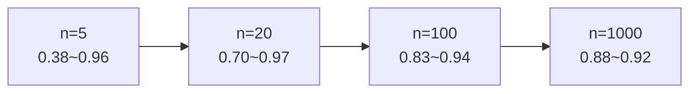
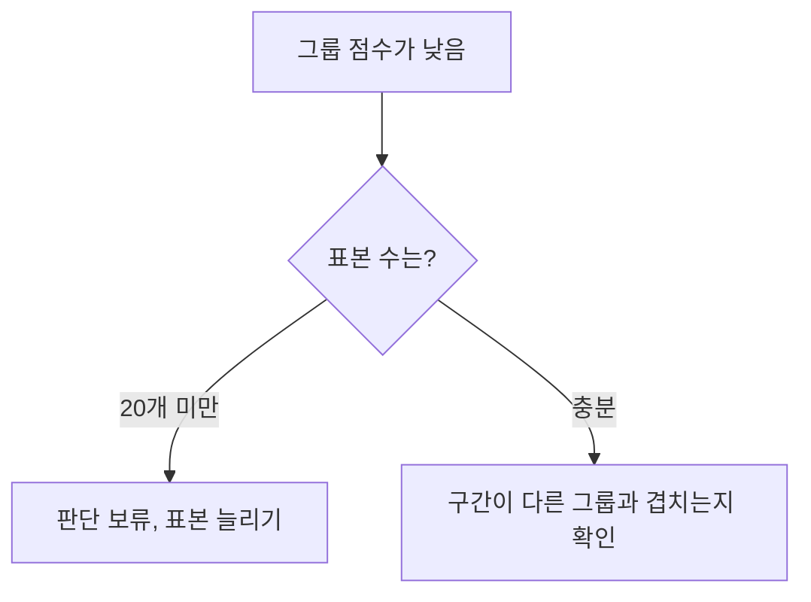

# 작은 그룹의 점수 노이즈

> 표본이 적은 그룹의 정확도는 우연만으로도 크게 흔들린다. 그룹별 점수가 낮다고 바로 "그 그룹에 약하다"고 결론 내리지 말고 표본 수와 신뢰구간을 함께 본다.

## 쉽게 말하면
농구 선수가 자유투 5개 중 2개를 넣었다고 "성공률 40%의 약한 선수"라고 하면 성급하다. 5번이면 운이 크게 작용한다. 500번을 던져 200개를 넣었어야 40%라는 말에 무게가 실린다. 그룹 점수도 표본 수가 적으면 같은 문제가 생긴다.

## 자세히
- **직접 계산한 수치(실제 정확도 0.9인 그룹을 표본 크기별로 5,000번 시뮬레이션하고 Wilson 95% 구간을 계산)**:

| 그룹 표본 수 | 관측 정확도 0.9일 때 Wilson 95% 구간 | 점수의 표준편차 | 우연히 0.8 이하가 나올 확률 |
| --- | --- | --- | --- |
| 5 | 0.38~0.96 | 0.134 | 0.406 |
| 20 | 0.70~0.97 | 0.067 | 0.131 |
| 100 | 0.83~0.94 | 0.030 | 0.001 |
| 1,000 | 0.88~0.92 | 0.009 | 0.000 |

  실제로는 똑같이 정확도 0.9인 그룹이라도, 표본이 5개면 10번 중 4번은 0.8 이하로 보인다. 표본이 100개 이상이면 거의 안 생긴다.
- **구간 선택(위키피디아 이항 비율 구간 문서, 열람)**: 단순 정규 근사(Wald) 구간은 표본이 작거나 비율이 0·1에 가까우면 부정확하며 구간이 [0,1]을 벗어나거나 폭이 0이 될 수 있다. Wilson 구간은 비대칭이어서 그런 문제가 없고 작은 표본에서 잘 맞는다.
- **보고 방법(해석)**: 그룹별 표에 표본 수(n)와 Wilson 구간을 붙인다. 구간이 겹치면 그룹 간 차이를 주장하지 않는다. 표본이 20개 미만이면 "판단 보류"로 표시한다. 가능하면 비슷한 그룹을 합치거나 교차검증 예측을 풀링해 표본을 늘린다([그룹 크기 불균형](#group-size-imbalance)).
- **다중 비교**: 그룹이 많으면 그중 하나는 우연히 아주 낮게 나온다. 최저 그룹을 뽑을 때는 이 선택 효과를 감안한다([최악 그룹 성능](#worst-group-performance)).

## 그림으로 보기

## 예시
- 지역별 분류 정확도에서 표본이 8건인 지역이 0.5로 나오면 "개선 필요"가 아니라 "표본 부족"으로 표시한다.
- 코드: `statsmodels.stats.proportion.proportion_confint(k, n, method="wilson")`. 교육 활용: 같은 정확도 0.9를 n만 바꿔 시뮬레이션해 분포를 그려 본다.

## 헷갈리는 것과 비교
| 개념 | 차이 |
| --- | --- |
| 작은 그룹 노이즈 | 표본이 적어 우연 변동 큼 |
| 실제 약점 | 표본이 충분한데도 낮음 |
| [최악 그룹 성능](#worst-group-performance) | 가장 낮은 그룹 보고 |
| [부트스트랩](#bootstrap-resampling) | 구간을 재표집으로 만드는 방법 |

## 더 읽을거리
- [Wikipedia: Binomial proportion confidence interval](https://en.wikipedia.org/wiki/Binomial_proportion_confidence_interval) — Wald 구간의 문제와 Wilson 구간
