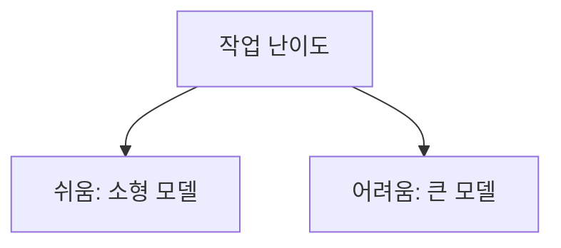

# 소형 언어모델

> **파라미터 수가 작아도(수십억 이하) 특정 작업에는 충분한 성능을 내는** 언어모델. 폰이나 노트북, 저비용 서버에서 돌릴 수 있다.

## 쉽게 말하면
모든 일을 하는 종합병원 대신, 자주 필요한 진료만 빠르게 보는 동네 의원이다. 어려운 수술은 못 해도 일상 업무에는 충분하고 싸고 가깝다.

## 자세히
- 대표 사례: Phi-3 보고서(arXiv 2404.14219, 초록 읽음). **phi-3-mini 38억 파라미터**, **3.3조 토큰** 학습, MMLU **69%**, MT-bench **8.38**로 Mixtral 8x7B·GPT-3.5와 견줄 만하다고 저자들이 주장하며 "폰에 배포할 수 있을 만큼 작다". 기반 데이터는 필터링한 웹 데이터와 합성 데이터([합성 데이터](#synthetic-data)).
- 같은 계열: phi-3-small(7B)·medium(14B)은 4.8조 토큰으로 MMLU 약 75%·78%, MT-bench 8.7·8.9. phi-3.5 시리즈는 다국어·멀티모달·긴 문맥을 추가했고, **phi-3.5-MoE는 16×3.8B 전문가에 활성 파라미터 6.6B**, phi-3.5-Vision은 4.2B.
- 설계 원칙: 데이터 품질에 투자해 크기를 줄인다는 접근(초록의 "phi-2 데이터셋의 확대판"에서 읽을 수 있는 방향).
- 한계: 위 수치는 모델 발표 시점의 저자 보고이며 벤치마크가 일반 업무 성능을 대변하지 않는다. 지식량·긴 추론은 큰 모델에 못 미칠 수 있다(일반 논평).
- 활용: 로컬 실행([VRAM 예산](#vram-budgeting) 계산으로 가능 여부 확인), 지연·비용 민감 작업, 라우팅의 쉬운 쪽([로컬+API 혼합](#hybrid-local-api)).

## 그림으로 보기

## 예시
- 사내 문서 분류·요약을 노트북에서 소형 모델로 처리하고 어려운 질문만 API로.
- 교육: 소형·대형 모델에 같은 업무 질문 10개를 보내 품질·속도 비교.

## 헷갈리는 것과 비교
| 개념 | 차이 |
|---|---|
| 소형 언어모델 | 작지만 특정 용도에 충분 |
| 대형 모델 | 범용·고성능·고비용 |
| 양자화 | 같은 모델을 작게 압축 |

## 더 읽을거리
- [Phi-3 Technical Report](https://arxiv.org/abs/2404.14219) — 폰에 올리는 3.8B(초록 읽음).
