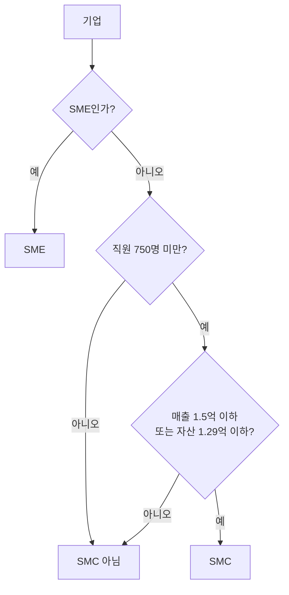
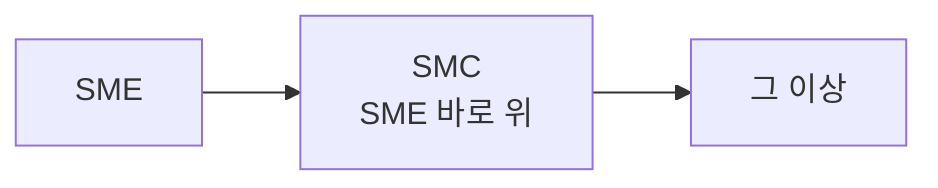

# 소형 중견기업(small mid-cap, SMC)

> EU가 중소기업(SME)의 바로 위에 새로 만든 중간 규모 범주. SME 정의를 벗어났지만 직원 750명 미만이고 매출 또는 자산이 일정 한도 이하인 기업으로, 일부 규제 부담 경감의 대상이 된다.

## 쉽게 말하면
키 150cm 이하 어린이 요금 제도가 있는데, 막 그 기준을 넘긴 청소년도 일부 할인을 받게 하려고 "청소년 요금"을 새로 만든 것과 비슷하다. SME를 막 벗어난 성장 기업이 갑자기 대기업과 같은 부담을 지지 않게 하려는 취지다.

## 자세히
출처는 집행위 권고(EU) 2025/1099(EUR-Lex, 열람)다. 법률 자문이 아니다.
- **기준(부속서 2항)**: SME(권고 2003/361/EC 기준)가 아니어야 하고, 직원 750명 미만이며, 연 매출 1억 5,000만 유로 이하 또는 자산 총액 1억 2,900만 유로 이하여야 한다. 전문(11)에 따르면 두 재무 한도를 모두 넘을 때만 제외된다.
- **기업 유형**: 자율·파트너(상위 기업이 25% 이상 보유)·연결 기업 구분은 SME 정의의 틀을 이어받고(25% 기준은 2003/361/EC에서 승계), 공공기관이 자본·의결권 25% 이상을 통제하면 SMC가 될 수 없다. 25% 이상 보유해도 자율 기업으로 남는 예외에는 공공 투자법인·벤처캐피털·사모펀드·기관투자자, 같은 기업 총 투자 500만 유로 미만의 비즈니스 엔젤, 대학·비영리 연구센터, 예산 1,000만 유로 미만·주민 5,000명 미만의 지방자치단체가 있다. SME 정의(엔젤 125만 유로 미만)와 엔젤 한도가 다르다.
- **계산 규칙**: 직원은 연간 근무 단위로 계산하고 견습생·직업훈련 학생·출산·육아휴직 기간은 제외한다. 최신 승인 회계기간을 쓰고 매출에는 부가세 등 간접세를 제외하며, 한도를 넘거나 내려와도 두 회계연도 연속일 때만 지위가 바뀐다. 신설 기업은 성실한 추정치를 쓸 수 있다. 파트너 기업은 비례, 연결 기업은 전액 합산.
- **SME 정의와의 관계**: 두 정의는 겹치지 않아야 한다(전문 9, 9항). 상한은 최대치라 회원국·EIB·EIF는 더 낮은 한도를 쓰거나 직원 수만 쓸 수 있다.
- **AI Act와의 연결**: 앞의 [SME 과태료 낮은 쪽 규칙](#sme-fine-rule)에서 AI Act 99조 6a항이 SMC에 제한적으로 낮은 쪽 상한을 준다고 적었다. 개정 법안의 확정 문구와 시행 시점은 이번에 공식 문서로 확인하지 못했다. 검색 요약에는 의회·이사회가 더 높은 한도(예: 1,000명·2억 유로 등)를 요구했다는 보도가 있었으나 열어 보지 못했고 최종 수치는 불확실하다.
- 이 범주가 다른 법(AI Act 외)에 어떻게 인용되는지는 각 입법을 확인해야 한다.

## 그림으로 보기

## 예시
- 직원 600명, 매출 1억 유로 회사(독립 기업): SME 아님, 750명 미만, 매출 한도 이내 → SMC 요건 충족 가능(가상 예).
- 교육 실습: 직원 수·매출·자산이 주어진 회사 3곳을 SME, SMC, 그 외로 분류.

## 헷갈리는 것과 비교
| 개념 | 차이 |
|---|---|
| SME | 직원 250명 미만 등 |
| SMC | SME 위, 직원 750명 미만 등 |
| 대기업 | 둘 다 아님 |
| [SME 정의](#sme-definition) | 아래 범주의 기준과 관계 유형 |

## 더 읽을거리
- [Commission Recommendation (EU) 2025/1099](https://eur-lex.europa.eu/legal-content/EN/TXT/?uri=CELEX:32025H1099) — SMC 정의(열람)
- [EU Commission: SME definition](https://single-market-economy.ec.europa.eu/smes/sme-definition_en) — SME 기준
