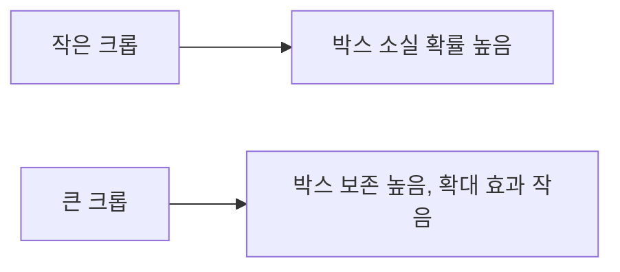
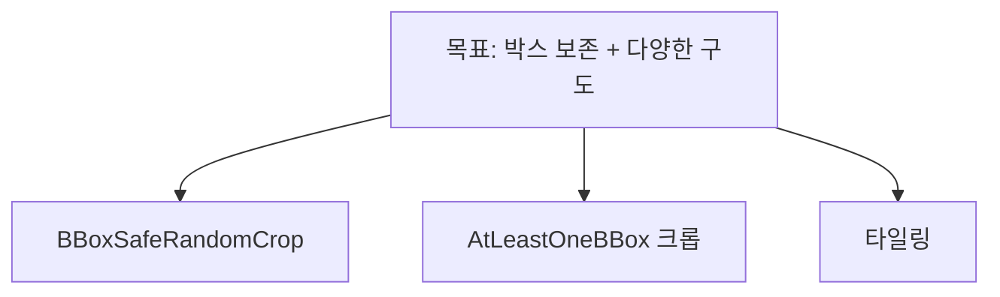

# 작은 물체와 크롭 트레이드오프

> 이미지를 무작위로 자르면 **크롭이 작을수록 박스가 잘리거나 사라질 확률이 커진다.** 박스를 지키는 크롭(BBoxSafeCrop 계열)은 이를 막지만, 지키려 할수록 크롭이 커져 확대 효과(작은 물체를 크게 보이게 하는 이득)가 줄어든다.

## 쉽게 말하면
큰 지도에서 작은 가게를 찾아 작은 창으로 오려 내면 가게가 창 밖에 있을 확률이 높다. 창을 크게 하면 가게는 거의 포함되지만 확대 효과는 사라진다. 그 사이에서 균형을 잡는 문제다.

## 자세히
- 직접 실험(Albumentations 2.0.8, 1024×1024 이미지, 정사각 박스 하나를 무작위 위치에 두고 `RandomCrop(c, c)`를 400번 시행, 박스가 하나라도 남는 비율 / 원래 크기 그대로 남는 비율):
  | 박스 한 변 | 크롭 224 | 크롭 512 | 크롭 800 |
  |---|---|---|---|
  | 32 | 0.06 / 0.03 | 0.26 / 0.22 | 0.69 / 0.59 |
  | 128 | 0.12 / 0.01 | 0.43 / 0.17 | 0.90 / 0.55 |
  | 300 | 0.31 / 0.00 | 0.78 / 0.09 | 1.00 / 0.47 |
- 읽는 법: 크롭 224에서 32px 박스는 **94%가 사라진다**. 박스가 클수록 "남기는" 확률은 오르지만 "온전히" 남는 확률은 오히려 낮다(300px 박스는 224 크롭에 아예 못 들어가므로 온전 유지 0.00). 즉 큰 물체는 잘리고 작은 물체는 사라지는, 서로 다른 문제다.
- 해결 방향(제안): ① [BBoxSafeRandomCrop](#erosion-rate-bbox-crop)으로 박스를 보존(크롭이 박스 합집합 이상 크기) ② 크롭을 정할 때 박스 하나 이상을 반드시 포함(`AtLeastOneBBoxRandomCrop`) ③ [min_area](#min-area-filter)·min_visibility 기준을 작은 물체에 맞게 낮춤 ④ 작은 물체 전용으로는 크롭 대신 타일링(큰 이미지를 겹치게 잘라 모두 사용).
- 트레이드오프: 박스 보존 크롭은 합집합 영역이 크면 크롭이 사실상 원본 크기여서 증강 효과가 작다(앞 [erosion_rate 실험](#erosion-rate-bbox-crop): 최소 크롭 408×303).
- 한계: 이 실험은 박스 하나·균등 위치 가정이며 실제 데이터는 박스가 몰려 있어 확률이 다르다.

## 그림으로 보기

## 예시
- 드론 영상의 작은 차량 탐지: 224 크롭이면 32px 차량의 94%가 사라지므로 타일링으로 학습.
- 교육: "증강은 공짜가 아니다 — 정답을 잃는 비용이 있다"는 사례.

## 헷갈리는 것과 비교
| 개념 | 차이 |
|---|---|
| 박스 보존 크롭 | 박스를 지키려 크롭이 커짐 |
| 일반 무작위 크롭 | 크롭이 작아 박스를 잃기 쉬움 |
| 타일링 | 큰 이미지를 겹치게 잘라 전부 사용 |

## 더 읽을거리
- [Albumentations 문서](https://albumentations.ai/docs/) — 크롭 변환 목록.
- 직접 실행: 1024×1024 합성 이미지 400회 시행.
