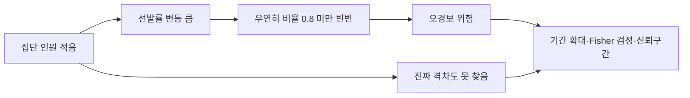

# 작은 표본 주의

> 집단별 지원자·신청자 수가 적으면 선발률 비율이 크게 흔들려서, **실제 차별이 없어도 4/5(0.8) 미만이 자주 나온다.** 작은 표본의 비율은 신호가 아니라 잡음일 수 있다.

## 쉽게 말하면
동전을 10번씩 두 번 던져 앞면 비율을 비교하면 공정한 동전이어도 차이가 꽤 나온다. 1,000번씩 던지면 거의 같아진다. 표본이 작을수록 우연의 폭이 크다.

## 자세히
출처: 29 CFR 1607.4(D)의 작은 표본 단서([4/5 규칙](#four-fifths-rule) 노드에서 확인), 검색 요약, **직접 시뮬레이션**(2026-11-18, 아래 코드).
- **지침의 단서**: 숫자가 작고 통계적으로 유의하지 않은 큰 격차는 불리한 영향이 아닐 수 있고, 숫자가 너무 작으면 더 긴 기간이나 비슷한 상황의 결과를 보라는 취지다.
- **시뮬레이션**: 두 집단의 진짜 선발률이 모두 50%로 같을 때, 우연만으로 비율이 0.8 미만이 되는 확률(시행 2만 회, 난수 시드 1):

| 집단당 인원 | 0.8 미만이 나올 확률 |
|---|---|
| 10 | 약 56% |
| 20 | 약 46% |
| 50 | 약 26% |
| 100 | 약 12% |
| 500 | 약 0.1% |
| 2,000 | 약 0% |

- **함의**: 인원이 10명이면 차별이 전혀 없어도 절반 넘게 "위반처럼" 보인다. 반대로 작은 표본에서 진짜 격차를 놓칠 수도 있다(검정력 부족, 일반 지식).
- **대응**: ①기간을 늘리거나 여러 채용 건을 합산 ②Fisher 정확 검정 같은 작은 표본용 검정([통계적 유의성](#statistical-significance-adverse-impact)) ③신뢰구간 병기 ④뉴욕시 규칙의 2% 소규모 범주 제외([소규모 범주 제외 규칙](#small-category-exclusion))처럼 계산에서 빼되 수치는 공개.
- **한계**: 시뮬레이션은 선발률 50%, 두 집단 같은 크기라는 단순 가정이다. 선발률·집단 크기가 다르면 확률이 달라진다.

## 그림으로 보기


## 예시
```python
import random
def false_alarm(n, p=0.5, T=20000):
    c = 0
    for _ in range(T):
        a = sum(random.random() < p for _ in range(n)) / n
        b = sum(random.random() < p for _ in range(n)) / n
        hi, lo = max(a, b), min(a, b)
        c += (hi > 0 and lo / hi < 0.8)
    return c / T
print(false_alarm(10), false_alarm(100))
```
소규모 부서의 AI 승진 추천 결과를 한 분기만 보고 "편향"이라 결론 내리지 않도록 최소 인원 기준을 둔다.

## 헷갈리는 것과 비교
| 개념 | 차이 |
|---|---|
| 작은 표본 주의 | 비율이 잡음에 휘둘리는 문제 |
| [통계적 유의성과 실질적 유의성](#statistical-significance-adverse-impact) | 우연성 판정과 크기 판정의 구분 |
| 검정력 | 진짜 격차를 찾아낼 능력 |
| [소규모 범주 제외 규칙](#small-category-exclusion) | LL144의 2% 제외 규정 |

## 더 읽을거리
- [4/5 규칙](#four-fifths-rule) — 조문과 작은 표본 단서
- [SciPy fisher_exact](https://docs.scipy.org/doc/scipy/reference/generated/scipy.stats.fisher_exact.html) — 작은 표본 검정 도구
