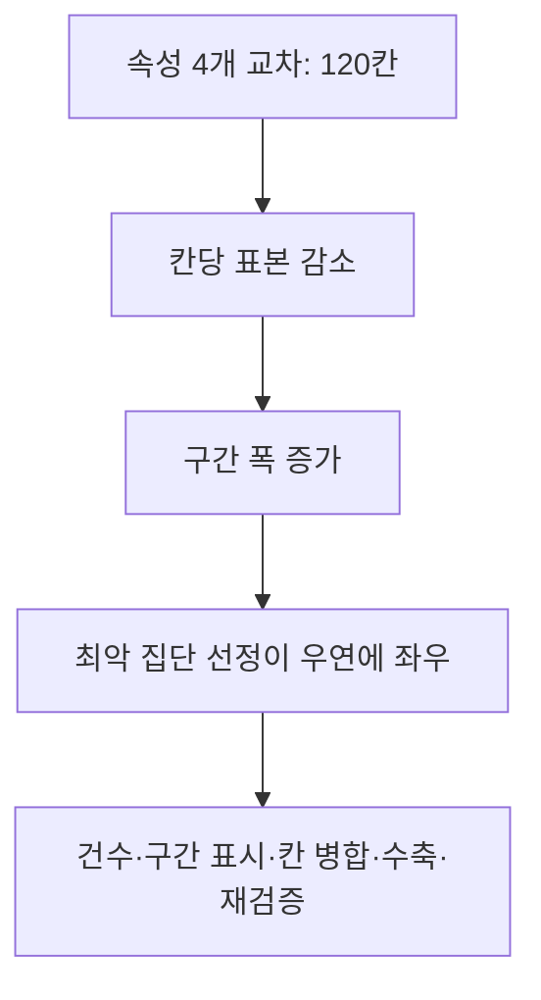
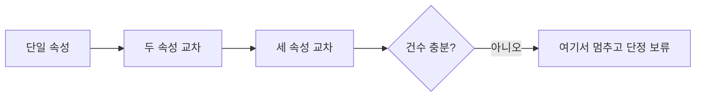

# 작은 집단의 불확실성

> 성별×연령×피부색처럼 **속성을 교차시킬수록 칸(집단)이 잘게 쪼개져 각 칸의 표본이 줄고**, 그 칸에서 잰 성능은 우연에 크게 흔들린다. 그래서 "이 집단에서 성능이 낮다/높다"는 결론은 신뢰 구간 없이 내리면 위험하다.

## 쉽게 말하면
학급 성적을 학년·반·성별·동아리로 계속 쪼개면, 어느 칸에는 학생이 2명뿐이다. 그 두 명이 시험을 망쳤다고 "그 칸의 학생들은 못한다"고 말할 수는 없다. 칸이 작을수록 평균은 우연에 좌우된다.

## 자세히
(교차 보고의 출처는 Mitchell 등의 모델 카드 논문(arXiv 1810.03993, 상위 노드에서 직접 확인), Wilson 구간은 위키백과 문서를 앞서 직접 확인. 아래 수치는 직접 시뮬레이션이다.)
- **상위 노드의 한계 서술**: 모델 카드는 단일 요인 결과와 교차 결과를 보고하라고 제안하며, 교차 조합이 늘면 표본이 줄어 신뢰 구간이 넓어진다는 한계가 이미 지적된다([집단별 성능 보고](#subgroup-performance-report)).
- **직접 시뮬레이션(2026-11-22)**: 4개 속성(성별 2×연령 4×피부색 3×지역 5)을 교차한 **120칸**에 3,000건을 배분(각 속성 안에서 1:1/2:1/3:1처럼 치우친 분포). 칸마다 진짜 정확도는 0.90 중심, 표준편차 0.03만큼 다름.
  | 지표 | 값 |
  |---|---|
  | 칸 크기 중앙값 / 최소 / 최대 | 14 / 0 / 214 |
  | 5건 미만인 칸 | 15칸(12%), 데이터 1.3% |
  | 10건 미만 | 45칸(38%), 데이터 8.4% |
  | **30건 미만** | **85칸(71%), 데이터 31.1%** |
  | 95% Wilson 구간 평균 폭 | 30건 미만 칸 **0.41**, 30건 이상 칸 0.16 |
  120칸 중 71%가 30건 미만이고, 그런 칸의 구간 폭은 평균 0.41로 정확도가 0.7이든 0.9든 가능하다는 정도다.
- **"가장 나쁜 집단 찾기"의 함정(같은 시뮬레이션)**: 관측 정확도가 가장 낮은 5칸은 크기가 2·2·6·5·6건이었고 관측 정확도 0.5~0.67이었다. **진짜 정확도는 0.86~0.96으로 오히려 평균 이상**이었고, 진짜 가장 나쁜 5칸 중 관측 최악 5칸에 든 것은 **0개**였다. 쪼갠 칸 수가 많으면 우연히 낮게 나온 작은 칸이 "최악 집단"으로 뽑힌다([슬라이스 다중 비교](#multiple-comparisons-slices)).
- **개선 방법(제안)**
  1. **칸마다 건수와 95% 구간을 함께 표시**하고 건수가 작은 칸에 경고([작은 칸 표시](#crosstab-small-cell-flag)).
  2. **칸 병합·계층적 보고**: 단일 속성 → 두 속성 교차 → 세 속성 교차 순으로 내려가며 건수가 충분한 곳까지만 단정.
  3. **수축(shrinkage) 추정**: 작은 칸의 추정을 전체 평균 쪽으로 당긴다. 직접 구현한 단순 방식(전체 평균에 가상 표본 20건을 더하는 식)으로 **칸별 평균제곱오차가 0.00995에서 0.00116으로**, 작은 칸만 보면 0.01326에서 0.00125로 줄었다. 단, 이 방식은 실제 칸 간 차이가 작다고 가정한 시뮬레이션에서 유리하고, 진짜로 크게 나쁜 소수 집단의 문제를 희석할 수도 있다.
  4. **목표 표본 수집**: 취약하거나 중요한 집단은 평가용 데이터를 일부러 더 모은다([슬라이스 기반 데이터 보강](#slice-driven-data-collection)).
  5. 다중 비교 보정이나 탐색 결과는 새 표본으로 **재검증**.
- **한계**: 위 시뮬레이션은 가정한 분포와 정확도에서 나온 것이며 실제 데이터에선 다르다. 구간이 넓다는 것은 "문제가 없다"가 아니라 "알 수 없다"는 뜻이다.

## 그림으로 보기

## 예시
- 얼굴 인식 평가에서 성별×피부색×연령×조명 120칸 정확도 표: 건수 30 미만 칸은 구간과 함께 "불확실"로 표시, 가장 나쁜 칸 목록은 추가 데이터 수집 후보로만 사용.
- 교육 소재: "가장 못하는 집단"을 뽑는 실습 — 위 시뮬레이션처럼 우연히 낮은 칸이 뽑히는 것을 체험.

## 헷갈리는 것과 비교
| 개념 | 차이 |
|---|---|
| 작은 집단의 불확실성 | 잘게 쪼갠 칸의 성능 추정이 흔들림 |
| [집단별 성능 보고](#subgroup-performance-report) | 집단별 성능을 보고하는 방법 |
| [작은 칸 표시](#crosstab-small-cell-flag) | 건수 적은 칸에 경고 |
| [슬라이스 다중 비교](#multiple-comparisons-slices) | 많이 쪼갤수록 우연한 나쁜 칸이 생김 |

## 더 읽을거리
- [Model Cards for Model Reporting (arXiv 1810.03993)](https://arxiv.org/abs/1810.03993) — 단일·교차 요인 결과 보고 제안(상위 노드에서 직접 확인).
- [Binomial proportion confidence interval — 위키백과](https://en.wikipedia.org/wiki/Binomial_proportion_confidence_interval) — Wilson 구간(직접 확인).
