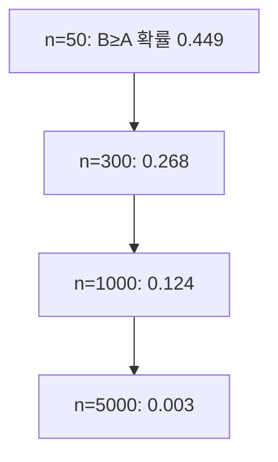

# 작은 시험셋의 변동

> 시험 세트가 작으면 같은 모델도 어떤 문항이 뽑혔느냐에 따라 점수가 크게 달라진다. 비율 지표의 표준오차는 약 √(p(1−p)/n)이라 문항 수 n이 작으면 점수 차이 1~2%p는 우연일 수 있다.

## 쉽게 말하면
반 학생이 평균 85점이라는 걸 확인하려고 5문제만 내면 그날 어떤 문제가 나왔느냐로 결과가 들쭉날쭉하다. 100문제를 내면 훨씬 안정적이고, 1,000문제면 거의 흔들리지 않는다. 시험 문항 수는 "그 점수를 얼마나 믿을 수 있는가"를 정한다.

## 자세히
(표준오차 공식은 이항분포의 기본 성질이며 아래 수치는 직접 시뮬레이션해 계산. 외부 문헌은 [소규모 데이터 검증 전략](#small-data-validation-strategy)에서 Varoquaux 논문 초록을 확인한 내용을 참조.)
- **표준오차**: 정확도 p=0.85일 때 √(p(1−p)/n)는 n=50에서 0.050, 100에서 0.036, 300에서 0.021, 1,000에서 0.011, 5,000에서 0.005(직접 계산). n=100이면 ±1표준오차가 약 ±3.6%p, 95% 구간은 약 ±7%p다.
- **순위가 뒤집힐 확률(직접 시뮬레이션)**: 진짜 정확도가 A=0.85, B=0.83(2%p 차이)인 두 모델을 **서로 독립인 시험 세트**로 비교할 때 B가 A 이상으로 나올 확률은 n=50에서 **0.449**, 100에서 0.388, 300에서 0.268, 1,000에서 0.124, 5,000에서 0.003. 2%p 차이를 믿으려면 문항이 수천 개 필요하다.
- **같은 문항으로 비교하면 더 안정적**: 두 모델이 같은 시험 문항을 풀고 B가 맞히는 문항이 A가 맞히는 문항의 부분집합인 극단적 설정에서는 B≥A 확률이 n=100에서 0.134, n=1,000 이상에서 0으로 줄었다. 현실에서는 두 모델의 오류가 부분적으로 겹치므로 그 중간이며, **같은 문항에서의 쌍 비교(paired test)** 가 독립 비교보다 검정력이 높다(제안). 이 극단 가정 결과를 일반화하지 말 것.
- **그룹·희귀 클래스**: 문항이 독립이 아니거나 희귀 클래스가 적으면 실효 표본 수가 더 작다([그룹 정의하기](#group-definition), [희귀 클래스 기준 시험 크기](#test-set-size-rare-class)).
- **대응(제안)**: ① 점수와 함께 [윌슨 신뢰구간](#wilson-interval) 보고 ② 문항 수를 늘리거나 교차 검증·반복 ③ 쌍 비교와 신뢰구간으로 차이 검정 ④ 작은 차이(1~2%p)는 결론으로 삼지 않고 모델 선택은 비용·지연 등 다른 기준을 함께 ⑤ 리더보드 숫자 차이도 같은 시각으로 해석([리더보드 작은 점수 차](#leaderboard-small-gap)).

## 그림으로 보기



## 예시
```python
import numpy as np
p, n = 0.85, 100
se = np.sqrt(p * (1 - p) / n)      # 0.0357
print(round(se, 3))
```
- 사내 챗봇 두 버전을 100문항으로 비교해 87점 vs 85점이 나왔다면, 표준오차가 약 3.6%p이므로 "개선"이라고 말하기 어렵다. 500문항 이상으로 늘리거나 같은 문항에서 쌍 비교를 한다.

## 헷갈리는 것과 비교
| 개념 | 차이 |
|---|---|
| 표본 크기에 의한 변동 | 시험 문항을 몇 개 뽑았느냐에 따른 점수 흔들림 |
| 모델 학습 시드 변동 | 같은 모델을 다시 학습할 때의 변동 |
| [데이터 누수](#data-leakage) | 점수가 체계적으로 부풀음 |
| [윌슨 신뢰구간](#wilson-interval) | 변동을 구간으로 표현 |

## 더 읽을거리
- [Cross-validation failure: small sample sizes lead to large error bars (arXiv 1706.07581)](https://arxiv.org/abs/1706.07581) — 소표본 오차 막대(초록 확인).
- [statsmodels: proportion_confint](https://www.statsmodels.org/stable/generated/statsmodels.stats.proportion.proportion_confint.html) — 비율 구간 계산(열어 확인).
