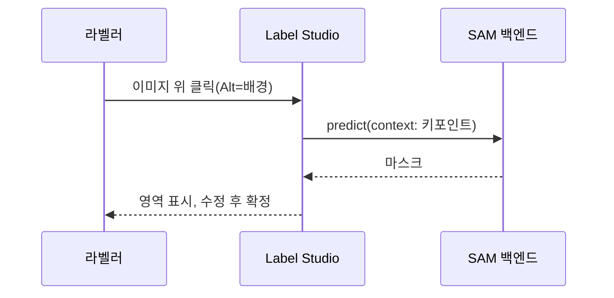
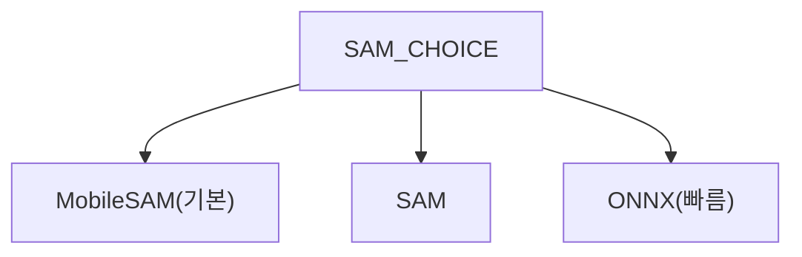

# 스마트 도구(대화형 라벨링)

> 사용자가 이미지에 점·상자를 찍으면 ML 백엔드(예: Segment Anything)가 즉시 영역 마스크를 만들어 주는 Label Studio의 대화형 사전 주석 기능이다.

## 쉽게 말하면
포토샵 '자동 선택 도구'처럼, 대상 위를 한 번 클릭하면 AI가 윤곽선을 따 준다. 사람은 윤곽을 직접 그리는 대신 클릭으로 안내만 한다.

## 자세히
(label-studio-ml-backend 저장소와 segment_anything_model 예제 README를 직접 열어 확인. 2026-11-21 기준.)
- **저장소 예제**: `segment_anything_model`(Meta SAM, 대화형 전용), `segment_anything_2_image`(SAM2), `grounding_sam`(텍스트 프롬프트 + SAM2), Nebius 서버리스 SAM2 예제. segment_anything_model은 **AdvancedSAM**(MobileSAM 또는 SAM, 혼합 프롬프트)과 **ONNX SAM**(더 빠름, 고정 이미지 크기)을 제공.
- **설정 순서**: ML 백엔드 설치 → 로컬 파일 서빙 켜기(`LABEL_STUDIO_LOCAL_FILES_SERVING_ENABLED=true`, `LABEL_STUDIO_LOCAL_FILES_DOCUMENT_ROOT`=이미지 폴더) → 액세스 토큰 발급 → docker-compose에 `LABEL_STUDIO_HOST`(localhost 아닌 IP:포트)·`LABEL_STUDIO_ACCESS_TOKEN` → `docker-compose up`(9090) → 프로젝트에 라벨링 설정 붙여넣기, 모델 URL 연결, **대화형 사전 주석** 켜기.
- **환경 변수**: `SAM_CHOICE` = MobileSAM(기본)/SAM/ONNX, `MOBILESAM_CHECKPOINT`, 맥은 `KMP_DUPLICATE_LIB_OK=True`.
- **라벨링 설정**: AdvancedSAM은 클래스별 BrushLabels + RectangleLabels와 KeyPointLabels(Foreground/Background)가 필요. **Alt+클릭은 음성(배경) 점**. ONNX는 `smart="true"`.
- **제약**: **로컬 스토리지에서만** 동작(S3·Azure·GCP 불가), COCO/YOLO 내보내기 미지원(NumPy/PNG 사용). 예제 compose는 메모리 8GB 제한을 둔다.

## 그림으로 보기

## 예시
- 제품 사진 1,000장에서 클릭 2~3번으로 상품 영역 마스크 생성 후 사람이 경계 보정.
- 교육 활용: 분할(segmentation) 라벨링이 어떻게 사람과 AI의 공동 작업이 되는지 시연.

## 헷갈리는 것과 비교
| 개념 | 차이 |
|---|---|
| 대화형 사전 주석 | 사용자 클릭마다 즉시 예측 |
| 일반 사전 주석 | 작업 전체에 일괄 예측 |
| [predict·fit](#ml-backend-predict-fit) | 두 방식의 구현 함수 |

## 더 읽을거리
- [label-studio-ml-backend](https://github.com/HumanSignal/label-studio-ml-backend) — 예제 목록.
- [segment_anything_model 예제](https://github.com/HumanSignal/label-studio-ml-backend/tree/master/label_studio_ml/examples/segment_anything_model) — 설정과 제약.
