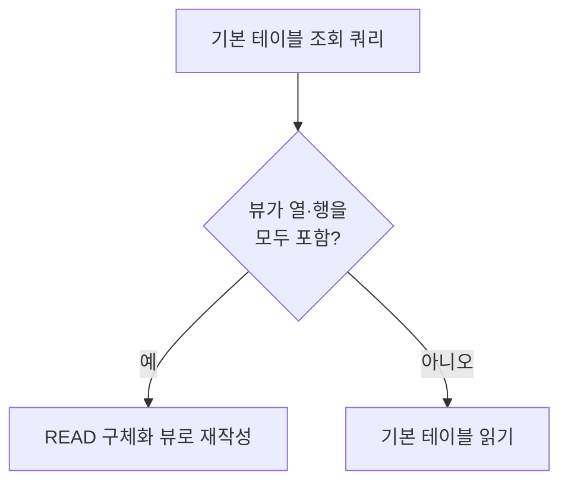
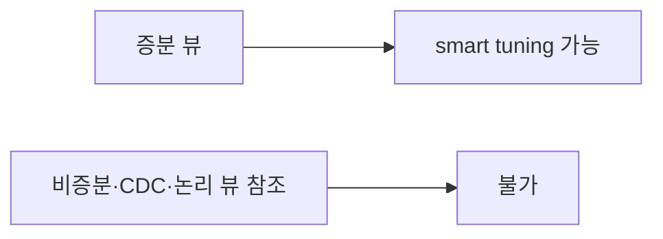

# smart tuning(쿼리 자동 재작성)

> BigQuery가 **기본 테이블을 조회하는 쿼리를 구체화 뷰를 읽도록 자동으로 바꿔 쓰는** 기능이다. 결과가 달라지지 않을 때만 바꾸며, 사용자가 쿼리를 고치지 않아도 더 싸고 빠르게 만든다.

## 쉽게 말하면
도서관 사서가 "그 통계는 이미 정리해 둔 요약표에서 바로 찾을 수 있습니다"라며 원본 장부 대신 요약표를 꺼내 주는 것이다. 단, 요약표에 없는 열이나 범위를 묻는 질문이면 원본 장부로 간다.

## 자세히
(BigQuery 공식 문서 "Introduction to materialized views"와 "Use materialized views"를 직접 읽었다. BigQuery 전용 기능이며 표의 사례는 문서의 예시다.)
- **무엇을 하나(문서)**: 결과가 같을 때 쿼리를 구체화 뷰를 읽도록 재작성해 성능을 높이고 비용을 줄이며, **갱신을 일으키지는 않는다**. **증분 뷰만** 지원한다.
- **재작성되는 모양(문서 예시에서 읽은 패턴)**: 열 부분집합(뷰가 가진 열 중 일부만 읽기), 행 부분집합(뷰가 이미 포함한 범위 안에서 더 좁게 거르기), 집계 재사용(미리 집계된 결과로 더 거친 집계 계산, 문서가 이름 붙이진 않음).
- **요건(문서)**: 뷰가 쿼리와 **같은 기본 테이블 집합**을 쓰고, 쿼리가 읽는 **모든 열과 모든 행**을 포함해야 한다. 뷰는 기본 테이블 중 하나와 같은 프로젝트이거나 쿼리가 실행되는 프로젝트에 있어야 한다.
- **문서의 예(뷰: `store_id`, 날짜로 캐스팅한 `sold_datetime`, `SUM(net_profit)`, 2021-01-01 이후이고 `promo_id`가 null이 아닌 행, 매장·날짜별)**

| 쿼리 변경 | 재작성? | 이유 |
|---|---|---|
| `SUM(net_paid)` 추가 | 아니오 | 뷰에 없는 열 |
| 같은 필터로 `SUM(net_profit)`만 | 예 | 뷰 열·행의 부분집합 |
| `customer_id = 12345`로 필터 | 아니오 | 뷰에 없는 열 |
| `sold_datetime`을 직접 필터 | 아니오 | 뷰에는 캐스팅된 날짜만 있음 |
| `store_id = 12345` 추가 | 예 | 뷰 출력 열로 필터 |
| `promo_id = 12345` 추가 | 아니오 | `promo_id`는 출력 열이 아님 |
| 날짜 2020-01-01부터 | 아니오 | 뷰 밖의 행을 읽음 |
| 날짜 2022-01-01부터 | 예 | 뷰 범위 안 |
- **쓰이지 않는 경우(문서)**: 뷰가 논리 뷰를 참조, `UNION ALL`·left outer join 사용, 비증분 뷰, CDC 테이블 참조, 호출자에게 `bigquery.tables.get`·`bigquery.tables.getData` 권한이 없음, `UPDATE`·`MERGE`·`DELETE`·truncate·파티션 만료로 증분 갱신이 불가능해 갱신 전까지는 캐시를 못 씀, 미처리 변경이 기본 테이블의 타임 트래블 간격을 넘음, 자동 갱신이 꺼져 있고 미처리 변경이 있음.
- **쓰였는지 확인하는 법(문서)**: 쿼리 계획에 `READ my_materialized_view` 단계가 있으면 재작성된 것이다. 작업 통계의 `materialized_view_statistics`에서 `chosen`이 `TRUE`면 사용, `rejected_reason`(예: `COST` — 더 효율적인 원본이 있다고 판단)이 이유를 알려 준다. 통계에 뷰가 없으면 뷰를 직접 질의해 보고, 그래도 안 쓰이면 쿼리 모양이 뷰와 맞지 않는 것이다.
- **`max_staleness`와의 관계**: 입문 문서에 따르면 smart tuning은 `max_staleness`와 무관하게 쿼리를 재작성한다. 이 옵션은 뷰를 직접 조회하는 쿼리에만 영향을 준다.

## 그림으로 보기

## 예시
- 매장별 일일 이익 뷰가 있을 때, 같은 조건으로 "특정 매장의 이익 합계"를 기본 테이블에 질의하면 뷰를 읽도록 재작성된다(문서 예).
- 교육 소재: 요약표에 없는 열을 물으면 왜 원본으로 가는지 표로 설명.

## 헷갈리는 것과 비교
| 개념 | 차이 |
|---|---|
| smart tuning | 기본 테이블 쿼리를 뷰로 자동 재작성 |
| 뷰 직접 조회 | 뷰를 명시해 쿼리, `max_staleness` 영향 |
| [허용 최신성 지연](#max-staleness) | 뷰 직접 조회 때의 허용 낡음 |
| [증분 갱신](#incremental-refresh) | smart tuning의 전제 조건(증분 뷰) |

## 더 읽을거리
- [Use materialized views (BigQuery)](https://docs.cloud.google.com/bigquery/docs/materialized-views-use) — smart tuning 요건·예·확인법(직접 읽음).
- [Introduction to materialized views (BigQuery)](https://docs.cloud.google.com/bigquery/docs/materialized-views-intro) — 증분 뷰만 지원한다는 설명(직접 읽음).
