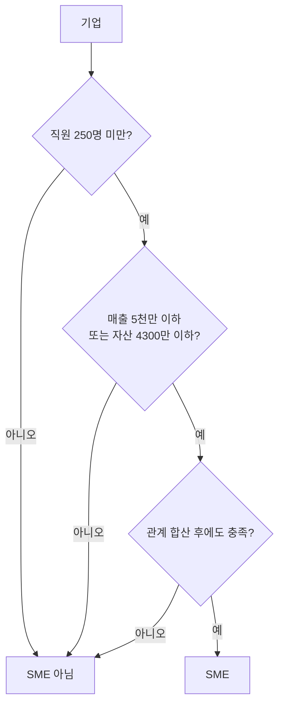
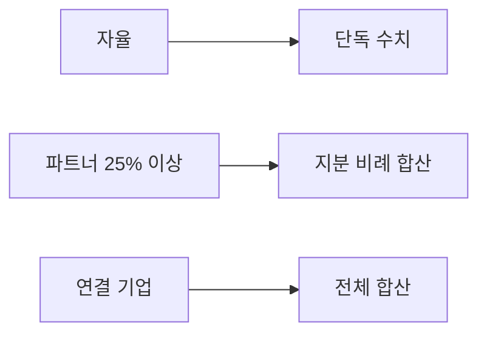

# SME 정의

> EU에서 중소기업(SME)을 가르는 기준: 직원 수와 매출 또는 자산 총액의 상한, 그리고 모기업·투자자와의 관계(자율·파트너·연결 기업)까지 합쳐 따진다. AI Act의 "SME는 과징금 낮은 쪽" 규칙의 대상 범위가 여기서 정해진다.

## 쉽게 말하면
"작은 회사냐"를 묻는 질문에 직원 수 한 줄로 답할 수 없는 이유는, 큰 회사의 자회사가 직원 몇 명뿐일 수 있기 때문이다. 그래서 지분 관계까지 합산해 따진다.

## 자세히
출처는 EU 집행위 SME 정의 페이지(열람)와 권고 2003/361/EC 원문(EUR-Lex, 열람). 법률 자문이 아니다.
- **상한표**: 각 기업은 직원 수 한도를 충족하고, 매출 한도 또는 자산 총액 한도 중 하나를 충족해야 한다(재무 요건은 "and/or").

| 구분 | 직원 | 연 매출 | 자산 총액 |
|---|---|---|---|
| 초소기업(micro) | 10명 미만 | 200만 유로 이하 | 200만 유로 이하 |
| 소기업(small) | 50명 미만 | 1,000만 유로 이하 | 1,000만 유로 이하 |
| 중기업(medium) | 250명 미만 | 5,000만 유로 이하 | 4,300만 유로 이하 |

- **개별 기업 수치만이 아님**: 위 상한은 개별 기업 수치에 적용되고, 더 큰 그룹에 속하면 그룹의 직원·매출·자산을 합산해야 할 수 있다(집행위 페이지).
- **관계 유형(권고 3조, 열람)**
  - 자율 기업: 파트너도 연결 기업도 아님.
  - 파트너 기업: 상위 기업이 하위 기업 자본·의결권의 25% 이상을 단독 또는 연결 기업과 함께 보유. 다만 적격 투자자(총 투자 125만 유로 미만의 비즈니스 엔젤, 대학·비영리 연구센터, 기관투자자, 예산 1,000만 유로 미만·주민 5,000명 미만 지방자치단체 등)가 보유하면 자율 기업으로 남을 수 있다.
  - 연결 기업: 다른 기업의 의결권 과반 보유, 이사회 과반 임면 권한, 계약·정관상 지배적 영향력, 주주 간 합의로 의결권 과반 통제 중 하나.
  - 공공 통제: 파트너 예외가 아닌 한 공공기관이 자본·의결권 25% 이상을 통제하면 SME가 될 수 없다.
- **소형 중견기업(SMC)**: 집행위 페이지는 SME 정의를 벗어난 기업을 위한 새 범주가 도입됐다고만 하고 수치는 주지 않았다. AI Act 99조 6a항 맥락은 [소형 중견기업](#small-mid-cap) 참고.
- 정의는 권고이며 실제 법·지원 사업에서 어떻게 인용되는지는 각 규정을 확인해야 한다.

## 그림으로 보기

## 예시
- 직원 30명, 매출 800만 유로 스타트업: 소기업 기준. 단 대기업이 의결권 과반을 가지면 연결 기업이라 그룹 수치를 합산.
- 교육 실습: 가상의 회사 3곳의 직원·매출·지분 구조를 주고 SME 여부를 판정하게 한다.

## 헷갈리는 것과 비교
| 개념 | 차이 |
|---|---|
| SME | 직원 250명 미만 등 위 기준 |
| [소형 중견기업](#small-mid-cap) | SME를 벗어난 새 중간 범주 |
| [SME 과태료 낮은 쪽 규칙](#sme-fine-rule) | 이 정의를 대상으로 한 AI Act 규칙 |
| 자율·파트너·연결 기업 | 합산 범위를 정하는 관계 유형 |

## 더 읽을거리
- [EU Commission: SME definition](https://single-market-economy.ec.europa.eu/smes/sme-definition_en) — 상한표(열람)
- [Recommendation 2003/361/EC (EUR-Lex)](https://eur-lex.europa.eu/legal-content/EN/TXT/?uri=CELEX:32003H0361) — 2조·3조(열람)
