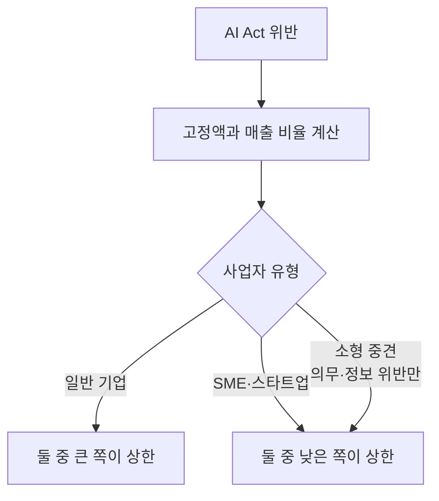

# SME 과태료 낮은 쪽 규칙

> EU AI Act 99조에 따라 중소기업(스타트업 포함)은 과징금 상한이 "고정액과 매출 비율 중 큰 쪽"이 아니라 **낮은 쪽**이다. 소규모 기업에 상한이 과도해지지 않게 하는 장치다.

## 쉽게 말하면
같은 속도위반 벌금이라도 대기업은 매출 비례, 영세 상인은 "정액과 비례 중 작은 금액"을 넘지 않도록 하는 배려 규정이다.

## 자세히
99조 조문(artificialintelligenceact.eu 확인):
- 일반 기업: 금지 행위 €35M/7%, 의무 위반 €15M/3%, 허위·불완전 정보 €7.5M/1% — 각각 **큰 쪽(whichever is higher)**.
- **99조 6항**: SME(스타트업 포함)는 같은 두 숫자 중 **낮은 쪽**이 상한.
- **6a항(개정으로 추가)**: 소형 중견기업(small mid-cap)은 4항·5항(의무 위반, 허위 정보)에 한해 같은 낮은 쪽 처리. 금지 행위(3항)에는 적용되지 않는다(페이지 표기 기준, 개정 문구는 확정판 확인 필요).
- 7항: 당국은 중대성·기간, 사업자 규모·매출, 협조, 고의·과실, 완화 조치를 따진다.
- 상한일 뿐이다. 실제 부과액은 사정에 따라 낮아진다.
- 99조는 2025-08-02부터 적용(113조(b))이라고 조문 페이지에 적혀 있다.

## 그림으로 보기

## 예시
- 연 매출 1천만 유로 스타트업이 금지 행위 위반: 7% = 70만 유로 < €35M → SME는 **70만 유로**가 상한(일반 기업이면 €35M).
- 같은 회사가 허위 정보 제출: 1% = 10만 유로 < €7.5M → 10만 유로 상한.

## 헷갈리는 것과 비교
| 개념 | 차이 |
|---|---|
| 일반 기업 | 큰 쪽 |
| SME | 낮은 쪽 |
| [GDPR 과징금](#gdpr-fines) | 큰 쪽, 별도 SME 낮은 쪽 규칙은 없음 |
| [AI Act 과징금](#eu-ai-act-penalties) | 전체 구조 |

## 더 읽을거리
- [AI Act Article 99](https://artificialintelligenceact.eu/article/99/) — SME 규칙(6항)·소형 중견(6a항)
