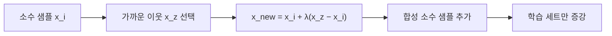

# SMOTE

> SMOTE는 소수 클래스 샘플과 그 가까운 이웃 사이를 보간해 가상의 새 소수 샘플을 만들어 클래스 불균형을 완화하는 오버샘플링 기법이다.

## 쉽게 말하면
희귀한 우표가 두 장뿐일 때 똑같은 것을 복사하는 대신, 두 장 사이 "중간 모양" 우표를 그려 추가하는 것이다. 단순 복제보다 다양한 예가 늘어난다.

## 자세히
imbalanced-learn 문서(2026-11 확인):
- 생성: 소수 샘플 x_i와 k-최근접 이웃 하나 x_zi를 골라 x_new = x_i + λ·(x_zi − x_i), λ는 [0,1] 난수. 두 점을 잇는 선분 위에 새 점이 생긴다.
- 범주형: 일반 SMOTE는 수치 특성 필요. SMOTE-NC는 이웃에서 가장 흔한 범주를 할당, SMOTEN은 전부 범주형일 때 값 차이 지표 사용.
- 변형: Borderline-SMOTE(노이즈·위험·안전으로 분류해 위험 샘플에서만 생성), SVM-SMOTE, KMeans-SMOTE, ADASYN(이웃에 타 클래스가 많은 어려운 영역에 더 생성).
- 주의: SMOTE는 정상점과 이상치를 이어 붙일 수 있고 ADASYN은 이상치에 집중할 수 있어 결정 경계가 나빠질 수 있다. 다중 클래스는 one-vs-rest.
- **누수 주의(일반 원칙, [데이터 누수](#data-leakage))**: 합성은 **학습 데이터에만** 적용한다. 분할 전에 오버샘플링하면 합성 샘플이 테스트에 섞여 점수가 부풀려진다. 교차 검증에서는 imbalanced-learn `Pipeline`을 쓴다.
- 이 문서에서 테스트 데이터를 리샘플링하지 않는다는 명시는 없고, 위 원칙은 scikit-learn 누수 가이드에서 온 일반 규칙이다.

## 그림으로 보기


## 예시
```python
from imblearn.over_sampling import SMOTE
X_res, y_res = SMOTE(random_state=0).fit_resample(X_train, y_train)
```
사기 거래 1% 데이터에서 학습 세트만 증강하고 평가는 원래 분포의 테스트 세트로 한다.

## 헷갈리는 것과 비교
| 개념 | 차이 |
|---|---|
| SMOTE | 합성 샘플 생성 |
| 무작위 오버샘플링 | 기존 샘플 복제 |
| [클래스 가중치](#class-weights) | 데이터는 그대로, 손실 가중 |
| 언더샘플링 | 다수 클래스를 줄임 |

## 더 읽을거리
- [imbalanced-learn: Over-sampling](https://imbalanced-learn.org/stable/over_sampling.html) — SMOTE 수식·변형·주의.
