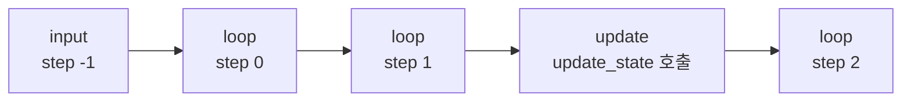

# metadata.source

> LangGraph 체크포인트의 `metadata["source"]`는 그 체크포인트가 어떻게 만들어졌는지 알려 주는 값이다. 공식 문서가 나열하는 값은 `input`, `loop`, `update` 세 가지다.

## 쉽게 말하면
세이브 파일의 꼬리표다. "처음 입력 받고 저장"(input), "게임이 진행되며 자동 저장"(loop), "누군가 손으로 값을 고쳐서 저장"(update). 꼬리표만 보면 이 저장이 정상 진행의 결과인지 사람이 개입한 흔적인지 구분할 수 있다.

## 자세히
Checkpointers 문서 기준(확인 2026-11-12).
- `input`: `invoke`에 넘긴 입력이 상태에 반영된 체크포인트. `step`은 `-1`, `writes`는 입력값(예 `{'foo': ''}`).
- `loop`: 그래프 실행 루프의 super-step이 끝날 때 자동 생성되는 체크포인트. `step`은 0부터 증가.
- `update`: `graph.update_state(...)`로 상태를 직접 고쳐 만든 체크포인트.
- 같은 metadata에 `writes`(그 단계의 노드 출력)와 `step`(super-step 번호)도 있다.
- 문서는 `"fork"` 값을 나열하지 않는다. 다른 값이 있는지는 확인하지 못했다(주장 없음).
- 활용: `[s for s in history if s.metadata["source"] == "update"]`로 수동 편집 지점만 모은다.

## 그림으로 보기


## 예시
```python
history = list(graph.get_state_history(config))
manual = [s for s in history if s.metadata["source"] == "update"]
step_2 = next(s for s in history if s.metadata["step"] == 2)
```
감사(audit) 때 "사람이 상태를 고친 시점"만 뽑아 본다.

## 헷갈리는 것과 비교
| 값 | 만들어지는 때 | step |
|---|---|---|
| input | 입력 반영 | -1 |
| loop | super-step 종료 | 0 이상 |
| update | update_state 호출 | 호출 시점 기준 |
| [StateSnapshot](#langgraph-state-snapshot) | 이 값을 담는 객체 |  |

## 더 읽을거리
- [LangGraph Checkpointers](https://docs.langchain.com/oss/python/langgraph/checkpointers.md) — StateSnapshot 필드 표와 메타데이터 필터 예시
