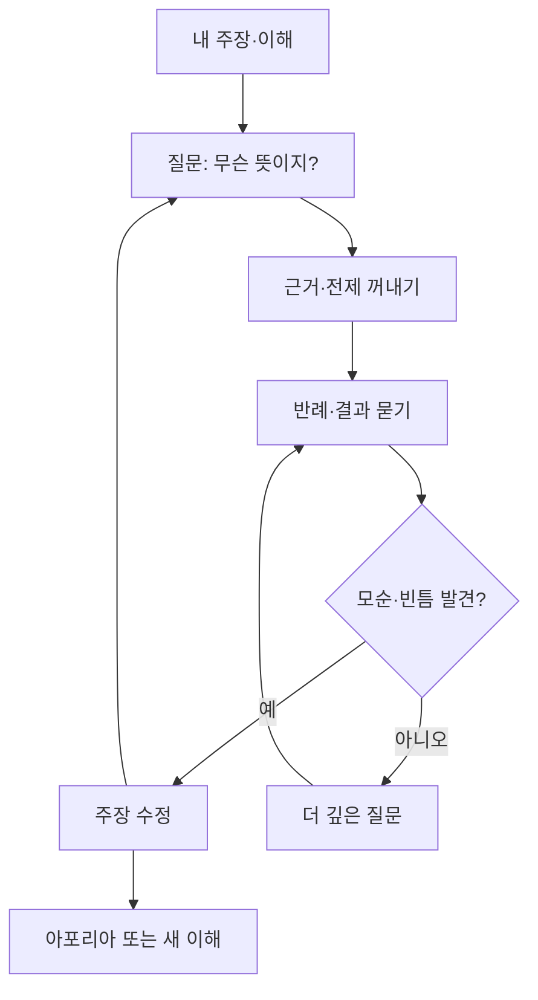
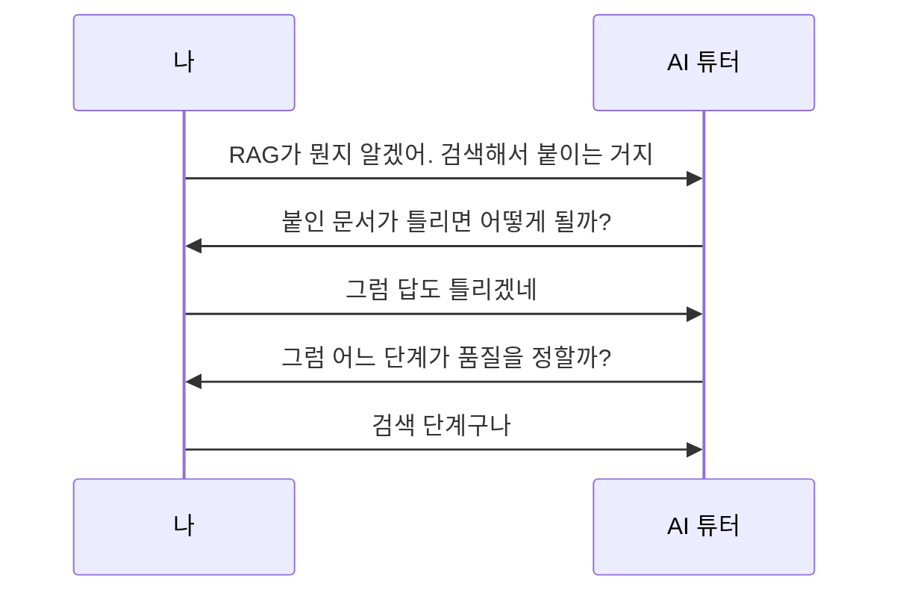

# 소크라테스 논증법

> 답을 알려 주는 대신 질문을 이어 가며, 상대가 자기 생각의 빈틈을 스스로 발견하게 만드는 대화 방법. 산파술(maieutic method)이라고도 한다.

## 쉽게 말하면
산파는 아기를 대신 낳아 주지 않고 낳는 과정을 돕는다. 소크라테스식 대화도 같다. 선생이 정답을 건네지 않고 "그게 정확히 무슨 뜻이지?", "그럼 이런 경우는?" 하고 묻는다. 대답하다 보면 내가 알던 것이 모순이거나 비어 있다는 걸 본인이 알아챈다. 남이 알려 준 결론보다 스스로 부딪혀 알아낸 결론이 오래 남는다.

## 자세히
- **엘렝코스(elenchus, 반박 검증)**: 플라톤 대화편의 전형적 절차. 철학자 Vlastos의 정리를 줄이면 ① 상대가 주장을 내놓는다(예: "용기란 도망치지 않는 것") ② 그 주장을 시험 대상으로 삼는다 ③ 상대가 동의할 만한 전제들을 모은다 ④ 그 전제들이 원래 주장과 충돌함을 보인다 ⑤ 주장을 고친다.
- **아포리아(aporia)**: 정답 없이 "모르겠다"에서 끝나는 상태. 대부분의 소크라테스 대화가 여기서 끝난다. 모른다는 걸 아는 것이 출발점이라는 입장이다.
- **교육 현장**: 소크라테스 세미나(교사는 진행만, 학생이 본문을 놓고 토론). 질문은 여는 질문 → 이끄는 질문 → 닫는 질문(정리·성찰) 순으로 쓴다. 인지치료의 소크라테스식 질문도 같은 뿌리다.
- **자주 쓰는 질문 유형**: 명료화("무슨 뜻?"), 근거("왜 그렇게 생각해?"), 가정("그게 항상 참이야?"), 반례("이런 경우엔?"), 결과("그러면 어떻게 돼?"), 질문 자체 되묻기("왜 이게 중요하지?").
- **한계**: 반박은 해도 새 이론을 세워 주지는 않는다(비판적 방법에 가깝다는 학계 논쟁). 질문이 추궁처럼 되면 상대가 수치심을 느낄 수 있다. 시간이 오래 걸린다.
- **AI와 쓰는 법**: 생각 없이 답만 받으면 AI가 내 이해를 대신해 버린다. "답을 말하지 말고 질문으로 내가 스스로 결론 내게 해줘"라고 시키면 AI가 소크라테스 역할을 한다. 반대로 AI의 주장을 내가 소크라테스처럼 캐물으면 [환각](#hallucination)이나 빈약한 근거를 걸러낼 수 있다.

## 그림으로 보기

## 예시
- 학습 프롬프트: "나는 [환각]을 이해했다고 생각해. 정답을 알려 주지 말고, 한 번에 질문 하나씩 던져서 내 설명의 허점을 찾아 줘. 내가 막히면 힌트만 줘."
- 검증 프롬프트: "방금 네 주장의 근거와 반례를 스스로 물어보고 답해 봐."
- 교육 설계: 수업 끝 10분에 "오늘 배운 걸 모르는 사람에게 설명한다면 어디서 막힐까?"를 질문 카드로 쓴다.

## 헷갈리는 것과 비교
| 개념 | 차이 |
| --- | --- |
| 소크라테스 논증법 | 질문으로 빈틈을 드러내는 대화. 상대가 있음 |
| [파인만 기법](#feynman-technique) | 내가 쉽게 설명해 보며 빈틈을 찾음. 혼자 가능 |
| [재귀적 공백 채우기](#recursive-gap-filling) | 찾은 빈틈을 채우고 그 안에서 또 찾기를 반복 |
| 토론(debate) | 이기는 것이 목적. 소크라테스식은 함께 알아가는 것이 목적 |

## 더 읽을거리
- [Socratic method (Wikipedia)](https://en.wikipedia.org/wiki/Socratic_method) — 엘렝코스 단계, 아포리아, 소크라테스 세미나, 한계 논쟁
