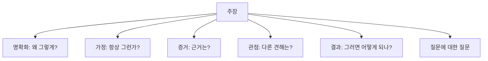
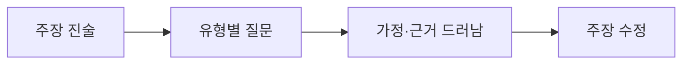

# 소크라테스식 질문 유형

> **소크라테스식 질문**은 답을 알려 주는 대신 **규율 있는 질문**으로 생각의 근거·가정·결과를 스스로 따져 보게 하는 방법이다. 흔히 여섯 가지 유형으로 정리한다.

## 쉽게 말하면
의사가 "어디가 아프세요?" 하나만 묻지 않고 "언제부터?", "다른 증상은?", "이전에도 그랬나요?"를 이어 묻듯, 한 가지 생각을 여러 각도에서 캐묻는 질문 도구 상자다.

## 자세히
(Wikipedia "Socratic questioning" 확인)
- **목적**: 복잡한 생각을 탐구하고, 진실에 다가가고, **가정을 드러내고**, **아는 것과 모르는 것을 구별**하기 위한 "규율 있는 질문". 교육에서는 학생의 생각을 **탐색**하고 학생이 스스로 소크라테스식 질문을 던지는 능력을 기르는 것이 목적이다. 인지 재구조화 심리치료에도 쓰인다.
- **여섯 유형**(문서의 "교육" 항목 예시):
  1. 생각을 명확히 하고 기원을 탐색 — "왜 그렇게 말하죠?"
  2. 가정에 도전 — "항상 그런가요?"
  3. 논증의 근거로 증거 제시
  4. 대안적 관점·주장 사이의 충돌 발견
  5. 함의와 결과 탐색
  6. 질문 자체에 질문 — "제가 왜 이 질문을 했을까요?"
- **주의**: 이 여섯 유형이 Paul & Elder의 것이라고 본문이 명시하지는 않는다(Paul & Elder는 참고문헌에만 나오며 목록은 다른 출처를 인용). 페이지도 예시를 "신뢰성 의문" 표시했다.
- **AI 활용**(권고): AI에게 "유형 2·5 질문만 써서 내 주장을 검토해 줘"처럼 유형을 지정해 질문하게 한다.

## 그림으로 보기



## 예시
```
[프롬프트] 내 주장: "AI 도입하면 교육 비용이 줄어든다."
유형 2(가정 도전)와 유형 5(결과 탐색) 질문을 각각 3개씩 해 줘. 답은 하지 말고 질문만.
```

## 헷갈리는 것과 비교
| 개념 | 차이 |
|---|---|
| 소크라테스식 질문 | 질문 도구 상자 |
| [엘렝코스](#elenchus) | 반박·검증을 통한 핵심 기법 |
| [아포리아](#aporia) | 결론 없이 막히는 상태 |
| [AI 소크라테스 튜터](#ai-socratic-tutor) | 질문형 튜터 프롬프트 |

## 더 읽을거리
- [Socratic questioning (Wikipedia)](https://en.wikipedia.org/wiki/Socratic_questioning)
