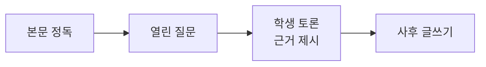
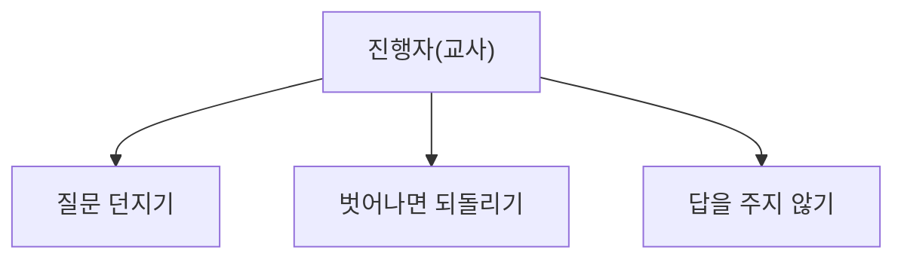

# 소크라테스 세미나

> 교사는 진행만 하고, **학생들이 같은 글(텍스트)을 놓고 열린 질문으로 서로 토론**하는 수업 형식. 정답을 전달하는 것이 아니라 근거를 들어 해석을 겨루는 연습이다.

## 쉽게 말하면
독서 모임과 비슷하다. 같은 책을 미리 읽고 둥글게 앉아 "작가가 왜 이렇게 썼을까?" 같은 질문으로 서로의 생각을 캐묻는다. 사회자는 답을 알려 주지 않고 흐름만 잡는다.

## 자세히
(검색 요약 기준. 단일한 공식 단계 목록은 없고 기관마다 다르다.)
- **Paideia Seminar**(National Paideia Center): "텍스트에 대한 열린 질문으로 진행되는 협력적 지적 대화". 현대 형식은 Mortimer Adler의 1982년 Paideia Proposal에서 비롯됐다고 보는 설명이 많다.
- 주기: 텍스트를 여러 번 꼼꼼히 읽기 → 세미나에서 말하기·듣기 → 세미나 후 글쓰기.
- 질문: 한 교사 가이드는 Paideia 모델(Strong, 1997)의 3단계 질문을 소개하며 첫 단계는 주제를 건드리는 큰 질문. 좋은 질문은 **논쟁 가능하고, 여러 방어 가능한 해석을 허용하며, 본문 근거를 요구**한다(Bill of Rights Institute).
- 교사 역할: 가르치는 사람이 아니라 진행자. 교정·인정·답 제공을 참고, 열린 질문으로 시작하고 주제에서 벗어나면 되돌리는 질문을 한다.
- 형식: 전원 참여 원탁, 인원이 많으면 **금붕어 어항(fishbowl)** — 절반은 가운데서 토론, 절반은 관찰.
- 준비: 본문 선택, 규칙(손 안 들기, 존중하는 반대) 정하기, 말문 틔우는 문장 틀 제공, 마무리 성찰. 침묵도 괜찮다. 첫 회는 30분 이내, 익숙해지면 45~50분.
- AI와의 연결: AI에게 진행자나 반대 의견 참가자 역할을 시킬 수 있지만, 이 글의 출처는 AI 활용을 다루지 않는다(내 추정).

## 그림으로 보기

## 예시
- 생성형 AI 윤리 글 한 편을 읽고 "AI가 쓴 보고서의 책임은 누구에게?"라는 질문으로 25분 토론.
- 교육: 사내 AI 가이드라인 문서를 놓고 팀별 세미나.

## 헷갈리는 것과 비교
| 개념 | 차이 |
|---|---|
| 소크라테스 세미나 | 학생 중심 텍스트 토론 |
| 강의 | 교사가 지식 전달 |
| [AI를 학생으로 두고 가르치기](#explain-to-ai-student) | AI에게 설명해 빈틈 찾기 |

## 더 읽을거리
- [Paideia Seminar (National Paideia Center)](https://www.paideia.org/our-approach/paideia-seminar) — 정의(검색 결과 확인).
- [Facing History: Socratic Seminar](https://www.facinghistory.org/resource-library/socratic-seminar) — 단계(검색 요약).
- [Bill of Rights Institute: Socratic Seminar](https://billofrightsinstitute.org/teaching-strategies/socratic-seminar/) — 좋은 질문 기준.
