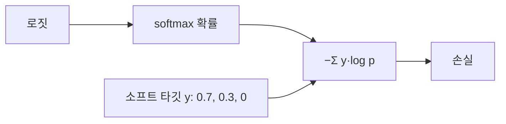
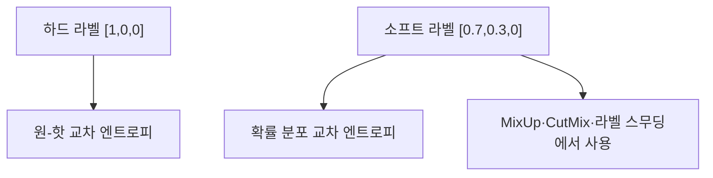

# 소프트 라벨 손실

> 정답을 "고양이=1, 나머지=0" 같은 원-핫이 아니라 **"고양이 0.7, 강아지 0.3" 같은 확률 분포**로 주고 계산하는 교차 엔트로피 손실이다. MixUp·CutMix처럼 라벨이 섞이는 학습과 라벨 스무딩에 쓴다.

## 쉽게 말하면
시험 채점에서 정답이 하나가 아니라 "A 70%, B 30% 정도 맞다"고 적혀 있는 문제다. 모델은 확률을 정답 비율에 맞추도록 배운다.

## 자세히
- 식(PyTorch `CrossEntropyLoss` 문서, 클래스 확률 타깃 경우): 샘플 하나의 손실 = −Σ_c w_c · log softmax(x)_c · y_c. y가 원-핫이면 보통의 교차 엔트로피가 된다.
- PyTorch 조건(문서 확인): 타깃은 **float**, 입력과 같은 shape, 각 값은 [0,1]이며 합이 1이어야 하는데 **PyTorch는 이 조건을 검사하거나 경고하지 않는다**. 잘못된 분포는 오해를 부르는 손실과 불안정한 기울기를 만든다. 문서는 클래스 인덱스 타깃이 일반적으로 더 낫다고도 적는다.
- 쓰임: 문서는 "혼합 라벨, 라벨 스무딩 등"에 쓴다고 설명한다. `label_smoothing`(0~1, 기본 0)은 타깃을 원래 정답과 균등분포의 혼합으로 만든다(Inception 논문 인용).
- 직접 계산(로짓 [2.0, 0.5, −1.0] → softmax [0.786, 0.175, 0.039]): 원-핫(클래스1) 손실 0.241. 타깃 [0.7, 0.3, 0] 손실 0.691, [0.5, 0.5, 0] 손실 0.991. 이 값은 두 원-핫 손실의 가중합(0.7×0.241+0.3×손실(클래스2))과 정확히 같다 — 그래서 MixUp은 "두 라벨의 손실을 λ로 섞은 것"과 같다.
- 결과적으로 모델은 확신을 100%로 밀어붙이지 않고 타깃 확률에 맞추게 된다. 타깃이 [0.5,0.5,0]이면 최소 손실은 0이 아니라 타깃의 엔트로피(약 0.693)이므로 손실값이 0에 가까워지지 않는 것이 정상이다.

## 그림으로 보기



## 예시
```python
loss = torch.nn.CrossEntropyLoss()(logits, soft_targets)  # soft_targets: float, 합 1
```
- MixUp 배치: `y = lam*y_onehot_a + (1-lam)*y_onehot_b`를 그대로 타깃으로 넘긴다.
- 교육: "정답이 한 개가 아닐 수도 있다"는 개념을 채점표로 설명.

## 헷갈리는 것과 비교
| 개념 | 차이 |
|---|---|
| 하드 라벨 | 정답 하나(원-핫) |
| 소프트 라벨 | 확률 분포 타깃 |
| [라벨 스무딩](#label-smoothing) | 원-핫을 균등분포와 섞는 특수한 소프트 라벨 |
| [MixUp·CutMix](#mixup-cutmix) | 이미지와 함께 라벨도 섞어 소프트 라벨을 만든다 |

## 더 읽을거리
- [PyTorch CrossEntropyLoss 문서](https://docs.pytorch.org/docs/2.15/generated/torch.nn.CrossEntropyLoss.html) — 확률 타깃 식과 제약(열어 확인).
