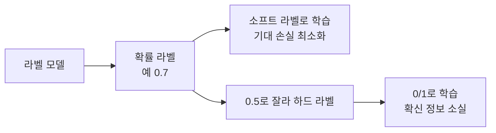
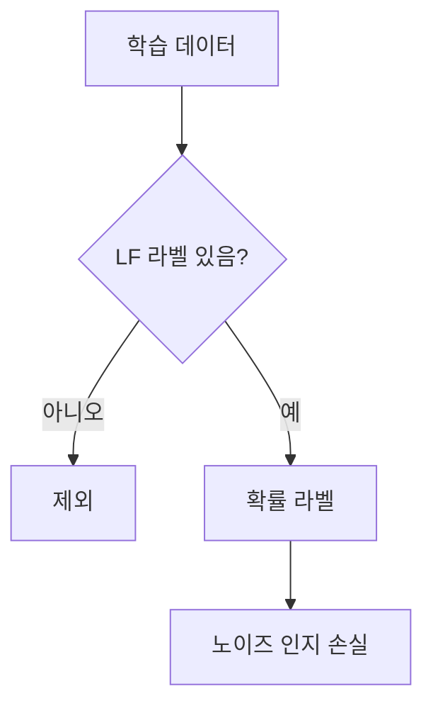

# 확률 라벨을 소프트 라벨로

> 라벨 모델이 내놓은 "이 데이터가 클래스 1일 확률 0.7" 같은 확률 값을 **0/1로 자르지 않고 그대로 학습 목표로 쓰는 것**이다. 확신이 낮은 데이터는 덜 반영되고, 확신이 높은 데이터는 더 반영된다.

## 쉽게 말하면
채점자가 "이 답안은 70% 확률로 맞음"이라고 적었을 때, 이를 무조건 "맞음"으로 확정하면 30%의 의심이 사라진다. 소프트 라벨은 "70% 정도 맞다"는 정도를 그대로 두고 배우게 하는 방식이라, 애매한 예제에 휘둘리지 않는다.

## 자세히
(Snorkel 논문 arXiv 1711.10160의 해당 절과 결과를 직접 확인하고, 학습 비교는 직접 시뮬레이션.)
- **논문의 방식**: 라벨 모델의 출력은 확률 라벨 Ỹ(각 ỹ는 0~1)이고, 판별 모델은 이 라벨에 대한 **기대 손실을 최소화하는 "노이즈 인지(noise-aware)" 손실**로 학습한다. 표준 손실을 가진 모델이면 어떤 것이든 쓸 수 있다고 논문이 적는다. 즉 하드 라벨로 바꾸지 않아도 된다.
- **논문 결과 일부**: 생성 모델 단계를 건너뛰고 LF 출력의 **가중 없는 평균**으로 학습한 파이프라인과 비교했을 때, Snorkel의 확률 라벨로 학습한 판별 모델이 일관되게 낫고 **평균 5.81%** 개선(Table 5). 이것은 "생성 모델로 합친 확률 라벨 대 단순 평균" 비교이고, "소프트 대 하드 라벨"만의 비교는 아니다.
- **튜토리얼의 쓰임**: 스팸 튜토리얼은 `predict_proba`로 얻은 확률을 소프트 라벨로 쓰고, `probs_to_preds`로 하드 라벨로 바꿔 scikit-learn에 넘긴다. 확률이 0.5 근처인 점이 가장 불확실하다고 설명하며, 어떤 LF도 라벨을 못 붙인 데이터는 먼저 걸러 낸다.
- **직접 시뮬레이션(2026-11-22)**: 5차원 로지스틱 문제, 학습 400건, 약한 라벨은 확신도가 높을수록 정확하게 만든 확률(하드로 자르면 정답과 72.8% 일치). 로지스틱 회귀를 직접 구현해 하드 라벨, 소프트 라벨, 정답 라벨로 학습해 새 20,000건으로 평가.
  | 학습 라벨 | 테스트 정확도(1회) |
  |---|---|
  | 하드 라벨(0.5로 자름) | 0.842 |
  | 소프트 라벨 | 0.858 |
  | 정답 라벨 | 0.917 |
  시드 20개 반복: 하드 평균 0.872, 소프트 평균 0.885, **소프트가 17/20회 우세**. 차이는 약 1.3%p로 작고, 확률이 잘 보정되어(확신도와 정확도가 비례) 있다는 가정이 들어간 장난감 설정이다.
- **주의(제안)**: ① 라벨 모델의 확률이 과신이면 소프트 라벨의 이점이 줄어든다 — 개발 세트로 보정을 확인([합친 라벨 검증](#label-model-validation)) ② 소프트 라벨을 받는 학습 코드가 필요하다(PyTorch 교차 엔트로피는 확률 타깃 허용, 일부 라이브러리는 정수 라벨만 받음) ③ 하드 라벨이 꼭 필요하면 임계값을 0.5 대신 확신 높은 것만 남기는 방식도 가능.

## 그림으로 보기

## 예시
- 약한 지도로 만든 문의 분류 라벨 중 확률 0.55짜리가 많다면, 하드로 자르면 절반은 틀린 라벨을 단호히 학습한다. 소프트로 쓰면 영향이 작다.
- 교육 소재: "AI도 확신도 정보를 버리지 않고 배울 수 있다"를 위 표로 설명.

## 헷갈리는 것과 비교
| 개념 | 차이 |
|---|---|
| 소프트 라벨(약한 지도) | 라벨 모델 확률을 학습 목표로 |
| 라벨 스무딩 | 정답 라벨을 일부러 흐리는 정규화 기법(출처 약한 지도와 별개) |
| [라벨 모델](#label-model-denoising) | 확률 라벨을 만드는 쪽 |
| [노이즈 인지 손실](#noise-aware-loss) | 확률 라벨에 쓰는 손실 함수 |
| [합친 라벨 검증](#label-model-validation) | 확률이 믿을 만한지 사람 라벨로 확인 |

## 더 읽을거리
- [Snorkel: Rapid Training Data Creation with Weak Supervision (arXiv 1711.10160)](https://arxiv.org/abs/1711.10160) — 노이즈 인지 손실과 확률 라벨 결과(PDF 직접 확인).
- [Snorkel 스팸 튜토리얼 소스](https://github.com/snorkel-team/snorkel-tutorials/blob/master/spam/01_spam_tutorial.py) — `predict_proba`, `probs_to_preds` 사용(직접 확인).
