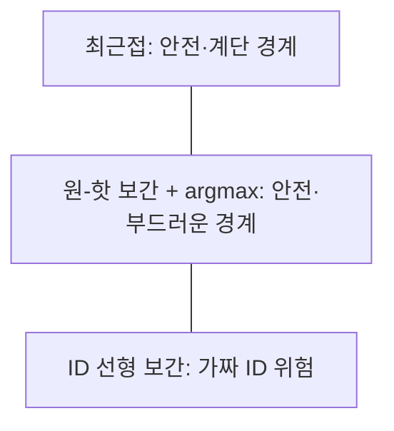

# 확률 마스크 보간 후 argmax

> 클래스 ID 마스크를 **클래스별 0/1 마스크(원-핫)로 쪼개 부드럽게 보간한 뒤, 픽셀마다 가장 큰 값의 클래스를 고르는(argmax)** 방식이다. 클래스 ID를 직접 섞는 오류 없이 경계를 부드럽게 다룬다.

## 쉽게 말하면
국경선을 확대·회전할 때, 나라 번호를 평균내는 대신 "이 칸이 A국일 확률 0.6, B국일 확률 0.4"처럼 나라별 확률 지도를 따로 만든다. 마지막에 확률이 더 높은 나라를 그 칸의 주인으로 정한다.

## 자세히
- 문제: 정수 클래스 ID에 선형 보간을 쓰면 2·3·4처럼 존재하지 않는 ID가 생긴다([이미지·마스크 보간 분리](#image-vs-mask-interpolation)). 최근접 보간은 안전하지만 경계가 계단처럼 거칠다.
- 방법: ① 마스크를 클래스 수 C개의 채널(원-핫, float)로 분해 ② 이미지처럼 선형 보간으로 변환 ③ 채널 방향 `argmax`로 다시 ID 마스크로 변환. 보간된 채널의 합은 1로 유지되어 확률 해석이 가능하다(실험에서 합 최소·최대 모두 1.0).
- 직접 실험(OpenCV, 128×128 마스크 클래스 ID 0·1·5·9, 회전 30° + 0.5배 축소):
  - 선형 보간(ID 그대로): 고유값 0~9 10개(가짜 ID 포함).
  - 최근접: `[0,1,5,9]`.
  - 원-핫 선형 보간 + argmax: `[0,1,5,9]` — **가짜 ID 없음**. 최근접과 다른 픽셀은 16,384개 중 48개(약 0.3%)로, 경계 근처에서만 달랐다.
  - 단순 2.5배 확대에서는 최근접과 argmax 결과가 100% 동일했다.
- 해석: 이 단순 합성 마스크에서는 이득이 아주 작았다. 얇은 구조물, 작은 물체, 큰 폭의 축소처럼 경계 픽셀 비중이 큰 경우에 차이가 커질 수 있다(추정 — 이 실험에서 직접 확인하지는 않음).
- 비용: 채널 C개를 변환하므로 클래스가 많으면 메모리·시간이 C배다. 최근접이 충분하면 굳이 쓰지 않는다(제안).
- 변형: 학습에서 소프트 라벨(확률 그대로)을 손실에 쓸 수도 있다. 그 경우 argmax 단계를 생략한다.

## 그림으로 보기



## 예시
```python
oh = np.stack([(mask==c).astype(np.float32) for c in ids], -1)
soft = np.stack([cv2.warpAffine(oh[...,k], M, size, flags=cv2.INTER_LINEAR) for k in range(len(ids))], -1)
out = np.array(ids)[soft.argmax(-1)].astype(np.uint8)
```
- 교육: "범주형 값은 평균내지 말고 확률로 바꿔서 다뤄라"는 일반 원칙 사례.

## 헷갈리는 것과 비교
| 개념 | 차이 |
|---|---|
| 최근접 보간 | 가장 가까운 픽셀의 ID 복사, 계단형 |
| 원-핫 보간+argmax | 확률 보간 후 ID 복원, 비용 C배 |
| [소프트 라벨 마스크](#soft-label-masks) | argmax 없이 확률 그대로 학습 |

## 더 읽을거리
- [OpenCV warpAffine 문서](https://docs.opencv.org/4.x/da/d54/group__imgproc__transform.html) — 보간 플래그 설명.
- 직접 실행: OpenCV로 세 방식 비교.
