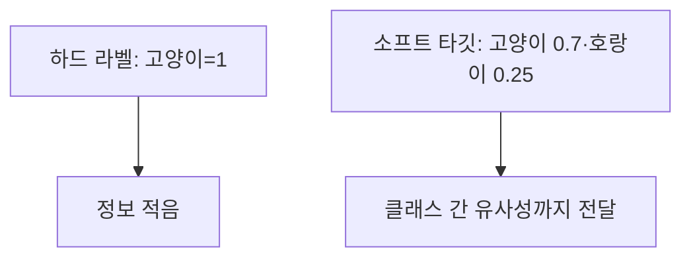

# 소프트 타깃

> 정답 라벨(원-핫) 대신 **교사 모델이 낸 확률 분포**를 학생 모델의 학습 신호로 쓰는 것. 지식 증류의 핵심 아이디어다.

## 쉽게 말하면
시험 해설에서 "정답은 3번"만 알려 주는 것(하드 라벨)과 "3번이 가장 유력하고 2번도 꽤 비슷해 보이는 이유가 있다"까지 알려 주는 것(소프트 타깃)의 차이다. 후자가 더 많은 정보를 준다.

## 자세히
- 출발 논문: Hinton·Vinyals·Dean, *Distilling the Knowledge in a Neural Network*(arXiv 1503.02531, 2015, 초록 읽음). 여러 모델의 예측을 평균하는 앙상블은 성능이 좋지만 배포 비용이 크므로, 앙상블의 지식을 **배포하기 훨씬 쉬운 단일 모델로 압축**한다.
- 초록에서 확인한 결과: 널리 쓰이는 상용 시스템의 **음향 모델을 크게 개선**했고, MNIST에서 "놀라운 결과"를 보고했다. 또 전체 모델 앙상블과, 전체 모델이 혼동하는 세부 클래스를 맡는 **전문가(specialist) 모델**을 제안했다.
- **주의**: 이 초록에는 소프트 타깃이나 온도(temperature)라는 말이 나오지 않았다. 교사의 확률 분포를 학습 신호로 쓰고 온도로 분포를 부드럽게 한다는 설명은 이 논문의 본문에서 널리 알려진 내용이지만, 이번에는 본문을 열람하지 않아 일반 지식으로 적는다.
- 활용(일반): 큰 모델의 출력 분포를 작은 모델이 모방하게 해 작은 모델의 성능을 끌어올린다. LLM에서는 교사의 로짓 분포, 또는 교사가 생성한 텍스트([합성 데이터](#synthetic-data))를 학습 신호로 쓴다.
- 한계: 교사의 분포에 접근할 수 있어야 한다(API는 확률을 제한할 수 있음, 일반 설명). 교사의 오류도 함께 전달될 수 있다.

## 그림으로 보기

## 예시
- 큰 분류 모델의 확률 출력을 작은 모델이 따라 학습해 모바일에 배포.
- 교육: 같은 정답의 "확신 있음/없음"이 학습에 어떤 차이를 주는지 토의.

## 헷갈리는 것과 비교
| 개념 | 차이 |
|---|---|
| 소프트 타깃 | 확률 분포를 신호로 |
| 하드 라벨 | 정답 하나 |
| [합성 데이터](#synthetic-data) | 교사가 만든 텍스트를 데이터로 |

## 더 읽을거리
- [Distilling the Knowledge in a Neural Network](https://arxiv.org/abs/1503.02531) — 증류 원 논문(초록 읽음).
