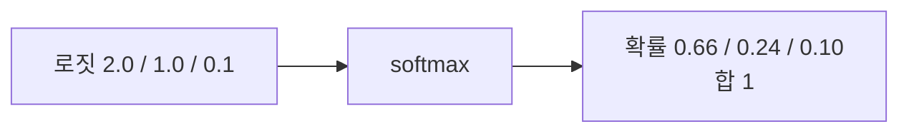
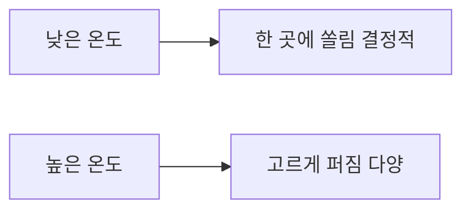

# 소프트맥스

> 임의의 실수 점수들을 "모두 양수이고 합이 1"인 확률로 바꾸는 함수. 분류 모델과 LLM의 마지막 단계에서 쓴다.

## 쉽게 말하면
오디션 점수(30, 20, 5점)를 "우승 확률(예: 99%, 1%, 0%)"로 바꾸는 환산표다. 점수 차가 크면 1등에게 확률이 확 쏠리고, 비슷하면 고르게 나뉜다.

## 자세히
- 식: `softmax(z)_i = e^(z_i) / Σ_j e^(z_j)`. 지수함수로 모두 양수로 만들고 합으로 나눠 1을 맞춘다.
- **온도(temperature) T**: 점수를 T로 나눈 뒤 적용한다(β=1/T). T가 높으면 확률이 고르게 퍼지고(다양한 출력), 낮으면 1등에 쏠린다(결정적 출력). 예: 입력 (0,10)에서 T=1이면 약 (0.00005, 0.99995), T=100이면 약 (0.475, 0.525)(Wikipedia). LLM의 temperature 설정이 바로 이것이다.
- **수치 안정화**: 큰 값의 지수는 넘칠 수 있어, 모든 점수에서 최댓값을 빼고 계산한다. 결과는 같다(상수를 더해도 불변).
- **argmax와의 관계**: argmax는 1등만 1로 만드는 뭉툭한 함수이고, softmax는 미분 가능한 부드러운 근사다. 그래서 학습에 쓸 수 있다. 입력이 되는 날 점수를 로짓(logit)이라 부른다.
- 어텐션 가중치 계산에도 쓴다.

## 그림으로 보기

## 예시
- 고양이/개/새 분류기가 로짓 (2.0, 1.0, 0.1)을 내면 softmax로 약 (66%, 24%, 10%).
- LLM 다음 토큰: 어휘 전체 로짓에 softmax → 확률로 샘플링. temperature 0.2는 안정적, 1.0은 창의적.

## 헷갈리는 것과 비교
| 개념 | 차이 |
|---|---|
| softmax | 여러 클래스, 합이 1 |
| sigmoid | 클래스 하나의 0~1 확률 |
| argmax | 1등만 고름, 미분 불가 |
| [교차 엔트로피](#cross-entropy) | softmax 출력과 정답을 비교하는 손실 |

## 더 읽을거리
- [Softmax function — Wikipedia](https://en.wikipedia.org/wiki/Softmax_function) — 정의·온도·안정화.
