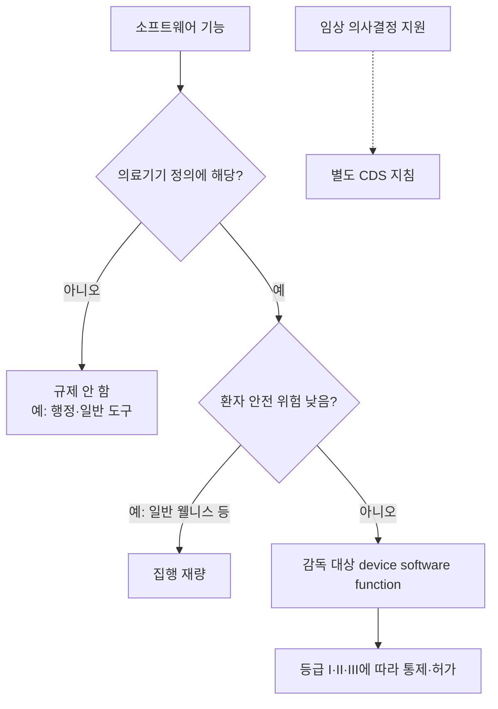

# 소프트웨어 기능 정책

> FDA 지침 "Policy for Device Software Functions and Mobile Medical Applications". 소프트웨어 중 어떤 기능을 의료기기로 보고 감독하며, 위험이 낮아 집행 재량을 두는 범위는 어디까지인지를 플랫폼(스마트폰·PC·기기 내장)에 상관없이 **기능 단위**로 정리한 정책이다.

## 쉽게 말하면
"의료 앱"이라는 이름이나 스마트폰이라는 플랫폼이 아니라, 소프트웨어가 **하는 일**이 의료기기 기능인지가 기준이다. 걸음 수 세기는 건강 앱이고, 혈당 측정기를 제어하거나 센서로 부정맥을 진단하는 기능은 기기다.

## 자세히
출처: FDA 지침 PDF(2022-09-28 발행, 최초 2013-09-25, 5쪽 공개본의 앞부분과 V절 일부를 내려받아 읽음). 문서 머리글에는 2026-02-02 발효된 QMSR(21 CFR 820이 ISO 13485:2016을 인용)이 이후 개정됐다는 안내가 붙어 있다. 비구속 권고.
- **핵심 방침**: FDA는 **의료기기에 해당하고, 의도대로 작동하지 않을 때 환자 안전에 위험이 될 수 있는** 소프트웨어 기능에만 감독을 적용한다. 많은 소프트웨어는 기기가 아니고(FD&C Act 201(h)), 일부는 기기이지만 위험이 낮아 FDA가 "지금은 요건을 집행하지 않을 의도(집행 재량)"를 밝힌다.
- **용어**: 기기인 소프트웨어 기능을 "device software function"이라 부르며 SaMD와 SiMD를 모두 포함한다. 모바일 플랫폼에서 돌면 "mobile medical app"이라 한다. 정책은 플랫폼과 무관하고 기능 단위로 적용된다.
- **범위(IV절)**: mobile medical app은 기기이면서 ① 규제 대상 의료기기의 **부속품**으로 쓰이거나 ② 모바일 플랫폼을 규제 대상 의료기기로 **전환**하는 앱이다. 부록 A에 기기가 아닌 예, 부록 B에 집행 재량 예, 부록 C에 감독 대상 예가 있다.
- **감독 대상 예(V.A)**: 하나 이상의 의료기기에 연결해 제어하거나 그 데이터를 분석하는 소프트웨어 기능 등. 연결은 유선·무선 모두 해당. 
- **집행 재량 쪽(예, 부록 항목 6)**: 건강한 식단·운동·체중 감량 장려, 식단 일지·칼로리 계산, 일반 일상 활동 기록, 정상 아기의 수면·수유 기록 등 일반 건강·웰니스 목적 기능.
- **제조사**: 면허 의료인이 자기 진료에만 쓰려고 만든 앱은 제조사로 보지 않는 등 예외가 있다.
- **품질 시스템**: 기기일 수 있는 모든 소프트웨어 기능의 제조사에게 품질 시스템 규정을 따르라고 강하게 권고한다.
- **AI와의 관계**: 환자별 분석으로 임상 의사결정을 돕는 소프트웨어는 이 지침이 아닌 별도 CDS 지침이 다룬다고 IV절이 안내한다([CDS 예외 4조건](#cds-exemption)). 나머지 부록의 전체 목록은 이번에 다 읽지 않았다.

## 그림으로 보기

## 예시
- 칼로리 계산기·식단 앱: 일반 웰니스로 집행 재량 쪽.
- 인슐린 펌프를 무선으로 제어하는 앱: 기기 연결 제어이므로 감독 대상.
- 점검: 제품 설명이 웰니스 참고인지 진단·치료인지 문구를 확인([용도 기반 분류](#intended-use-classification)).

## 헷갈리는 것과 비교
| 개념 | 차이 |
|---|---|
| 소프트웨어 기능 정책 | 어떤 소프트웨어를 감독할지의 큰 틀(기능 단위) |
| [CDS 예외 4조건](#cds-exemption) | 임상 의사결정 지원만 다루는 별도 지침 |
| [SaMD](#samd) | 하드웨어 없이 의료 목적을 수행하는 소프트웨어 |
| [집행 재량](#enforcement-discretion) | 요건을 집행하지 않겠다는 FDA 입장 |

## 더 읽을거리
- [Policy for Device Software Functions and Mobile Medical Applications (FDA, 2022-09-28)](https://www.fda.gov/media/80958/download) — 정책 본문(앞부분 내려받아 확인)
