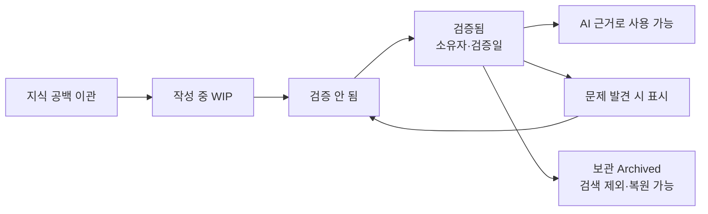

# 출처 문서 소유자 (Source Article Ownership)

> AI 상담 답변이 근거로 삼는 **모든 지식 문서에 승인 상태·갱신일·담당자(소유자)를 붙이고**, AI가 그 상태가 확인된 문서만 근거로 쓰게 하는 운영 원칙. 문서가 틀리면 AI는 틀린 답을 자신 있게 반복하므로, 문서의 생애주기를 사람이 관리해야 한다.

## 쉽게 말하면
식당 레시피 책이 오래되어 재료가 바뀌었는데 로봇 요리사가 그대로 따라 한다면 사고가 난다. 레시피마다 "누가 책임지는지, 언제 확인했는지"가 적혀 있어야 틀렸을 때 고칠 곳이 보인다.

## 자세히
출처: KCS(Knowledge-Centered Service) v6 실무 가이드의 "Technique 5.2: Article State"(본문 확인, 2026-11-18)와 ServiceNow의 KCS 상태 매핑 검색 요약. AI 상담에의 적용(근거 문서 필터링 등)은 제안이다.
- **KCS 문서 상태(신뢰 수준)**: ①**작업 중(WIP)** 해결책이 아직 없는 초안, 임시. ②**검증 안 됨(Not Validated)** 해결책은 있으나 구조·내용에 대한 확신이 낮음. ③**검증됨(Validated)** 완성되고 재사용 가능하며 작성자가 확신 있음(해결 확인·문제 재현·경험 기반, 콘텐츠 표준 준수). ④**보관(Archived)** 검색에서 제외하되 삭제하지 않음, 어떤 상태로든 복원 가능.
- **역할(문서)**: 후보(Candidate)는 검증 안 됨 상태 문서만 만들고 고칠 수 있으며 코치가 검토한다. 기여자·발행자·KDE·코치는 검증할 수 있고, 검증됨 문서를 **수정할 수 있는 것은 발행자뿐**이다. 문제를 발견한 사람은 표시하고 검증 안 됨으로 돌려 발행자가 검토하게 하거나 권한이 있으면 직접 고친다. 활성 위험이 있으면 즉시 코치·KDE에게 올린다.
- **검토 원칙**: 수요(재사용)에 따라 검토한다. 모든 검증 안 됨 문서를 검토하면 비용만 크다는 서술. 문서가 상태를 따라 흘러가는 정도가 건강 지표.
- **노출 규칙 예**: 파트너·고객에게는 검증됨 문서만 보이게 하는 비즈니스 규칙을 예로 든다. 성숙한 조직은 새 문서 대부분이 검증됨이고 대상이 외부로 시작된다.
- **ServiceNow 매핑(검색 요약)**: 초안·검토·예약은 WIP, 발행은 역할에 따라 검증됨 또는 검증 안 됨, 폐기는 보관.
- **AI 상담에의 적용(제안)**: ①AI가 근거로 쓰는 문서는 검증됨 상태만(또는 위험 등급별로 허용 상태 지정) ②문서마다 소유자·마지막 검증일·다음 검토일 ③답변 로그에 근거 문서 ID·버전 기록(오류 시 추적) ④소유자 없는 문서는 검색 색인에서 제외 ⑤정책·가격 같은 변경 빈도가 높은 문서는 짧은 검토 주기 ⑥[지식 공백 이관](#knowledge-gap-escalation)이 쌓이면 소유자에게 작성·수정 과제 배정.
- **한계**: KCS는 소유자 한 명을 지정하라고 규정하지 않고 역할 기반 권한을 쓴다(문서에서 확인한 범위). 소유자 지정은 조직의 선택이다.

## 그림으로 보기

## 예시
| 문서 | 상태 | 소유자 | 마지막 검증 | AI 사용 |
|---|---|---|---|---|
| 환불 규정 | 검증됨 | 정책팀 | 2026-10-20 | 허용 |
| 신규 프로모션 FAQ | 검증 안 됨 | 마케팅 | - | 제외 |
| 구버전 앱 가이드 | 보관 | - | - | 제외 |
교육 활용: 자사 FAQ 문서 20개에 상태·소유자·검증일 열을 직접 채워 보고 빈칸이 많은 영역을 찾는 실습.

## 헷갈리는 것과 비교
| 개념 | 차이 |
|---|---|
| 출처 문서 소유자 | 문서별 담당과 상태 관리 |
| [지식 공백 이관](#knowledge-gap-escalation) | 문서가 없어서 넘어간 건 |
| KCS | 문서를 업무 흐름에서 만들고 개선하는 방법론 |
| [읽기 전용 vs 행동 문의](#read-only-vs-action-intents) | 문의 위험 등급에 따른 자율성 |

## 더 읽을거리
- [KCS v6 Technique 5.2: Article State](https://library.serviceinnovation.org/KCS/KCS_v6/KCS_v6_Practices_Guide/030/040/010/030) — 상태·역할·노출·검토 원칙
- [ServiceNow: Managing KCS article states](https://www.servicenow.com/docs/r/zS6yb8e~gR8BPjeviYdV9g/nIe4nbEYDVFkzzVW3PjlUw) — 워크플로 상태와 신뢰 값 매핑(검색 결과 요약만 확인)
