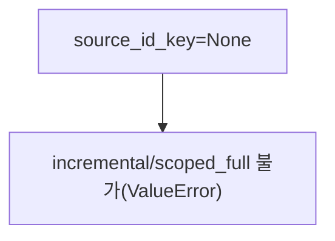

# 소스 ID 키

> LangChain 인덱싱 API에서 청크가 어느 원본 문서에서 나왔는지 식별하는 메타데이터 키다. `incremental`·`scoped_full` 정리 모드에서는 필수이며, 원본이 바뀌면 같은 소스의 옛 청크를 찾아 지우는 데 쓴다.

## 쉽게 말하면
책을 챕터 조각(청크)으로 나눠 보관할 때, 각 조각에 "이 책의 조각"이라는 꼬리표를 붙여 두어야 개정판이 나왔을 때 옛 조각을 한꺼번에 찾아 바꿀 수 있다.

## 자세히
(LangChain `indexing/api.py` 소스를 직접 읽고 확인.)
- **지정 방법**: `source_id_key`는 `None`, 문자열(메타데이터 키 이름), 또는 문서를 받아 문자열을 돌려주는 함수여야 한다. 문자열이면 `doc.metadata[source_id_key]`를 소스 ID로 쓴다. 그 외 타입이면 `ValueError`.
- **필수 조건**: cleanup이 `incremental` 또는 `scoped_full`이면 `source_id_key`가 필요하다("Source id key is required when cleanup mode is incremental or scoped_full"). 색인 중 어떤 문서의 소스 ID가 None이면 "Source IDs are required ..." 오류.
- **역할**: 소스 ID가 있으면 삭제를 **증분(incremental)** 으로 처리할 수 있다. `scoped_full`은 본 소스 ID를 집합으로 모아 그 범위 안에서만 삭제한다.
- **설계 주의(제안)**: 소스 ID는 청크가 아닌 **원본 문서 단위**(파일 경로·URL·DB 키)로, 이름 변경에도 안정적으로 정한다. 같은 원본의 청크가 여러 배치에 나뉘면 비효율적이다.

## 그림으로 보기



## 예시
```python
index(docs, record_manager, vector_store, cleanup="incremental", source_id_key="source")
```
- 교육 활용: 원본-청크 관계를 꼬리표로 관리하는 개념을 종이 카드로 설명.

## 헷갈리는 것과 비교
| 개념 | 차이 |
|---|---|
| 소스 ID | 원본 문서 식별(여러 청크가 공유) |
| 청크 해시 | 청크 내용 지문(내용이 바뀌면 달라짐) |
| [색인 정리 모드](#index-cleanup-modes) | 소스 ID를 쓰는 삭제 정책 |

## 더 읽을거리
- [LangChain indexing api.py (GitHub)](https://github.com/langchain-ai/langchain/blob/master/libs/core/langchain_core/indexing/api.py) — source_id_key 검증 코드.
