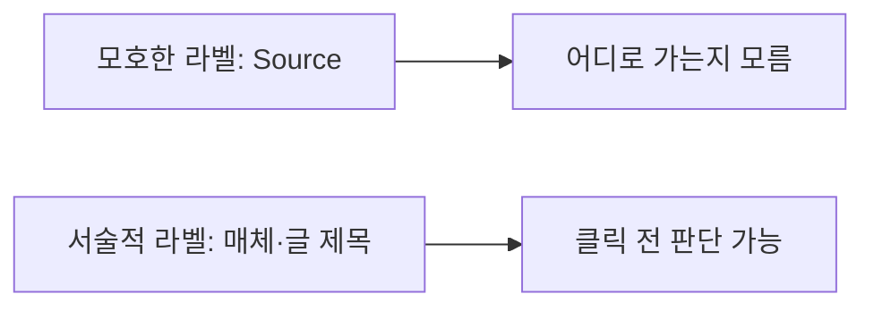

# 출처 라벨 설계

> 인용 링크의 **이름표를 "출처"처럼 모호하게 쓰지 않고, 출판물이나 글 제목처럼 서술적으로** 써서 사용자가 어디로 가는지 알게 하는 설계다.

## 쉽게 말하면
도로 표지판에 "다음 출구"만 쓰면 어디인지 모르지만 "서울역 3km"라고 쓰면 가야 할지 판단할 수 있다.

## 자세히
(NN/g "explainable AI" 글을 직접 읽었다.)
- **문제(NN/g)**: "Source" 같은 **모호한 라벨**은 링크가 어디로 이어지는지 가린다.
- **권고(NN/g)**: **출판물 이름·글 제목** 같은 서술적 라벨. 인용을 본문과 시각적으로 구별하고, 지지하는 주장 옆에 두며, 가능하면 관련 구절로 링크.
- **함께 쓰는 설계(해석)**: [호버 카드](#hover-card-citation)에 라벨과 해당 문단 미리보기를 함께 넣으면 확인 비용이 더 낮아진다. 라벨이 서술적이어도 [가짜 인용](#fabricated-citation) 자체는 막지 못한다.

## 그림으로 보기

## 예시
- "[1]" 대신 "[국세청 — 근로소득 원천징수 안내(2025)]"로 표시(제안).

## 헷갈리는 것과 비교
| 개념 | 차이 |
|---|---|
| 모호한 라벨 | 출처 내용이 안 보임 |
| 서술적 라벨 | 제목·매체가 보임 |
| [인용 밀도](#citation-density) | 인용 개수와 UI 효과 |

## 더 읽을거리
- [NN/g — Explainable AI](https://nngroup.com/articles/explainable-ai/) — 직접 읽음.
