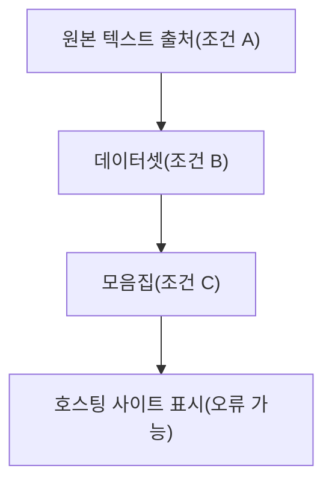
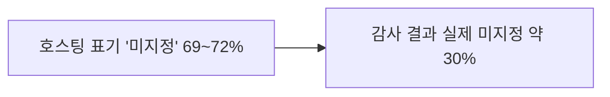

# 출처 단위 제한

> 데이터셋의 라이선스는 데이터셋 한 줄이 아니라 출처(원본 텍스트)·데이터셋·모음집 층을 따라 이어지며, 호스팅 사이트가 표시한 라이선스와 실제가 어긋나는 일이 많다. 출처 단위 조건까지 추적해야 한다.

## 쉽게 말하면
식당 메뉴에 "무료 시식"이라 적혀 있어도 재료 납품 계약서에 "시식 금지"가 있을 수 있다. 메뉴판(호스팅 사이트)이 아니라 재료 출처(원본)까지 확인해야 한다.

## 자세히
(Longpre 외 "The Data Provenance Initiative" arXiv 2310.16787 v3 전문을 하위 에이전트가 읽은 노트 기준.)
- **감사 규모**: 지시·정렬 미세조정 **44개 모음집, 1,858개 데이터셋**(초록 "1,800+").
- **계보 추적**: 출처(Text Source)·데이터셋·모음집 수준의 라이선스 계보를 따로 기록.
- **호스팅 사이트의 오류(표 2)**: "미지정(Unspecified)"으로 표시된 비율이 GitHub 72%, Hugging Face 69%, Papers with Code 70%인데 감사 결과 실제로 미지정은 **30%** 정도. 사이트 표기가 **너무 관대한** 비율은 GitHub 29%, Hugging Face 27%, Papers with Code 16%. 원인: 기여자가 코드 라이선스를 데이터 라이선스로 착각. 초록은 "라이선스 누락 70%+, 오류율 50%+"를 보고했고, Hugging Face 라이선스의 **66%가 다른 이용 범주**(주로 더 관대)였다고 한다.
- **올바른 라이선스 분포(표 2)**: 상업 허용 856(46.1%), 미지정 570(30.7%), 비상업 352(19.0%), 학술 전용 80(4.3%).
- **함의(제안)**: 호스팅 사이트의 라이선스 필드를 그대로 믿지 말고 원 논문·원 출처의 조건까지 확인하며, 결과를 데이터 카드에 남긴다([데이터 카드에 라이선스 기록](#data-card-license-record)).

## 그림으로 보기

## 예시
- Hugging Face 데이터셋을 쓰기 전 원 논문의 라이선스 문구와 출처 데이터의 조건을 대조.
- 교육 활용: "라이선스 표기가 있으면 안전한가?"를 감사 수치로 토론.

## 헷갈리는 것과 비교
| 개념 | 차이 |
|---|---|
| 출처 단위 제한 | 원본 출처의 조건 |
| 데이터셋 라이선스 | 데이터셋 배포자의 조건 |
| [모음집 풀어보기](#collection-unpacking) | 모음집 안을 분해해 조건 확인 |

## 더 읽을거리
- [Data Provenance Initiative (arXiv 2310.16787)](https://arxiv.org/abs/2310.16787) — 감사 결과와 표 2.
