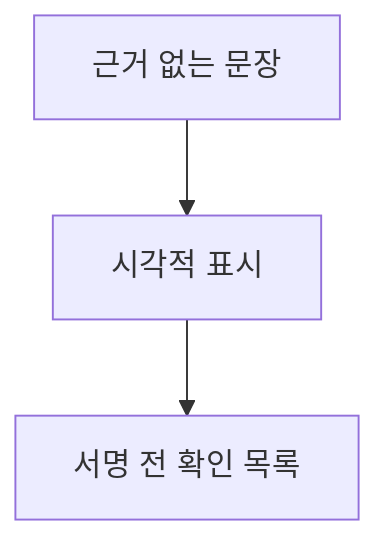

# 근거 연결형 노트

> AI가 쓴 진료 노트·요약의 문장마다 그 근거가 된 원본 대화·기록 구간으로 바로 이동하는 링크를 붙이는 설계. 의사가 문장을 확인하는 비용을 낮춰 형식적 서명을 줄이려는 목적이다.

## 쉽게 말하면
논문 각주에 "참고문헌 3번 45쪽"까지 적어 두면 독자가 바로 펼쳐 확인할 수 있는 것과 같다. 노트의 각 문장 옆에 "환자가 이렇게 말한 구간"이 붙어 있으면 확인이 쉬워진다.

## 자세히
출처는 NN/g의 설명 가능한 AI 글(열람), LLM 요약 평가 도구 PDSQI-9 논문(arXiv 2501.08977, 열람), 자동화 편향 고찰(PMC3240751, 열람)이다. 임상 노트에서 근거 연결의 효과를 직접 시험한 연구는 이번에 확인하지 못했고, 아래는 이들 자료를 모은 설계 해석이다.
- **인용 UI의 일반 권고(NN/g)**: 근거 인용을 해당 주장 바로 옆에 두고, 가능하면 근거 구절로 링크하여 확인 노력을 줄이며, 설명적 라벨을 쓰고, 사용자가 확인해야 한다고 알린다. 사람들은 인용 링크를 거의 누르지 않는다는 관찰도 있다([인용 UI 패턴](#citation-ui)).
- **PDSQI-9의 Cited 속성(arXiv 2501.08977)**: LLM 요약 평가에서 인용 여부를 하나의 속성으로 두었고 속성별 ICC가 0.947로 가장 높았다. 평가자들이 가장 일관되게 판단한 속성이라는 뜻이다. 이 도구는 Up-to-Date를 빼고 Cited와 Stigmatizing을 추가한 것이다.
- **자동화 편향과의 연결(PMC3240751)**: 조언을 덜 경계하며 확인하는 경향이 틀린 조언 시 오판을 약 26% 늘린다고 통합 추정했다. 완화책 중 하나가 조언의 정보 제공 방식과 갱신된 신뢰도 표시이므로, 근거 링크는 "확인하기 쉬운 형태의 정보"를 주는 수단으로 볼 수 있다(해석).
- **설계 요소(해석)**: ① 문장 단위가 아니라 주장 단위로 근거 구간 연결([주장 단위 출처 연결](#claim-level-attribution)), ② 연결된 근거가 없는 문장은 시각적으로 구분, ③ 클릭 한 번으로 원본 오디오·전사 구간 재생, ④ 서명 시 근거 없는 문장 목록 확인.
- **한계**: 근거 링크가 있어도 사람이 누르지 않을 수 있고, 링크 자체가 잘못된 구간을 가리키면 오히려 거짓 안심을 줄 수 있다. 링크 정확도를 점검해야 한다.

## 그림으로 보기

## 예시
- "환자는 penicillin 알레르기가 있다"는 문장 끝 [00:12:31] 링크를 누르면 해당 대화 구간이 재생된다(UI 예시).
- 교육 실습: AI 요약 한 문단의 문장마다 근거가 되는 원문 구절 번호를 달고, 근거 없는 문장을 표시해 본다.

## 헷갈리는 것과 비교
| 개념 | 차이 |
|---|---|
| 근거 연결형 노트 | 문장마다 원본 구간 링크 |
| [한 번 클릭 인증의 약점](#attestation-weakness) | 링크가 줄이려는 형식적 서명 |
| [주장 단위 출처 연결](#claim-level-attribution) | 일반 RAG의 같은 원리 |
| [인용 UI 패턴](#citation-ui) | 출처 표시 방식 비교 |

## 더 읽을거리
- [NN/g: Explainable AI](https://nngroup.com/articles/explainable-ai/) — 인용 표시 권고(열람)
- [PDSQI-9 (arXiv 2501.08977)](https://arxiv.org/html/2501.08977v2) — Cited 속성(열람)
- [Goddard 외: Automation bias (PMC3240751)](https://pmc.ncbi.nlm.nih.gov/articles/PMC3240751) — 자동화 편향(열람)
