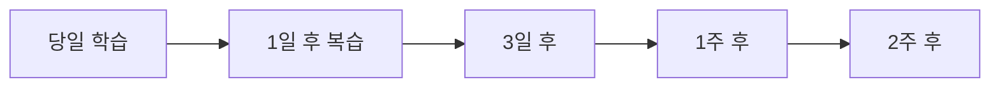
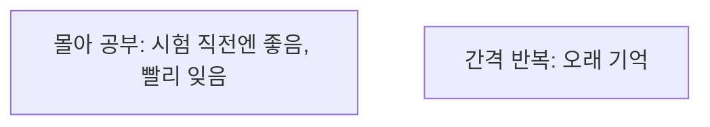

# 간격 반복

> **간격 반복(spaced repetition, 분산 학습)** 은 같은 내용을 한 번에 몰아 공부하는 대신 **간격을 두고 여러 번 복습**하는 방법이다. 학습 기법 연구에서 가장 높은 효용 등급을 받은 두 가지 중 하나다.

## 쉽게 말하면
화분에 물을 한 번에 왕창 주는 것보다 며칠에 한 번씩 주는 게 낫듯, 기억도 잊어버릴 즈음에 다시 꺼내 주면 뿌리가 깊어진다.

## 자세히
- **Dunlosky 외(2013)**: 10가지 학습 기법을 평가해 **연습 시험**과 **분산 연습**(distributed practice)이 가장 높은 효용 등급을 받았다. 두 방법의 이점은 다양한 종류의 시험에서 확인됐다고 한다. 반대로 많은 학생이 쓰는 **형광펜·다시 읽기**는 일관된 성적 향상이 없어 낮은 등급(PSPI 14(1), 검색 요약 기준. 요약 기법의 등급은 출처마다 달라 확인이 필요하다).
- **일정 예**(일반 지식, 연구마다 최적 간격이 다름): 학습 당일 → 1일 후 → 3일 후 → 1주 후 → 2주 후. 앱(Anki 등)은 답이 쉬웠는지에 따라 다음 간격을 늘리거나 줄인다.
- **인출과 결합**: 각 복습을 "다시 읽기"가 아니라 [능동적 인출](#active-recall)로 하면 효과가 크다.
- **AI 활용**(권고): AI에게 학습 내용을 질문 카드로 만들게 하고, 복습 일정표를 달력에 넣는다. AI가 만든 카드는 틀린 내용이 없는지 한 번 훑어 본다.

## 그림으로 보기

## 예시
- 신입 교육 후 2주간 매일 5분, 이후 주 1회 퀴즈 메일 발송.
- 외국어 단어를 카드 앱으로 복습하고 틀린 카드는 간격을 줄인다.

## 헷갈리는 것과 비교
| 개념 | 차이 |
|---|---|
| 간격 반복 | 시간 간격으로 복습 |
| [능동적 인출](#active-recall) | 떠올려 답하는 방식 |
| 벼락치기(집중 학습) | 한 번에 몰아 공부 |
| 다시 읽기 | 효용이 낮다는 평가 |

## 더 읽을거리
- [Dunlosky 외 2013 (PSPI 요약)](https://www.psychologicalscience.org/publications/journals/pspi/learning-techniques.html)
- [Reading Rockets: 효과적인 학습 기법 요약](https://www.readingrockets.org/resources/resource-library/improving-students-learning-effective-learning-techniques-promising)
