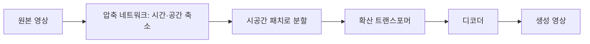
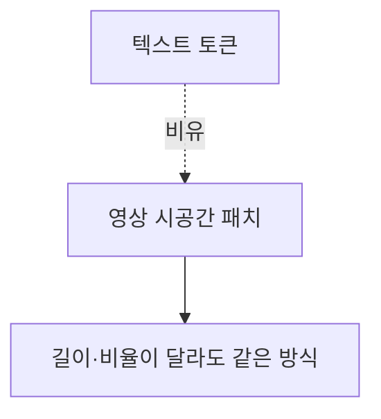

# 시공간 패치

> **시공간 패치(spacetime patches)** 는 영상을 시간·공간 방향으로 압축한 뒤 작은 덩어리로 쪼갠 단위로, 텍스트 토큰처럼 트랜스포머가 다루는 영상의 "토큰"이다.

## 쉽게 말하면
글을 단어 조각(토큰)으로 쪼개 읽듯, 영상을 "작은 영상 타일"로 쪼개 읽는다. 타일은 가로·세로뿐 아니라 시간 축으로도 이어져 있어서 움직임까지 한 덩어리로 담는다.

## 자세히
(OpenAI "Video generation models as world simulators" 확인)
- **잠재 공간 압축**: 별도 네트워크가 원본 영상을 시간·공간으로 줄인 표현으로 압축한다. Sora는 이 잠재 공간에서 학습·생성하고, 대응하는 디코더가 픽셀로 되돌린다.
- **패치 = 토큰**: 압축된 영상을 시공간 패치로 나눠 트랜스포머 토큰으로 쓴다. 이미지는 프레임이 1개인 영상으로 같게 다룬다.
- **확산 트랜스포머**: 노이즈 낀 패치와 텍스트 같은 조건을 받아 깨끗한 패치를 예측한다. 학습 연산이 늘수록 잘 확장된다고 보고한다.
- **가변 길이·해상도·비율**: 패치 시퀀스이므로 영상을 고정 크기로 자르거나 줄이지 않고 원래 크기로 학습할 수 있다. 추론 때는 무작위 패치를 원하는 격자 크기로 배열해 출력 크기를 정한다(세로 1080x1920~가로 1920x1080). 원래 비율로 학습하면 정사각 크롭보다 구도가 좋아진다고 한다.

## 그림으로 보기

## 예시
- 세로 쇼츠(1080x1920)와 가로 영상(1920x1080)을 한 모델이 만든다.
- 교육 활용: 영상 모델도 "토큰으로 쪼개 트랜스포머로 처리"한다는 점에서 LLM과 같은 계열임을 설명.

## 헷갈리는 것과 비교
| 개념 | 차이 |
|---|---|
| 시공간 패치 | 영상의 토큰, 시간 축 포함 |
| [이미지 패치 토큰](#image-patch-tokens) | 정지 이미지의 공간 패치 |
| [텍스트 토큰화](#tokenization) | 글을 토큰으로 |
| [플로 매칭](#flow-matching) | 확산과 가까운 생성 학습법 |

## 더 읽을거리
- [Video generation models as world simulators](https://openai.com/index/video-generation-models-as-world-simulators/) — Sora 기술 보고서.
