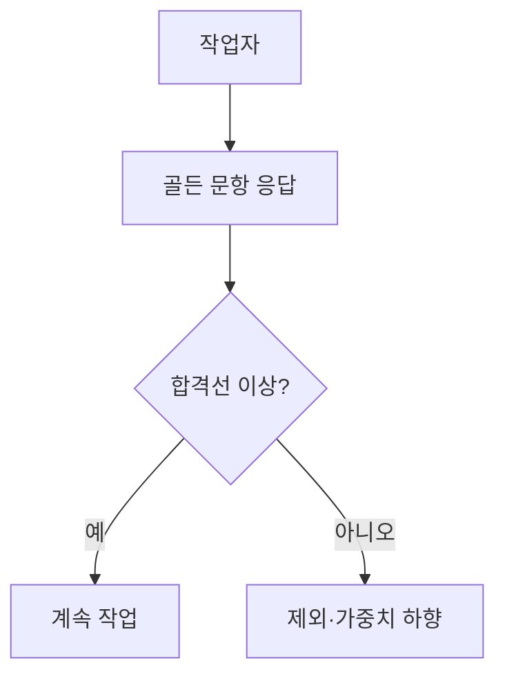
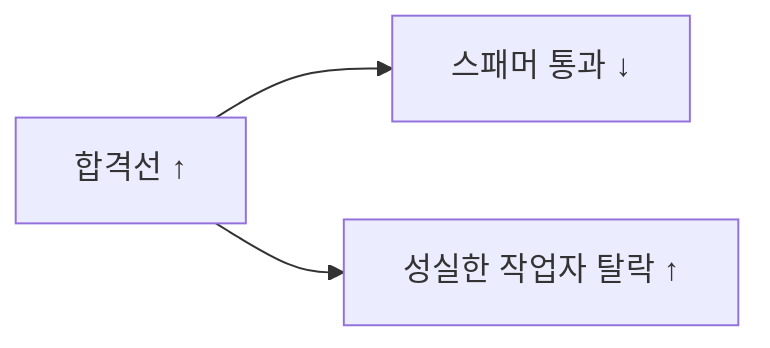

# 스패머 탐지

> 스패머는 문항을 읽지 않고 무작위·고정 패턴으로 답해 보수만 받으려는 작업자다. 정답이 알려진 골든 문항에 대한 정답률을 확인해 걸러 낼 수 있지만, 골든 문항 수와 합격선에 따라 통과하는 스패머와 탈락하는 성실한 작업자가 모두 생긴다.

## 쉽게 말하면
시험에서 답을 찍는 학생을 가려내려면 문제가 너무 적으면 운 좋게 맞는 학생이 섞이고, 합격선을 너무 높이면 열심히 푼 학생도 떨어진다. 문제 수와 합격선이 균형이다.

## 자세히
- **근거(검색 결과 요약, 일부 논문만 확인)**: 크라우드 품질 관리에서 정답(gold) 문항과 주의력 확인은 흔한 필터링 방법이고, 단순한 주의력 확인은 일반 문항과 구분하기 쉬워 성실하지 않은 작업자가 통과할 수 있다는 지적이 있다. 무작위 퀴즈를 넣으면 스패머가 운으로 통과할 가능성이 낮아진다고도 한다([작업자 품질 관리](#worker-quality-control)). 또한 한 번의 실수로 즉시 거절하지 않고 최근 문항의 비율로 판단하는 운영이 있다.
- **직접 계산(이항분포; 골든 m개 중 thr개 이상 맞히면 통과)**:

| 골든 수 / 합격선 | 찍는 스패머(2지선다) 통과 | 찍는 스패머(4지선다) 통과 | 정확도 0.9 통과 | 0.8 통과 | 0.7 통과 |
| --- | --- | --- | --- | --- | --- |
| 5 / 4 | 0.188 | 0.016 | 0.919 | 0.737 | 0.528 |
| 10 / 7 | 0.172 | 0.0035 | 0.987 | 0.879 | 0.650 |
| 10 / 8 | 0.055 | 0.0004 | 0.930 | 0.678 | 0.383 |
| 20 / 14 | 0.058 | 0.000 | 0.998 | 0.913 | 0.608 |
| 20 / 15 | 0.021 | 0.000 | 0.989 | 0.804 | 0.416 |

  2지선다 스패머는 5개 중 4개를 맞히면 18.8%가 통과한다. 20개 중 15개로 높이면 2.1%로 줄지만 정확도 0.8의 성실한 작업자도 20%가 탈락한다. 4지선다는 찍기가 훨씬 어려워 골든 몇 개로도 거의 걸러진다. (독립·찍기 가정의 계산이며 고정 패턴 스패머는 문항 순서를 알면 우회할 수 있다.)
- **설계 요령(해석)**: ① 문항을 늘리고 지속적으로 섞어 넣는다 ② 합격선은 성실한 작업자 평균 정확도보다 낮게, 스패머 통과율이 충분히 낮은 지점에서 ③ 선택지가 적은 문항일수록 골든을 더 많이 쓴다 ④ 보조 신호: 응답 시간이 지나치게 짧음, 항상 같은 선택지, 다른 작업자와 일치율이 우연 수준 ⑤ 탈락자 라벨은 삭제 대신 가중치 하향 또는 재검수.
- **연결**: 골든 문항 자체의 설계는 [골든 문항 선정](#golden-item-selection), 유출 방지는 [골든 유출과 교체](#golden-leak-rotation).

## 그림으로 보기

## 예시
- 골든 10개 중 8개 합격선: 2지선다 스패머 통과 5.5%, 정확도 0.8 성실 작업자 통과 67.8%. 탈락 비율이 부담되면 골든을 20개로 늘리고 합격선을 14개로 조정한다(위 표 기준).
- 교육 활용: 학습자가 m과 합격선을 바꿔 가며 두 통과율을 표로 만들고 균형점을 정한다.

## 헷갈리는 것과 비교
| 개념 | 차이 |
| --- | --- |
| 스패머 | 의도적으로 찍는 작업자 |
| 서툰 작업자 | 노력하지만 정확도 낮음 |
| [작업자 품질 관리](#worker-quality-control) | 전체 품질 관리 단계 |
| [주석자 품질 통계](#annotator-quality-stats) | 사후 통계 |

## 더 읽을거리
- [A Glimpse Far into the Future: Understanding Long-term Crowd Worker Quality (arXiv 1609.04855)](https://arxiv.org/abs/1609.04855) — 초반 성적이 장기 품질을 예측
