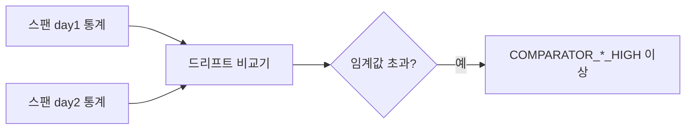
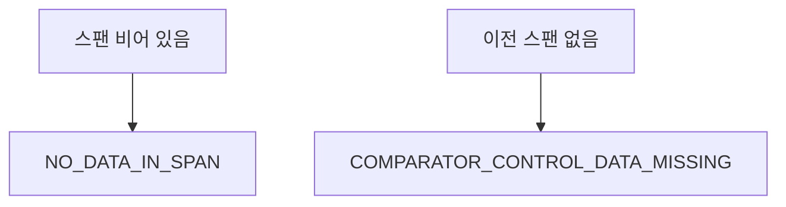

# 스팬 기반 검증

> 데이터를 **날짜 같은 시간 조각(스팬, span)** 으로 나눠 매 스팬을 이전 스팬과 비교하며 검증하는 구조다. 하루치 데이터가 어제와 비교해 갑자기 달라졌는지(드리프트)를 자동으로 잡는다.

## 쉽게 말하면
일기예보처럼 "어제와 오늘을 비교"하는 방식이다. 오늘 하루 데이터만 보면 정상처럼 보여도 어제 대비 특정 값의 비율이 확 달라졌다면 경보를 울린다. 하루 단위의 조각(스팬)이 쌓이며 기준이 이어진다.

## 자세히
(TFDV 시작 가이드, `schema.proto`, `anomalies.proto`를 직접 읽었다. "스팬"의 정식 정의 문구는 읽은 자료에 없고, 아래는 문서가 보여 주는 사용 방식에서 읽은 내용이다.)
- **드리프트 비교기(schema.proto)**: `Feature.drift_comparator`(필드 21)는 "연속된 스팬(예: 날짜) 사이의 분포를 비교"한다. `skew_comparator`가 서빙 데이터와 비교하는 것과 구별된다. 두 비교기 모두 `FeatureComparator`를 쓰며 L∞, Jensen–Shannon 발산, 정규화 절대 차이 임계값을 걸 수 있다.
- **TFDV 가이드의 예(직접 읽음)**: 날짜별 학습 데이터의 이틀치 통계를 만들고, 스키마의 `payment_type`에 `drift_comparator.infinity_norm.threshold = 0.01`을 지정한 뒤
  ```python
  drift_anomalies = tfdv.validate_statistics(
      statistics=train_day2_stats, schema=schema,
      previous_statistics=train_day1_stats)
  ```
  처럼 `previous_statistics`에 **이전 날 통계**를 넘긴다. 문서는 서빙 편향(`serving_statistics`)과 같은 방식으로 날짜 간 드리프트를 검출할 수 있다고 적는다. 또 L-infinity는 범주형만 감지하며 숫자·범주형 모두에는 Jensen–Shannon 임계값을 쓴다.
- **스팬과 관련된 이상 유형(anomalies.proto)**: `NO_DATA_IN_SPAN`(43, 스팬에 예제가 없음), `COMPARATOR_CONTROL_DATA_MISSING`(40, 대조 데이터 없음), `COMPARATOR_TREATMENT_DATA_MISSING`(41, 비교 대상 데이터 없음), `COMPARATOR_LOW_NUM_EXAMPLES`(49)·`COMPARATOR_HIGH_NUM_EXAMPLES`(50, 대조군 대비 예제 수가 너무 적거나 많음), `COMPARATOR_L_INFTY_HIGH`(42)·`COMPARATOR_JENSEN_SHANNON_DIVERGENCE_HIGH`(63)·`COMPARATOR_NORMALIZED_ABSOLUTE_DIFFERENCE_HIGH`(87). 비교를 하려면 이전 스팬 데이터가 있어야 하므로 **첫 스팬이나 빠진 날**은 비교 불가 이상이 될 수 있다.
- **운영 설계(일반 원칙, 제안)**: ① 스팬 단위(일·시간)를 정한다 ② 비교 대상을 직전 스팬으로 할지 일정 기간 이동 평균 기준으로 할지 정한다(문서 예는 직전 스팬) ③ 주말·행사 같은 정상 주기성을 고려해 임계값을 정하거나 같은 요일끼리 비교한다 ④ 스팬이 비었거나 늦게 도착한 경우의 처리 규칙을 둔다.
- **한계(해석)**: 직전 스팬과만 비교하면 **서서히 변하는 드리프트**는 임계값 아래로 계속 통과해 누적 변화를 놓칠 수 있다. 장기 기준(고정 기준 분포)과 병행한다.

## 그림으로 보기



## 예시
```python
tfdv.get_feature(schema, 'payment_type').drift_comparator.infinity_norm.threshold = 0.01
drift_anomalies = tfdv.validate_statistics(
    statistics=train_day2_stats, schema=schema,
    previous_statistics=train_day1_stats)
```
- 교육 소재: 하루씩 밀리는 막대그래프 두 장을 겹쳐 보며 "어제와 오늘의 차이"를 읽어 보기.

## 헷갈리는 것과 비교
| 개념 | 차이 |
|---|---|
| 스팬 기반 드리프트 검증 | 연속된 시간 조각 간 분포 비교 |
| skew 비교 | 학습 데이터와 서빙 데이터의 비교 |
| [skew vs drift](#skew-vs-drift) | 두 비교의 구분 개념 |
| [허용 편향 기준 정하기](#acceptable-skew-threshold) | 임계값 설계 |

## 더 읽을거리
- [Get started with TensorFlow Data Validation — drift](https://www.tensorflow.org/tfx/data_validation/get_started) — 날짜 간 드리프트 검출 예(직접 읽음).
- [schema.proto](https://raw.githubusercontent.com/tensorflow/metadata/master/tensorflow_metadata/proto/v0/schema.proto) — `drift_comparator` 정의(직접 읽음).
- [anomalies.proto](https://raw.githubusercontent.com/tensorflow/metadata/master/tensorflow_metadata/proto/v0/anomalies.proto) — 스팬·비교기 관련 이상 유형(직접 읽음).
