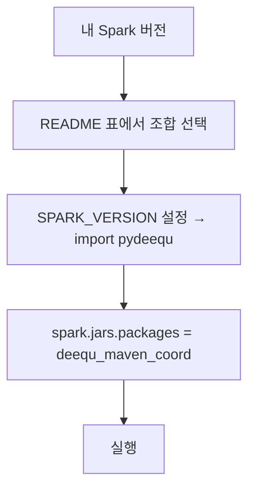
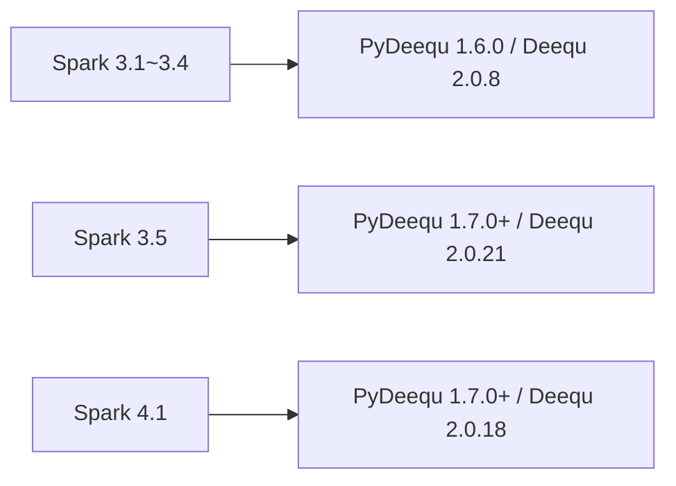

# Spark 버전 맞추기

> PyDeequ(파이썬용 Deequ)는 **Spark 버전마다 맞는 PyDeequ·Deequ 조합이 다르다.** 설치 전에 내 Spark 버전을 확인하고, 환경 변수 `SPARK_VERSION`을 import 전에 맞춰 두어야 엉뚱한 Deequ 빌드가 로드되는 일을 피한다.

## 쉽게 말하면
전동공구의 배터리는 모델마다 규격이 달라서 다른 규격을 끼우면 안 맞거나 고장 난다. PyDeequ도 Spark 버전이라는 "규격"에 맞는 Deequ jar를 끼워야 한다.

## 자세히
(PyDeequ 저장소 README(`awslabs/python-deequ`, master)를 WebFetch로 직접 확인. 이번에 Spark와 Deequ를 설치·실행해 보지는 않았다. README의 버전 표는 확인 시점(2026-11-22) 기준이며 이후 바뀔 수 있다.)
- **환경 변수(README)**: PyDeequ를 import하기 **전에** `SPARK_VERSION`을 Spark 런타임에 맞게 설정해야 한다. 허용 값은 `3.5`와 `4.1`이고 예시는 `os.environ["SPARK_VERSION"] = "4.1"`. README는 맞추지 않으면 **잘못된 Deequ 빌드가 로드될 수 있다**고 경고한다.
- **버전 조합(README 표)**
  | PyDeequ | Deequ | Spark |
  |---|---|---|
  | 1.7.0 이상 | 2.0.21 | 3.5 |
  | 1.7.0 이상 | 2.0.18 | 4.1 |
  | 1.6.0(이 범위의 마지막 릴리스) | 2.0.8 | 3.1~3.4 |
  → Spark 3.1~3.4를 쓴다면 **PyDeequ 1.6.0**을 써야 한다(README 경고).
- **jar 지정(README)**: `pydeequ.deequ_maven_coord`가 Deequ jar의 Maven 좌표를 주고, 세션 빌더에 `.config("spark.jars.packages", pydeequ.deequ_maven_coord)`와 `.config("spark.jars.excludes", pydeequ.f2j_maven_coord)`를 함께 둔다. Databricks처럼 세션을 코드로 설정할 수 없으면 해당 벤더 문서에서 Maven Central의 jar 설치 방법을 확인하라고 한다.
- **설치(README)**: `pip install pydeequ`. README는 Python·Java 런타임 요구를 사용자용으로 명시하지 않는다(개발자 설정에 Java 11/8, Spark 3.5.1이 나옴).
- **점검 순서(제안)**: ① `spark.version` 확인 → ② README 표에서 PyDeequ·Deequ 조합 선택 → ③ `SPARK_VERSION` 설정 후 import → ④ jar가 다운로드되는지(Maven 접근 가능한지) 작은 검증으로 확인. 앞선 노드에서 Maven 접근이 막혀 실행하지 못한 환경도 있었다. → [PyDeequ](#pydeequ)
- **한계**: 표는 README를 그대로 옮긴 것이며 실제 호환성을 직접 시험하지 않았다. 클라우드 관리형 Spark의 버전 표기와 jar 로드 방식은 다를 수 있다.

## 그림으로 보기

## 예시
- 사내 클러스터가 Spark 3.3이면 `pip install pydeequ==1.6.0`을 사용(README 경고 기준).
- 교육 활동: 세 가지 Spark 버전에 대해 어떤 PyDeequ·Deequ를 고를지 표를 보고 선택하기.

## 헷갈리는 것과 비교
| 개념 | 차이 |
|---|---|
| PyDeequ 버전 | 파이썬 패키지 버전 |
| Deequ 버전 | 실제 검증을 수행하는 Scala jar 버전 |
| `SPARK_VERSION` | PyDeequ가 어떤 Spark용 빌드를 쓸지 정하는 환경 변수 |
| [튜토리얼 버전 확인 습관](#tutorial-version-check) | 자료와 설치 버전 대조라는 같은 원칙 |

## 더 읽을거리
- [awslabs/python-deequ README](https://github.com/awslabs/python-deequ/blob/master/README.md) — SPARK_VERSION, 버전 조합 표, jar 좌표(직접 확인).
