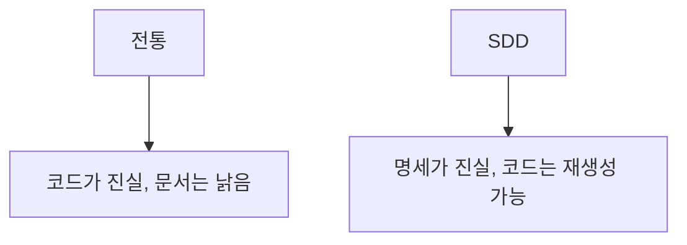

# 명세가 진실의 원천

> 명세 기반 개발(SDD)의 핵심 관점. **코드가 아니라 명세(의도 문서)가 기준 산출물**이고, 코드는 그 명세를 특정 언어·프레임워크로 표현한 결과물이라는 생각이다.

## 쉽게 말하면
건축에서 설계도가 먼저이고 건물은 설계도를 구현한 결과인 것과 같다. 건물이 어긋나면 벽을 두드리기 전에 설계도를 고친다.

## 자세히
- GitHub Spec Kit의 `spec-driven.md`(내가 열어 읽음)는 이를 **"힘의 역전(Power Inversion)"**이라 부른다: 전통적으로 코드가 진실이고 PRD·설계 문서는 곧 낡았지만, SDD에서는 "코드가 명세를 섬긴다".
- 명세·구현 계획이 충분히 정밀하면 AI가 코드를 생성하므로 둘 사이의 틈이 줄어든다는 주장이다(문서의 주장이며 보편 검증은 아니다).
- 유지보수 = 명세 진화. 디버깅은 잘못된 코드를 낳은 **명세와 구현 계획을 고치는 것**, 리팩터링은 명확성을 위한 재구성. 도메인 개념→데이터 모델, 사용자 스토리→API, 인수 시나리오→테스트로 이어진다.
- 피드백: 운영 중 성능 병목은 새 비기능 요구로, 보안 취약점은 이후 모든 생성에 적용되는 제약으로 명세에 반영한다.
- 실제 절차(Spec Kit 문서): constitution → specify → (clarify) → plan → (checklist) → tasks → (analyze) → implement → converge. 공식 페이지는 "source of truth"라는 표현은 쓰지 않지만 spec·plan·tasks를 기준 문서로 서로·코드와 대조한다.
- 한계: 명세 품질이 낮으면 틀린 코드를 정확히 생성한다. 명세를 코드와 계속 동기화하는 규율이 필요하다.

## 그림으로 보기

## 예시
- 로그인 오류 발생 → 코드를 직접 패치하기 전에 명세의 인수 조건을 고치고 계획·코드를 재생성.
- 교육: 업무 매뉴얼을 먼저 정확히 쓰면 자동화가 따라온다는 설명.

## 헷갈리는 것과 비교
| 개념 | 차이 |
|---|---|
| 명세 중심 | 의도 문서가 기준 |
| 코드 중심 | 코드가 곧 문서 |
| [에이전트 통합](#agent-integrations) | 이 절차를 여러 에이전트에 붙임 |

## 더 읽을거리
- [spec-driven.md (GitHub Spec Kit)](https://github.com/github/spec-kit/blob/main/spec-driven.md) — 철학 원문(읽음).
- [Agentic SDD 참조](https://github.github.com/spec-kit/reference/agentic-sdd.html) — 단계별 명령(읽음).
