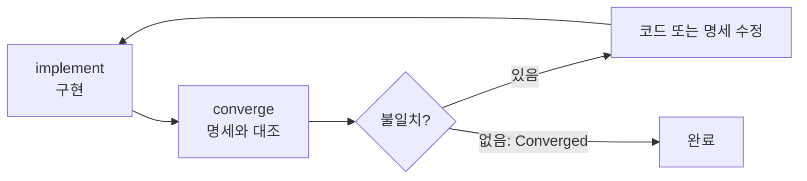

# 명세-코드 수렴 검사

> 구현이 끝난 뒤 **코드가 명세(스펙)와 실제로 일치하는지 점검하고, 어긋나면 고쳐 다시 점검하기를 "일치함"이 확인될 때까지 반복**하는 단계. 한 번에 만든 코드가 명세를 다 만족한다고 가정하지 않는 것이 핵심이다.

## 쉽게 말하면
건축 도면대로 집을 지은 뒤 준공 검사에서 도면과 다른 곳을 찾아 고치고, 검사를 통과할 때까지 되풀이한다. 도면이 기준이고, 지어진 집이 거기에 "수렴"해야 한다.

## 자세히
- **Spec Kit의 흐름**(GitHub spec-kit README 기준): `constitution → specify → plan → tasks → implement` 다음에 **`/speckit-converge`** 명령으로 결과를 점검하고, **`Converged`가 보고될 때까지 implement와 converge를 반복**한다고 안내한다. README는 converge 내부 동작의 세부는 설명하지 않는다(확인 못 한 부분).
- 관련 개념: 같은 저장소의 `spec-driven.md`는 명세를 **기준 산출물**로 보고, 명세 자체의 모호함·모순·누락을 점검하는 **일관성 검증**과 체크리스트(`[NEEDS CLARIFICATION]` 표시가 남아 있지 않은가, 요구사항이 테스트 가능한가)를 설명한다. 수렴 검사는 이 명세와 구현을 대조하는 단계에 해당한다.
- **수렴 검사에서 보통 보는 것**(일반 원칙):
  1. 명세의 요구사항마다 대응하는 코드·테스트가 있는가(누락).
  2. 명세에 없는 동작이 코드에 있는가(과잉).
  3. 테스트가 명세의 인수 기준을 실제로 검증하는가([테스트 조작 방지](#test-tampering)).
  4. 어긋남의 원인이 **코드 버그**인가 **명세의 모호함**인가 → 후자면 명세를 고치고 다시 생성.
- **끝내는 조건**: "불일치 0" 보고 + 테스트 통과 + 사람 확인. 무한 반복을 막으려면 최대 반복 횟수를 정한다.
- 한계: 자동 점검도 LLM이 하면 틀릴 수 있어, 핵심 요구사항은 테스트와 사람 검토로 보강한다.

## 그림으로 보기


## 예시
```markdown
# 수렴 점검 보고 (예시)
- R1 로그인 실패 5회 시 잠금 → 구현됨, 테스트 있음
- R2 비밀번호 재설정 메일 → 구현 없음(누락) → T012 추가
- 코드에 '관리자 우회 로그인' 있음 → 명세에 없음(과잉) → 삭제
```

## 헷갈리는 것과 비교
| 개념 | 차이 |
|---|---|
| 수렴 검사 | 구현이 명세에 맞는지 대조·반복 |
| 코드 리뷰 | 품질·스타일·버그 중심 검토 |
| [테스트](#test-types) | 동작을 자동 확인하는 수단 |
| [작업 분해](#tasks-breakdown) | 구현 이전의 계획 쪼개기 |

## 더 읽을거리
- [GitHub Spec Kit](https://github.com/github/spec-kit) — converge 포함 명령 흐름.
- [GitHub Spec Kit: spec-driven.md](https://github.com/github/spec-kit/blob/main/spec-driven.md) — 명세 중심 철학과 일관성 검증.
