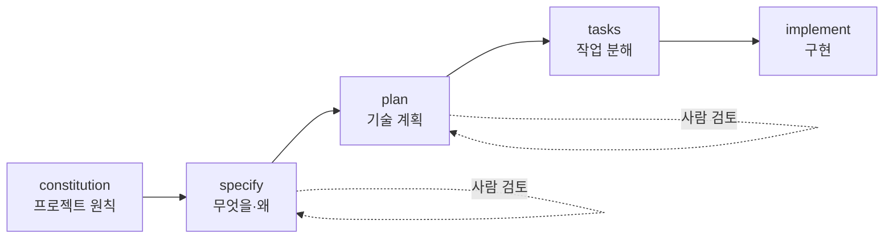
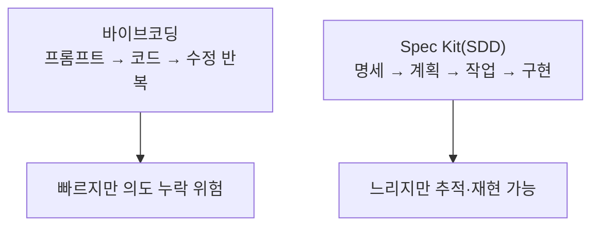

# Spec Kit

> GitHub이 공개한 오픈소스 툴킷. AI 코딩 에이전트와 함께 "명세 → 계획 → 작업 목록 → 구현" 순서로 개발하도록 슬래시 명령과 템플릿을 제공해 [SDD](#sdd)(명세 주도 개발)를 쉽게 해 준다.

## 쉽게 말하면
집을 지을 때 "대충 예쁜 집 지어 줘"라고 시공사에 말하면 결과가 복불복이다. 먼저 요구사항 문서(무엇을·왜), 설계도(어떻게), 공정표(작업 순서)를 만들고 승인한 뒤 짓는다. Spec Kit은 AI 시공사에게 이 문서 단계를 밟게 해 주는 양식 모음이다.

## 자세히
- **정체**: github/spec-kit 저장소. 코딩 에이전트에 구조화된 절차·재사용 템플릿·문서화된 산출물을 제공한다. 2026-11 기준 GitHub 별 약 15만 개(저장소 페이지 표시).
- **설치(저장소 README)**: Python 3.11+, `uv` 필요. `uv tool install specify-cli` → `specify init my-project --integration copilot` → 만든 폴더에서 코딩 에이전트 실행. Copilot 외 다른 에이전트도 "integration"으로 지원한다(목록은 문서 참고).
- **슬래시 명령(README 표기)**: `/speckit-constitution`, `/speckit-specify`, `/speckit-plan`, `/speckit-tasks`, `/speckit-implement`, `/speckit-converge`. 버그 수정(`/speckit-bug-*`)과 아이디어 평가(`/speckit-assess-*`) 흐름도 있다. 명령 이름은 버전에 따라 `/speckit.specify`처럼 점 표기였던 적이 있어 설치한 버전의 문서를 확인한다.
- **4단계(GitHub 블로그)**: ①**Specify** 무엇을·왜(사용자 여정·성공 기준, 기술 스택 제외) ②**Plan** 스택·아키텍처·제약(사내 표준, 규정) ③**Tasks** 독립적으로 구현·테스트 가능한 작은 작업으로 분해 ④**Implement** 에이전트가 작업을 하나씩 수행, 사람은 작은 변경만 검토. 단계마다 확인 지점이 있다.
- **핵심 사고**: "코드가 진실"에서 "의도가 진실"로. 명세가 살아 있는 문서로서 생성·테스트·검증을 이끈다.
- **바이브코딩과의 대비**: 빠른 시제품엔 바이브코딩이 좋지만, 실제 서비스나 기존 코드베이스에선 의도 누락·구조 불일치가 생긴다. 블로그의 주장은 문제가 에이전트 능력이 아니라 모호한 지시라는 것이다.
- **한계**: 명세 작성 비용이 든다. 작은 일엔 과하다([단순한 해법부터](#simplest-solution-first)).

## 그림으로 보기




## 예시
```bash
uv tool install specify-cli
specify init photo-app --integration copilot
cd photo-app
# 에이전트에서
# /speckit-specify  사진 앨범을 만들어 친구와 공유하는 앱. 공유 링크는 7일 뒤 만료.
```
"사진 공유 기능 추가해 줘" 대신, "이메일 형식을 검증하는 회원가입 엔드포인트 만들기"처럼 테스트 가능한 작업으로 쪼개진다.

## 헷갈리는 것과 비교
| 개념 | 차이 |
|---|---|
| [SDD](#sdd) | 방법론. Spec Kit은 그것을 돕는 도구 |
| [헌장(constitution)](#sdd-constitution) | 모든 기능에 적용되는 원칙 문서. Spec Kit의 첫 명령 |
| [TDD](#tdd) | 테스트를 먼저 씀. SDD는 명세를 먼저 씀(함께 쓰기도 함) |
| [바이브코딩](#vibecoding) | 즉흥적 프롬프트 개발. 명세 단계가 없음 |

## 더 읽을거리
- [github/spec-kit](https://github.com/github/spec-kit) — 설치·명령어·통합
- [Spec-driven development with AI (GitHub Blog)](https://github.blog/ai-and-ml/generative-ai/spec-driven-development-with-ai-get-started-with-a-new-open-source-toolkit/) — 4단계와 철학
