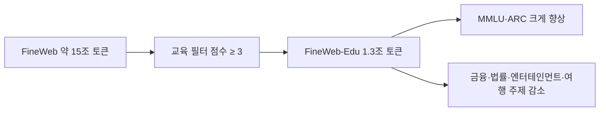
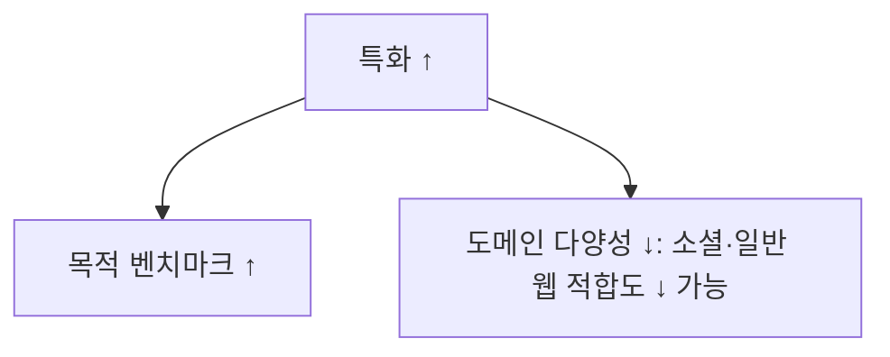

# 특화와 일반 성능 균형

> 데이터를 **한 목적에 맞춰 걸러 특화**하면(예: 교육 가치 높은 문서만) 그 목적의 벤치마크는 오르지만, 걸러 낸 주제·문체가 줄어 **다른 영역의 성능이나 도메인 적합도는 떨어질 수 있다.** 임계값은 이 균형을 고르는 일이다.

## 쉽게 말하면
교과서만 읽고 공부한 학생은 시험 과목에는 강하지만 신문 기사나 대화체에는 서툴 수 있다. 무엇을 많이 읽혔는지가 무엇을 잘하는지를 정한다.

## 자세히
- 출처: FineWeb 논문(arXiv 2406.17557) FineWeb-Edu·4장(읽음).
- **규모**: FineWeb(약 15조 토큰)에서 교육 분류기가 높게 평가한 **1.3조 토큰**만 FineWeb-Edu로 남겼다(약 8.7%, 내 계산). 논문 요약: FineWeb-Edu로 사전학습한 LLM은 **MMLU·ARC 같은 지식·추론 집약 벤치마크에서 "크게" 향상**됐다.
- **절충(임계값 3 선택 이유)**: 임계값은 "지식·추론 집약 벤치마크"와 "HellaSwag 같은 다른 벤치마크" 사이의 최선의 균형으로 골랐다([소형 모델 임계값 스윕](#threshold-sweep-small-model)). 즉 어느 쪽도 최대가 아니라 **절충점**이다.
- **주제 분포의 이동**(4.1절): 교육 분류기는 `Education, Learning, Teaching`, `History, Culture, Politics` 같은 주제를 **크게 늘리고**, `Business, Finance, Law`, `Entertainment, Film, Theater`, `Places, Travel, Real Estate` 등은 **줄였다**(클러스터 크기 비교). 직무 교육·기업 문서를 다루는 용도라면 금융·법률·사업 주제가 줄어드는 점을 알아야 한다.
- **도메인 적합도(퍼플렉서티)**(4.2절, Paloma 도메인): FineWeb 쪽이 **일반 웹(C4, mC4, Falcon, Dolma, RedPajama CC), 트위터(AAE), Manosphere, Gab, reddit, 4chan** 같은 출처에서 대체로 낮은 퍼플렉서티를 보였고, FineWeb-Edu는 **Wikipedia(WikiText-103, M2D2 Wikipedia)·학술(M2D2 S2ORC, arXiv)** 출처에 유리했으며 프로그래밍 콘텐츠 커버리지도 더 좋아 보였다(낮은 퍼플렉서티 = 그 유형 글을 더 잘 예측). 논문이 부록 F.4에 하위 도메인별 값을 싣는데, 예컨대 위키 하위 항목 중 `Philosophy and thinking → Thinking`은 FineWeb 14.081, FineWeb-Edu 16.067로 오히려 FineWeb-Edu가 높았다(부록 일부 행을 읽음, 일반화 금지).
- 해석: 특화는 **"무엇을 얼마나 포기하는가"**를 함께 보고해야 한다. 소셜·구어체·산업 도메인 성능이 중요하면 교육 필터를 완화하거나 원본 웹 데이터와 섞는 식의 설계가 필요하다(제안).
- 실무 체크리스트(제안): ① 목적 벤치마크와 **일반 벤치마크 둘 다** 측정 ② 필터 전후 **주제 분포**를 비교해 사라지는 주제 확인 ③ 도메인별 퍼플렉서티(또는 자체 평가셋) ④ 임계값별 점수 곡선을 보고 한쪽을 지나치게 희생하지 않는 값 선택 ⑤ 혼합 비율(특화:일반)을 실험.
- 한계: 이 문서는 논문 서술을 정리했다. 개별 벤치마크 수치(그래프)는 읽지 않았다.

## 그림으로 보기

## 예시
- 사내 지식 챗봇용으로 "기술 문서 품질" 필터를 강하게 걸었더니 고객 응대 대화체 성능이 떨어지는 경우.
- 교육: "필터링 = 가치 판단 + 비용(사라지는 것들)"이라는 점을 FineWeb-Edu 주제 분포 그림으로 설명.

## 헷갈리는 것과 비교
| 개념 | 차이 |
|---|---|
| 특화 | 목적에 맞는 데이터만 남김 |
| 일반화 | 다양한 영역에서 고르게 잘함 |
| 퍼플렉서티 | 그 도메인 글을 얼마나 잘 예측하는가(낮을수록 좋음) |
| [데이터 양 대 품질](#data-quantity-vs-quality) | 임계값에 따른 토큰 수와 품질의 맞교환 |

## 더 읽을거리
- [FineWeb 논문 (arXiv 2406.17557)](https://arxiv.org/abs/2406.17557) — 4.1 주제 분포, 4.2 도메인 적합도(읽음).
