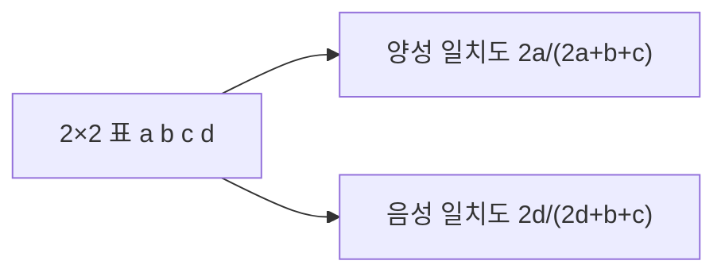
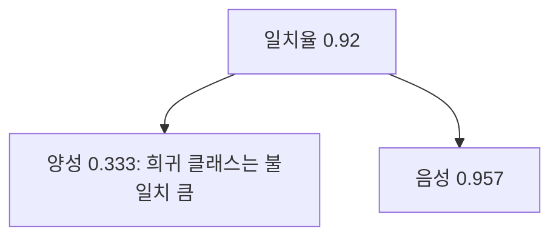

# 클래스별 일치도(specific agreement)

> 클래스별 일치도는 전체 일치율 하나 대신, 클래스마다 "두 평가자가 그 클래스를 함께 골랐는가"를 따로 재는 지표다. 이진 분류에서는 양성 일치도와 음성 일치도로 나뉜다.

## 쉽게 말하면
시험 전체 평균 점수만 보지 않고 과목별 점수를 보는 것이다. 평균이 90점이어도 수학 0점, 영어 100점일 수 있다. 일치율 92%도 "드문 클래스에서는 거의 일치하지 않는다"를 가릴 수 있다.

## 자세히
- **배경(검색으로 확인)**: Feinstein·Cicchetti(1990)는 kappa가 관찰 일치율이 높아도 주변 분포가 쏠리면 낮게 나오는 "역설"을 지적했고, 해법으로 양성·음성 판정의 일치를 따로 보는 두 지표(p_pos, p_neg)를 제안했다고 검색 결과가 전한다. 이 둘은 민감도·특이도와 비슷한 성격이다. 열어 본 PMC7222679 논문은 이 역설을 인용하지만 p_pos·p_neg 공식은 담고 있지 않았다.
- **2×2 정의(표준 정의. 이번에 공식 문서로 확인하지 못했고 아래 계산으로 검산함)**: a=둘 다 양성, b·c=엇갈림, d=둘 다 음성이면 양성 일치도 = 2a/(2a+b+c), 음성 일치도 = 2d/(2d+b+c). 두 평가자 사이의 F1처럼 읽을 수 있다(해석).
- **직접 계산(100개)**:

| (a, b, c, d) | 일치율 | 양성 일치도 | 음성 일치도 |
| --- | --- | --- | --- |
| (45, 5, 5, 45) | 0.90 | 0.900 | 0.900 |
| (90, 5, 5, 0) | 0.90 | 0.947 | 0.000 |
| (2, 4, 4, 90) | 0.92 | 0.333 | 0.957 |

  세 번째 줄은 일치율 0.92지만 양성(희귀 클래스)에서의 일치도는 0.333이다. 두 평가자가 "있다"고 한 것의 3분의 2는 서로 달랐다는 뜻이다. 이 값은 [kappa와 클래스 불균형](#kappa-class-imbalance) 문제를 보완해 준다.
- **다중 클래스(해석)**: 각 클래스를 "해당 클래스 vs 나머지"로 나눠 클래스마다 같은 계산을 한다. 낮은 클래스는 [혼동 행렬](#annotator-confusion-matrix)에서 원인 쌍을 찾는다.

## 그림으로 보기

## 예시
- 악성 댓글 라벨링에서 "악성"이 3%일 때, 전체 일치율은 높아도 "악성" 클래스의 양성 일치도가 0.4라면 그 클래스의 가이드를 고쳐야 한다.
- 교육 활용: 표의 세 줄을 보고 어떤 상황에서 일치율만 보면 안 되는지 정리한다.

## 헷갈리는 것과 비교
| 개념 | 차이 |
| --- | --- |
| 전체 일치율 | 모든 클래스 합친 하나의 수 |
| 클래스별 일치도 | 클래스마다 따로 |
| [평가자 간 일치도](#inter-annotator-agreement) | kappa 등 요약 통계 |
| [kappa와 클래스 불균형](#kappa-class-imbalance) | 쏠림이 kappa에 미치는 영향 |

## 더 읽을거리
- [Gwet의 AC1과 kappa를 다룬 논문 (PMC7222679)](https://pmc.ncbi.nlm.nih.gov/articles/PMC7222679) — kappa 역설과 AC1, 2×2 셀 정의
