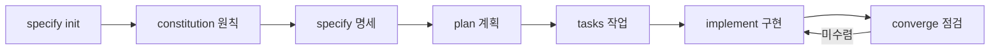
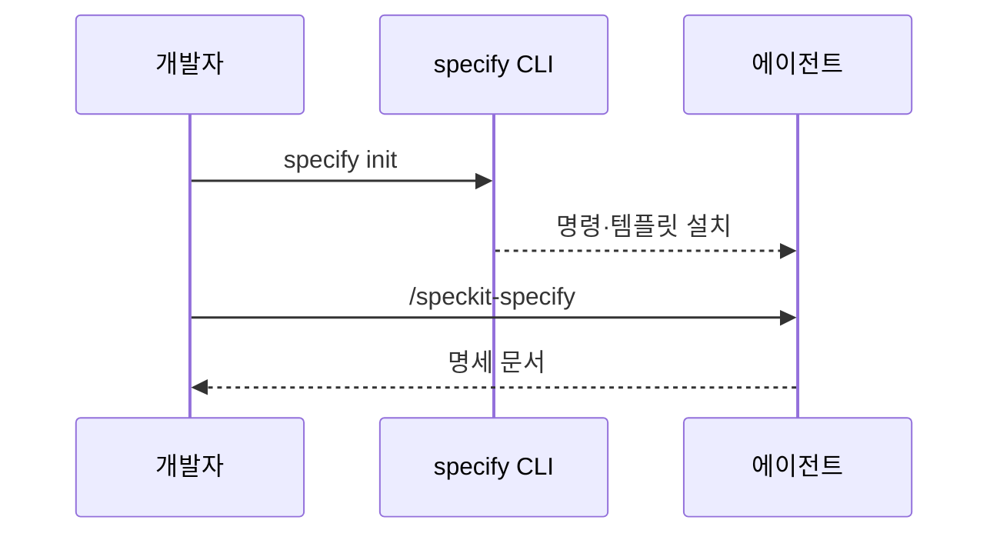

# specify CLI

> **specify CLI**는 GitHub **spec-kit**을 설치하고 프로젝트를 초기화하는 명령줄 도구다. AI 코딩 에이전트에 명세 주도 개발(SDD) 절차(슬래시 명령)를 심어 준다.

## 쉽게 말하면
요리 레시피 카드 세트를 주방에 비치해 주는 도구다. 설치하고 초기화하면 AI 에이전트가 "원칙 → 명세 → 계획 → 작업 → 구현" 카드를 순서대로 따를 수 있다.

## 자세히
(github/spec-kit README 확인)
- **준비물**: Python 3.11+, `uv`, 지원되는 AI 코딩 에이전트(Linux·macOS·Windows).
- **설치**: `uv tool install specify-cli`
- **초기화**: `specify init my-project --integration copilot` 후 `cd my-project`. `--integration`이 에이전트를 고르며 예시는 Copilot이다. 지원 목록은 README에 없고 통합 페이지를 보라고 한다.
- **슬래시 명령**(에이전트 채팅에서 하나씩, 결과 확인 후 다음): `/speckit-constitution`(원칙, 프로젝트당 1회) → `/speckit-specify`(무엇을·왜) → `/speckit-plan`(기술 접근) → `/speckit-tasks`(작업 분해) → `/speckit-implement`(구현) → `/speckit-converge`(결과 점검). "Converged"가 나올 때까지 implement·converge를 반복하고, 2~6단계는 기능마다 반복한다. 표기는 Copilot 기본 스킬 문법 기준이며 에이전트마다 다를 수 있다.
- README는 선택 단계(명확화, 체크리스트, 일관성 분석)도 있다고 한다.

## 그림으로 보기



## 예시
```bash
uv tool install specify-cli
specify init my-project --integration copilot
cd my-project   # 에이전트를 실행하고 /speckit-constitution부터
```

## 헷갈리는 것과 비교
| 개념 | 차이 |
|---|---|
| specify CLI | 설치·초기화 도구 |
| 슬래시 명령 | 에이전트 안에서 쓰는 단계별 명령 |
| spec-kit | CLI와 템플릿을 합친 툴킷 |
| [작업 분해](#task-decomposition) | `tasks` 단계의 핵심 개념 |

## 더 읽을거리
- [github/spec-kit](https://github.com/github/spec-kit) — 설치·워크플로 안내.
