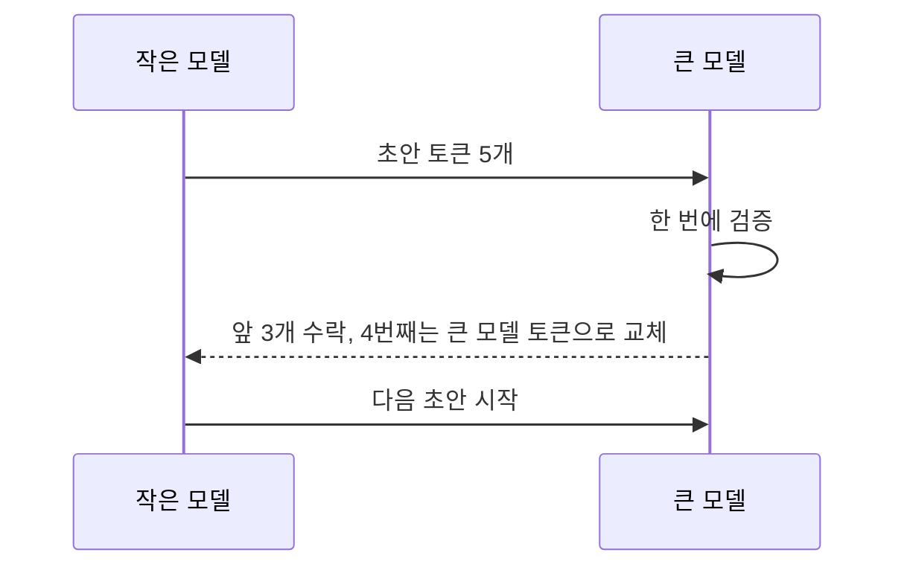

# 추측 디코딩 (Speculative Decoding)

> 작은 모델(assistant)이 토큰 여러 개를 초안으로 쓰면 큰 모델이 한 번의 계산으로 검증해, 결과는 큰 모델과 같게 두고 속도만 높이는 기법이다.

## 쉽게 말하면
수습 직원이 보고서 초안을 빠르게 쓰고 부장은 훑어보며 틀린 첫 줄에서만 고쳐 준다. 부장이 한 줄씩 직접 쓰는 것보다 훨씬 빠르다.

## 자세히
Hugging Face "Assisted Generation" 글(2026-11 확인):
- 병목은 연산이 아니라 **메모리 대역폭**(모델 가중치를 코어로 옮기는 일)이다. 그래서 여러 후보 토큰을 한 번에 검증해도 비용이 토큰 1개 생성과 비슷하다.
- 절차: assistant가 후보 토큰을 탐욕적으로 제안(시작 5개) → 큰 모델이 한 번의 forward pass로 각 위치의 자기 토큰을 계산 → **왼쪽부터 일치하는 만큼 수락**, 첫 불일치에서 큰 모델 토큰을 채택하고 나머지 폐기. 전부 맞으면 후보 수 +2, 아니면 −1.
- 보고된 속도 향상: 메모리에 올라가는 모델에서 INT8과 함께 최대 3배, 아니면 최대 2배, 메모리 오프로딩 시 최대 10배. 음성 인식·요약처럼 입력에 기반한 작업에서 강함.
- 조건: assistant는 **같은 토크나이저**여야 하고 대략 한 자릿수 배 작아야 한다. 출시 당시 배치 크기 1만 지원.
- 도움 안 되는 경우: 품질 낮거나 느린 assistant, 높은 temperature 샘플링, 창의적 글쓰기. 도입 전 벤치마크 권장.
- 호출: `model.generate(**inputs, assistant_model=assistant_model)`(예: Pythia-1.4B + Pythia-160M).
- 같은 아이디어: Blockwise Parallel Decoding(Google Brain), Speculative Sampling(DeepMind).

## 그림으로 보기

## 예시
로컬에서 큰 모델 추론이 느리다 → 같은 계열의 작은 모델을 assistant로 지정해 속도 비교. 요약처럼 원문을 베끼는 비중이 큰 작업에서 효과가 크다.

## 헷갈리는 것과 비교
| 개념 | 차이 |
|---|---|
| 추측 디코딩 | 큰 모델 검증을 거치므로 품질 유지, 속도 개선 |
| 모델 증류·양자화 | 모델 자체를 작게 만듦 — 품질이 달라질 수 있음 |
| [KV 캐시](#kv-cache) | 이전 계산 재사용, 함께 쓰이는 속도 기법 |
| [greedy vs beam](#greedy-vs-beam) | 토큰 선택 전략 — 추측 디코딩은 선택이 아닌 속도 기법 |

## 더 읽을거리
- [Assisted Generation (Hugging Face)](https://huggingface.co/blog/assisted-generation) — 원리·속도·조건.
