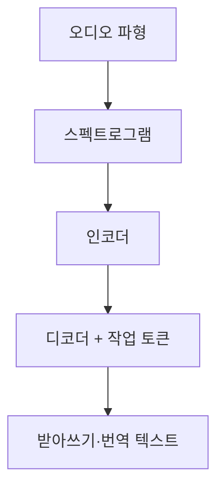

# 음성 인식과 합성

> 음성→글(ASR, 자동 음성 인식)과 글→음성(TTS, 음성 합성)을 합친 말. 음성 비서·회의록·더빙의 기반이다.

## 쉽게 말하면
ASR은 받아쓰기하는 속기사, TTS는 원고를 읽어 주는 성우다. 둘을 이으면 "말로 묻고 말로 듣는" AI가 된다.

## 자세히
- 모든 음성 작업은 오디오 파일에서 시작하고, 파형(waveform)·샘플링 레이트·스펙트로그램을 다룬다(Hugging Face Audio Course Unit 1).
- **Whisper(OpenAI, 오픈소스)**: Transformer 시퀀스-투-시퀀스 모델. 작업(인식·번역·언어 식별·음성 구간 탐지)을 특수 토큰으로 지정해 한 모델이 처리한다(GitHub README 기준).
  - 크기: tiny 39M(VRAM 약 1GB) ~ large 1550M(약 10GB). turbo 809M(약 6GB)은 large-v3 최적화판으로 약 8배 빠르지만 번역에는 부적합.
  - 8GB GPU 개인 PC에서도 small~turbo는 돌릴 만하다.
- **TTS**: 글을 소리로. 최근엔 감정·화자 복제가 가능한 신경망 TTS가 주류. 목소리 복제는 동의·사칭 문제가 있다(주의).
- 구성 방식 둘: ① ASR → LLM → TTS의 3단 파이프라인(교체가 쉬움) ② 음성을 직접 입출력하는 [멀티모달](#multimodal) 실시간 모델(지연이 짧음).
- 평가 지표: 인식은 WER(단어 오류율), 합성은 사람 청취 점수.

## 그림으로 보기

## 예시
- 회의 녹음 → Whisper로 자막 → LLM으로 요약·액션 아이템.
- 명령 예: `whisper meeting.mp3 --model turbo --language Korean`
- 교육 콘텐츠: 대본 → TTS로 나레이션.

## 헷갈리는 것과 비교
| 개념 | 차이 |
| --- | --- |
| ASR | 소리→글 |
| TTS | 글→소리 |
| 음성 복제 | 특정인 목소리를 흉내, 동의·윤리 이슈 |
| [이미지 생성](#image-generation) | 같은 생성 AI지만 소리 대신 그림 |

## 더 읽을거리
- [openai/whisper (GitHub)](https://github.com/openai/whisper) — 모델 크기·사용법
- [Hugging Face Audio Course](https://huggingface.co/learn/audio-course/chapter1/introduction) — 오디오 기초 용어
