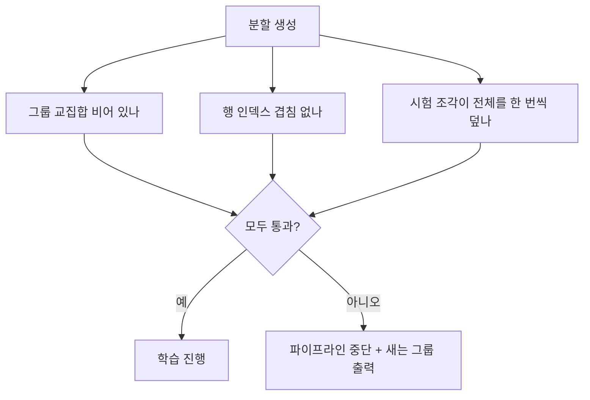
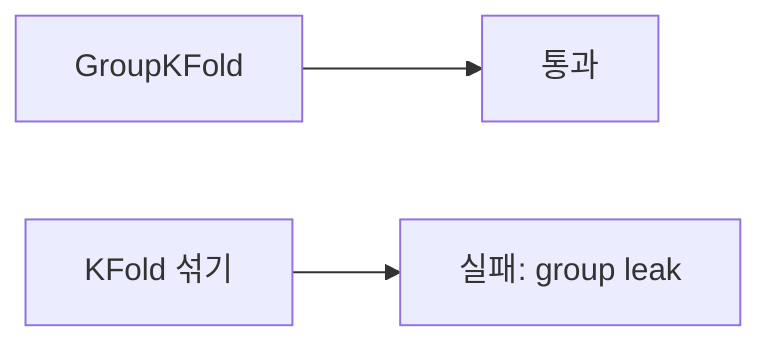

# 분할 단위 테스트

> 분할 단위 테스트는 "학습과 시험에 같은 그룹이 없다", "행이 겹치지 않는다", "모든 행이 정확히 한 번 시험에 쓰인다" 같은 약속을 assert로 코드에 적어 두고 파이프라인이 돌 때마다 자동으로 확인하는 것이다.

## 쉽게 말하면
조 편성을 할 때 "같은 반 학생이 두 조에 들어가면 안 된다"는 규칙을 사람이 눈으로 확인하다 보면 놓친다. 편성이 끝날 때마다 규칙을 기계가 자동으로 검사하게 하면 실수가 바로 드러난다.

## 자세히
- **검사 항목**: ① 폴드마다 학습 그룹과 시험 그룹의 교집합이 비어 있다 ② 학습·시험 행 인덱스가 겹치지 않는다 ③ 시험 조각들이 전체를 정확히 한 번씩 덮는다(분할기에 따라 해당하지 않을 수 있음, 예: `ShuffleSplit`은 이 조건이 안 맞는다([ShuffleSplit vs KFold](#shuffle-split-vs-kfold))) ④ 폴드 크기와 클래스 비율이 허용 범위 안이다.
- **직접 만들어 확인한 함수(그룹 30개 × 10행)**: 폴드마다 `set(groups[train]).isdisjoint(groups[test])`를 assert하고, 시험 인덱스 카운트가 전부 1인지 확인하는 `check_split`을 만들었다. `GroupKFold(5)`는 통과했고(True), 같은 데이터에 일반 `KFold(5, shuffle=True)`를 넣자 "fold 0: group leak [0, 1, 2]"라는 메시지와 함께 실패해 누수를 잡았다([샘플 단위 vs 그룹 단위 분할](#sample-vs-group-split)).
- **운영(해석)**: 이 함수를 단위 테스트(pytest)와 데이터 파이프라인 시작 단계에 넣는다. 실패 메시지에 어느 폴드, 어느 그룹이 새는지 적어야 원인 찾기가 빠르다. 그룹 열이 비어 있거나 결측이면 이 검사 이전에 막는다([ID 정규화](#id-normalization)).
- **한계**: 분할 규칙을 지켜도 특성 자체가 정답을 담은 누수(타깃 파생 특성)는 이 테스트가 못 잡는다. [정답 섞기 점검](#shuffled-label-sanity-check)과 함께 쓴다.

## 그림으로 보기



## 예시
```python
for tr, te in cv.split(X, y, groups):
    assert set(groups[tr]).isdisjoint(groups[te])
```
교육 활용: 일부러 일반 KFold를 넣어 테스트가 빨간불을 켜는지 확인하게 한다.

## 헷갈리는 것과 비교
| 개념 | 차이 |
| --- | --- |
| 분할 단위 테스트 | 분할 규칙 위반을 자동 검출 |
| [정답 섞기 점검](#shuffled-label-sanity-check) | 점수로 누수 의심 |
| [CI 겹침 게이트](#ci-overlap-gate) | 학습-평가 텍스트 겹침 점검 |
| [샘플 단위 vs 그룹 단위 분할](#sample-vs-group-split) | 어떤 단위로 나눌지 |

## 더 읽을거리
- [scikit-learn: Cross-validation iterators for grouped data](https://scikit-learn.org/stable/modules/cross_validation.html) — 그룹 분할기
