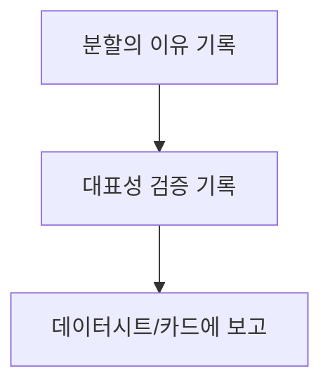

# 세트별 구성 비교

> 학습·검증·시험 세트마다 집단별 구성(성별, 지역, 클래스 비율 등)을 표로 만들어 비교하는 점검이다. 분할이 대표성을 유지하는지, 시험 세트가 특정 집단을 빠뜨리지 않았는지 확인한다.

## 쉽게 말하면
모의고사와 본고사의 출제 범위가 같은지 비교하는 것이다. 학습 세트에는 많은 유형이 시험 세트에는 거의 없으면 점수가 실력을 말해 주지 않는다.

## 자세히
(Datasheets for Datasets arXiv 1803.09010 §3.2와 Data Cards arXiv 2204.01075를 하위 에이전트가 원문으로 읽은 노트 기준.)
- **Datasheets §3.2 질문**: "추천 데이터 분할(학습·개발/검증·시험)이 있는가? 있다면 설명하고 **그 이유**를 적어라."
- **대표성 질문**: "데이터셋이 가능한 모든 인스턴스를 담고 있는가, 아니면 표본인가? 표본이라면 더 큰 집합을 대표하는가, 어떻게 검증했는가?"
- **Data Cards**: 확장 사용(Extended Use) 구역에서 제작자에게 "서로 다른 학습·시험 분할에 대한 기술 통계를 보고하라"고 요청한다(정확한 필드 라벨은 그림 속 문구라 미확인).
- **점검 표(제안)**: 행 = 집단(클래스·성별·지역·기간), 열 = train/val/test 건수와 비율, 마지막 열 = 차이. 칸 건수가 너무 작으면 표시한다([작은 칸 표시](#crosstab-small-cell-flag)). 시간 순서 분할이면 기간별 분포 변화도 확인.
- **한계**: 겉보기 비율이 같아도 같은 사용자·같은 원본의 변형이 양쪽에 있으면 누수가 있다([증강본 그룹 누수](#augmentation-group-leak)).

## 그림으로 보기

## 예시
- 시험 세트에 특정 지역 고객이 0건이면 해당 지역 성능을 평가할 수 없음을 표에서 발견.
- 교육 활용: 세 세트의 구성 표를 만들어 "시험이 공정한가" 토론.

## 헷갈리는 것과 비교
| 개념 | 차이 |
|---|---|
| 세트별 구성 비교 | 분할 간 분포 비교 |
| 데이터 누수 점검 | 같은 원본이 양쪽에 있는지 |
| [기준 집단 비율과 비교](#reference-population-comparison) | 외부 모집단과의 비교 |

## 더 읽을거리
- [Datasheets for Datasets (arXiv 1803.09010)](https://arxiv.org/abs/1803.09010) — §3.2 분할·대표성 질문.
- [Data Cards (arXiv 2204.01075)](https://arxiv.org/abs/2204.01075) — 분할별 통계 보고.
