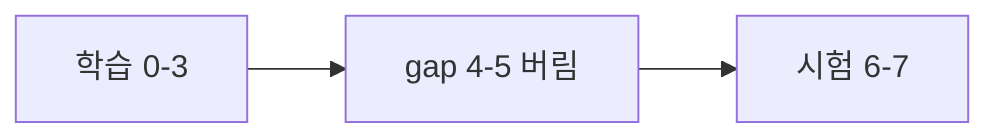
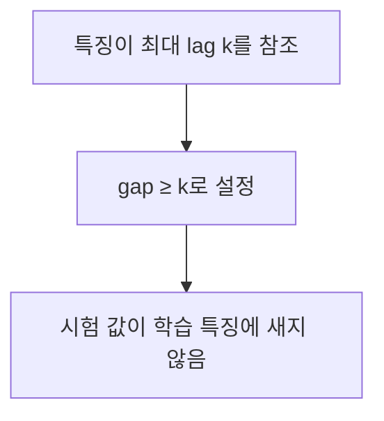

# 분할 gap 완충 구간

> 시간순 분할에서 학습 구간과 시험 구간 **사이를 몇 개 비워 두는 완충 구간(gap)** 이다. 지연(lag)·이동평균 특징이 시험 구간의 값을 미리 훔쳐 보는 누수를 막는다.

## 쉽게 말하면
어제까지 공부한 내용으로 오늘 시험을 보는데, 공부한 노트에 "오늘 오전 요약"이 끼어 있으면 시험 문제가 이미 노출된 셈이다. 공부 구간과 시험 구간 사이에 며칠 비워 두면 노트가 시험 시작 전의 내용만 담게 된다.

## 자세히
(scikit-learn `TimeSeriesSplit` 문서의 `gap` 매개변수 설명과 예제 출력을 앞서 직접 읽었다. 아래 재현 코드는 문서의 분할 규칙을 이 지도에서 순수 Python으로 다시 구현해 문서 출력과 같은지 확인한 것이다.)
- **`gap`의 정의(문서)**: "각 학습 세트의 끝에서, 시험 세트 앞에서 **제외할 샘플 수**"이며 scikit-learn 0.24에서 추가됐다. 기본값은 0이다.
- **문서의 예(12개 샘플, `n_splits=3`, `test_size=2`, `gap=2`)**: 폴드 0은 학습 `[0 1 2 3]`·시험 `[6 7]`, 폴드 1은 학습 `[0..5]`·시험 `[8 9]`, 폴드 2는 학습 `[0..7]`·시험 `[10 11]`이다. 학습 세트 끝의 두 샘플(폴드 0은 4·5)이 제외된다.
- **직접 재현(순수 Python)**: 시험 블록을 끝에서부터 `test_size`씩 나누고 학습 구간을 `[0, 시험시작 − gap)`로 잡는 규칙으로 구현하니 위와 **같은 세 폴드**가 나왔다. 같은 코드에서 `gap=0`이면 폴드 0은 학습 `[0..5]`·시험 `[6 7]`로 학습이 시험 바로 앞까지 이어진다. (재현 코드는 문서 설명과 예제 출력과의 일치만 확인한 것이며 scikit-learn 소스와 동일하다고 단정하지 않는다.)
- **왜 gap이 필요한가(일반 원칙, 앞서 읽은 검색 요약 포함)**: lag나 이동평균 특징은 과거 값을 참조한다. 예를 들어 "t의 값을 예측하는데 t−1부터 t−3의 평균 특징"을 쓴다면, 학습 마지막 시점의 특징이 시험 구간 첫 시점의 값을 포함할 수 있다. gap을 특징이 참조하는 **최대 lag 이상**으로 두면 이 누수가 막힌다. 검색 요약의 러시아어 글도 gap을 look-ahead 방지 완충으로 설명했다(원문 직접 확인 못 함).
- **대가**: gap만큼 학습 샘플을 버리고, 폴드 수·`test_size`와 함께 쓰면 사용할 수 있는 학습 데이터가 줄어든다. 문서는 시험 세트가 이전보다 항상 큰 인덱스여야 해 셔플이 부적절하다고 설명한다.
- **주의**: 표본이 **등간격**이어야 폴드 간 지표가 비교 가능하다는 문서의 조건은 gap에도 적용된다(샘플 개수가 곧 시간 간격).

## 그림으로 보기



## 예시
```python
from sklearn.model_selection import TimeSeriesSplit
tscv = TimeSeriesSplit(n_splits=3, test_size=2, gap=2)
for tr, te in tscv.split(X):
    ...
# 문서 예: 폴드0 학습 [0 1 2 3], 시험 [6 7]
```
- 교육 소재: 학습 노트와 시험 사이를 비우는 이유를 시간표로 그려 보기.

## 헷갈리는 것과 비교
| 개념 | 차이 |
|---|---|
| 분할 gap | 학습과 시험 사이를 비움 |
| [시간 기반 분할 규칙](#time-based-split-rule) | 시간순으로 나누는 상위 규칙 |
| [지연 특징과 shift](#lag-feature-shift) | 특징 쪽에서 당일 값을 제외 |
| [시점 누수](#point-in-time-leakage) | gap이 막으려는 문제 |

## 더 읽을거리
- [sklearn TimeSeriesSplit](https://scikit-learn.org/stable/modules/generated/sklearn.model_selection.TimeSeriesSplit) — gap 정의와 예제(직접 읽음).
