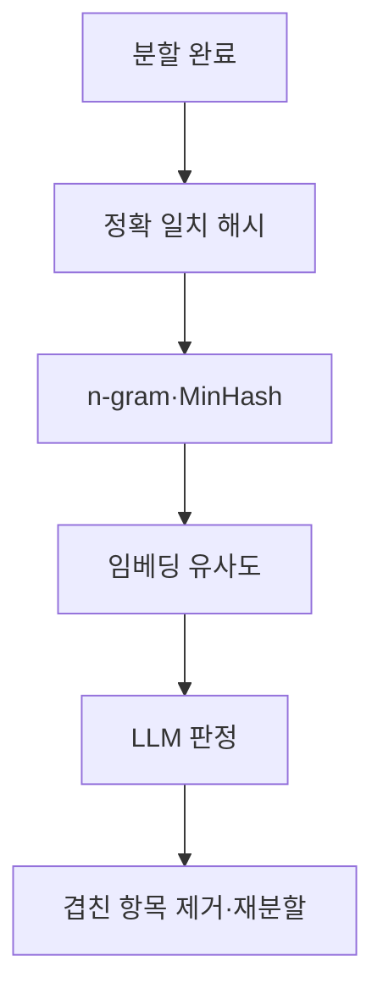
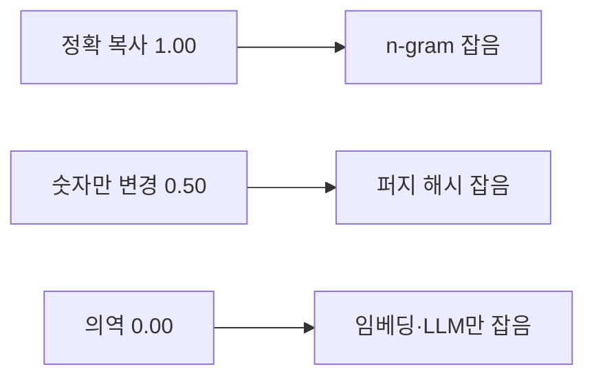

# 분할 후 누수 점검

> 학습/검증/테스트로 나눈 뒤 **세 세트 사이에 같거나 거의 같은 데이터가 섞였는지 확인하는 단계**다. 정확 일치 → n-gram·퍼지 해시 → 임베딩 유사도 순으로 겹을수록 촘촘한 그물을 쓴다.

## 쉽게 말하면
시험 전에 시험지 문제가 교과서 예제와 겹치는지 검토하는 출제 위원 점검이다. 글자가 똑같은 문제는 쉽게 찾지만, 숫자만 바꾼 문제나 말만 바꾼 문제는 따로 찾아야 한다.

## 자세히
- **1단계 정확 일치**: 정규화한 텍스트의 해시(예: SHA-256)가 같은지 본다. 가장 싸고 빠르다.
- **2단계 n-gram·퍼지(MinHash)**: 단어 n개 조각 겹침. 검색에서 본 사례로 GPT-3 논문은 13-gram 겹침을, GPT-4 보고서는 50자 겹침을 오염 기준으로 썼다(검색 요약, 원문 미확인). MinHash/LSH는 [근접 중복 탐지](#near-duplicate-detection)와 같은 기법.
- **직접 실험(단어 5-gram Jaccard, 간단 구현)**: 원문 대비 정확 복사 1.00, "thirty→30"만 바꾼 문장 0.50, 의역 문장 0.00. 의역은 n-gram으로 전혀 안 잡힌다.
- **3단계 임베딩 유사도**: 의역을 잡지만 임계값 선택이 필요하다. 한 벤치마크 보고서는 코사인 0.75~0.95 구간을 후보로 삼았다는 검색 요약이 있다(원문 미확인).
- **의역 오염(논문)**: "Rethinking Benchmark and Contamination for Language Models with Rephrased Samples"(arXiv 2311.04850)는 의역·번역 같은 간단한 변형이 표준 필터를 통과하며, 그런 변형이 학습에 남으면 13B 모델이 MMLU·GSM8K·HumanEval에서 GPT-4 수준 점수를 낼 수 있다고 보고한다. 저자들은 LLM 기반 decontaminator를 제안하고, HumanEval의 8~18%가 RedPajama-Data-1T·StarCoder-Data와 겹친다고 밝혔다. n-gram 겹침은 거의 그대로 복사한 경우만 잡는다.
- **문서 외 누수**: 글이 달라도 같은 고객·세션·작성자가 양쪽에 있으면 새는 것이다. 이럴 땐 그룹 분할이나 시간 분할을 함께 쓴다([층화와 누수](#stratification-vs-leakage)).
- **점검 순서 요약**: 정확 → n-gram/MinHash → 임베딩 → (필요 시) LLM 판정. 비용이 낮은 것부터 돌리고 남은 의심 쌍만 비싼 방법으로 본다.
- **한계**: 오염 없음을 증명하지는 못한다. 점검 통과는 "탐지 가능한 범위의 겹침이 없다"는 뜻이다.

## 그림으로 보기

## 예시
- 사내 FAQ 챗봇 평가셋 점검: 평가 질문과 학습용 대화 로그를 해시·MinHash·임베딩으로 대조해 겹치는 항목을 평가셋에서 뺀다.
- 교육: "점수가 너무 잘 나오면 의심" 사례 → 오염 점검 체크리스트.

## 헷갈리는 것과 비교
| 개념 | 차이 |
|---|---|
| 분할 후 누수 점검 | 나눈 뒤 겹침을 확인 |
| 분할 전 중복 제거 | 나누기 전에 묶음 처리 |
| [데이터 누수](#data-leakage) | 상위 개념 |
| 벤치마크 오염 | 평가셋이 사전학습 데이터에 포함 |

## 더 읽을거리
- [Rethinking Benchmark and Contamination for Language Models with Rephrased Samples](https://arxiv.org/abs/2311.04850) — 의역 오염과 decontaminator(초록 확인).
- [Near-duplicate Detection with LSH and Datasketch](https://yorko.github.io/2023/practical-near-dup-detection) — 퍼지 해시 단계 실측.
