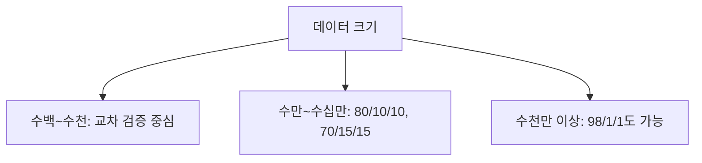
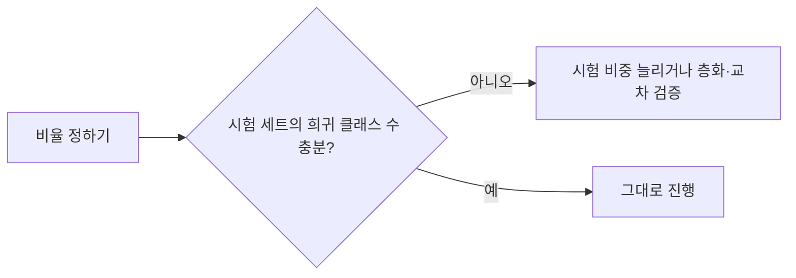

# 분할 비율 관행

> 학습·검증·시험을 몇 대 몇 대 몇으로 나누는가에 대한 관행이다. 정해진 규칙은 없고, 70/15/15나 80/10/10 같은 값이 흔한 출발점이며 데이터 양에 따라 조절한다.

## 쉽게 말하면
케이크를 나눌 때 인원이 10명이면 한 조각이 커서 신중해야 하지만, 100만 명이면 1%만 떼어도 충분히 많다. 데이터도 전체 크기에 따라 "시험용으로 얼마나 떼야 믿을 만한가"가 달라진다.

## 자세히
(scikit-learn 문서는 직접 확인, 비율 관행은 블로그·강의 자료 요약이라 규칙이 아닌 관행으로 읽는다.)
- **흔한 출발점(검색 결과 여러 출처)**: 80/10/10, 70/15/15, 60/20/20 중 하나. 표준이나 이론적 최적값이 아니다.
- **데이터가 많으면(관행)**: 검증·시험 1%만으로도 수만 건이 되므로 98/1/1처럼 학습에 더 몰아줄 수 있다는 설명이 있다(수천만 건 규모 예시). 이 98/1/1을 특정 인물에게 귀속하는 근거는 찾지 못했다.
- **데이터가 적으면**: 고정 검증 세트가 귀한 데이터를 낭비하므로 [교차 검증](#k-fold-cross-validation)이 보통 더 낫다고 한다.
- **모델 종류**: 신경망은 더 많은 학습 데이터가 필요해 학습 비중을 키우는 쪽이라는 의견이 있다(벤더 글).
- **scikit-learn `train_test_split` 기본값(공식 문서 확인, 1.9.1)**: `test_size`와 `train_size`가 모두 `None`이면 `test_size=0.25`. `shuffle=True`가 기본이며 `False`면 `stratify`는 `None`이어야 한다. `stratify`에 라벨을 주면 두 쪽의 클래스 비율이 유지된다. 재현 가능한 분할은 `random_state`에 정수를 준다. 검증 세트를 만들려면 이 함수를 두 번 부르는 식으로 쓴다(일반적 사용법).
- **비율보다 중요한 것(일반적 지적)**: ① 시험 세트가 **통계적으로 의미 있는 크기**인지(희귀 클래스가 몇 개나 들어가나) ② 누수가 없는지 ③ 분포가 운영 환경을 닮았는지. 비율은 조정 가능한 선택이고, 몇 가지를 시험해 결과가 얼마나 흔들리는지 보라는 권고가 있다.

## 그림으로 보기



## 예시
```python
from sklearn.model_selection import train_test_split
X_tmp, X_test, y_tmp, y_test = train_test_split(X, y, test_size=0.1, stratify=y, random_state=42)
X_train, X_val, y_train, y_val = train_test_split(X_tmp, y_tmp, test_size=1/9, stratify=y_tmp, random_state=42)
# 약 80/10/10
```
불량이 0.5%인 데이터에서 시험 세트가 1,000건이면 불량 샘플이 5개뿐이라, 비율이 아니라 **불량 샘플 수**를 기준으로 시험 세트를 키운다.

## 헷갈리는 것과 비교
| 개념 | 차이 |
|---|---|
| 분할 비율 | 세트별 크기 배분 |
| [학습·검증·시험 분할](#train-validation-test-split) | 나누는 이유와 규율 |
| [k-겹 교차 검증](#k-fold-cross-validation) | 작은 데이터에서 고정 분할 대신 |
| 층화 분할 | 클래스 비율을 양쪽에 유지 |

## 더 읽을거리
- [scikit-learn: train_test_split](https://scikit-learn.org/stable/modules/generated/sklearn.model_selection.train_test_split.html) — 기본값 test_size=0.25, stratify, shuffle(직접 열어 확인).
- [Lightly: Train Test Validation Split](https://lightly.ai/blog/train-test-validation-split) — 관행과 모범 사례(검색 결과 기준, 본문 미열람).
