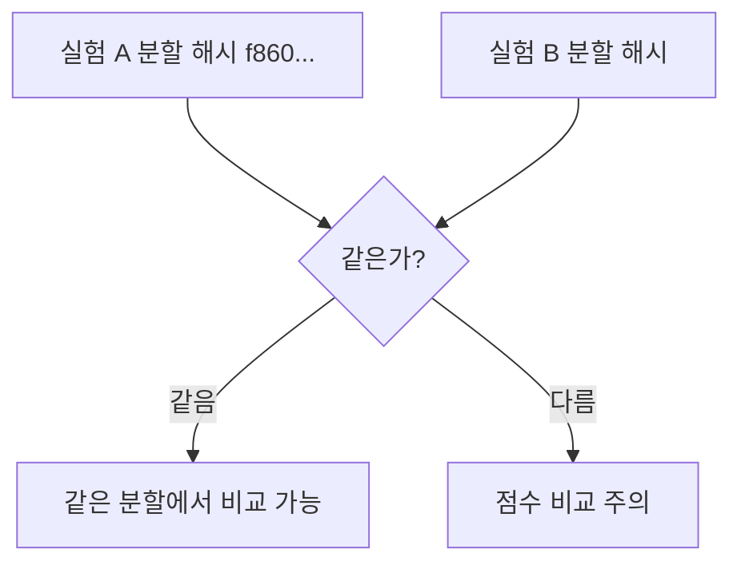

# 분할 기록 남기기

> 분할 기록은 "어떤 분할기를 어떤 설정으로 썼고, 폴드마다 행·그룹이 몇 개이며 겹침이 0인지"를 실험 기록에 함께 남기는 습관이다. 나중에 결과가 이상하거나 재현이 안 될 때 분할이 원인인지 바로 확인할 수 있다.

## 쉽게 말하면
시험 조 편성표를 사진으로 남겨 두는 것과 같다. 나중에 "그때 같은 학생이 두 조에 있었나?"라는 의문이 생겨도 사진을 보면 바로 답이 나온다. 기억이나 코드를 다시 돌려 추측하지 않아도 된다.

## 자세히
- **기록할 항목(해석)**: 분할기 종류와 인자(`repr(cv)`), 라이브러리 버전, 전체 행 수, 폴드별 학습·시험 행 수, 시험 그룹 수, **학습·시험 그룹 겹침 수**, 시험 그룹 ID 목록의 해시, 시험 조각의 양성 비율.
- **직접 만든 보고 함수 결과(그룹 30개×10행, `GroupKFold(5)`, scikit-learn 1.9.1)**: 폴드 0은 학습 240행·시험 60행·시험 그룹 6개·겹침 0·시험 그룹 목록 해시 `f8605e2dc7`·시험 양성 비율 0.517이었다. 5개 폴드 모두 겹침이 0이었고, 같은 설정으로 두 번 만들면 보고서가 완전히 같았다(재현 True). 시험 그룹 ID를 정렬해 해시한 값은 같은 분할인지 한눈에 비교하는 지문 역할을 한다.
- **쓰임(해석)**: ① 실험 추적 도구(MLflow 등)의 파라미터·아티팩트로 JSON 저장 ② 결과 비교 시 해시가 같은지 확인해 "같은 분할에서의 비교"를 보증([비교용 k 고정](#fixed-k-for-comparison)) ③ 나중에 누수 의심 시 겹침 수 확인 ④ 라이브러리 버전이 바뀌어 분할이 달라졌는지 판별([재현 가능한 분할](#reproducible-splits)).
- **한계**: 기록은 사실을 남길 뿐 자동으로 막지 않는다. 막으려면 [분할 단위 테스트](#split-assertion-test)로 assert를 건다. 개인정보가 든 ID는 원문 대신 해시를 남긴다.

## 그림으로 보기

## 예시
- 학습 실행마다 `split_report.json`을 같이 저장하고, 모델 비교표에 분할 해시 열을 넣는다.
- 교육 활용: 두 번 분할해 해시가 같은지, 시드를 바꾸면 달라지는지 확인한다.

## 헷갈리는 것과 비교
| 개념 | 차이 |
| --- | --- |
| 분할 기록 | 사실을 남김(사후 점검) |
| [분할 단위 테스트](#split-assertion-test) | 위반 시 중단(사전 차단) |
| [경고를 오류로 승격](#warnings-as-errors) | 알려진 경고 차단 |
| [분할 인덱스 저장](#save-split-indices) | 인덱스 전체를 저장해 그대로 재사용 |

## 더 읽을거리
- [scikit-learn: Cross-validation iterators for grouped data](https://scikit-learn.org/stable/modules/cross_validation.html) — 그룹 분할기와 반환되는 분할
