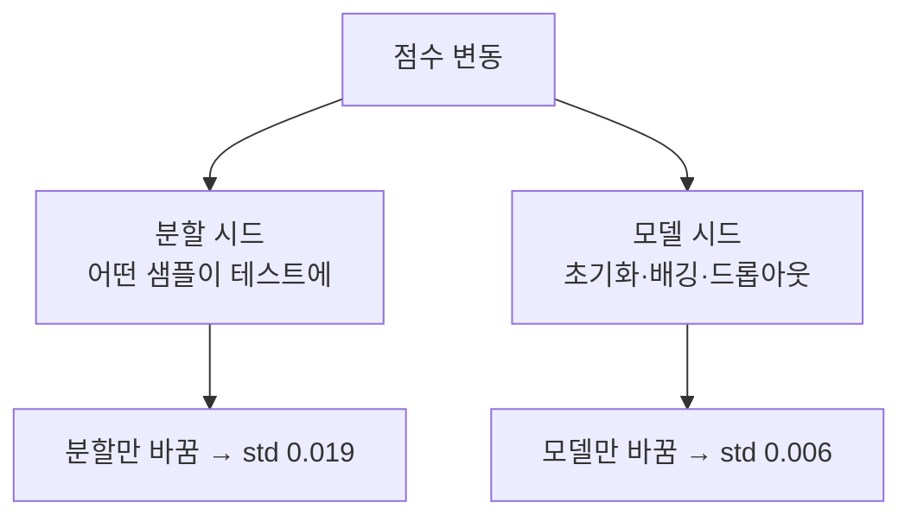

# 분할 시드 vs 모델 시드

> 실험 결과가 시드에 따라 흔들릴 때, 원인은 **데이터를 나누는 시드(분할)** 와 **모델 내부 무작위(초기화·샘플링)** 시드로 갈린다. 둘을 따로 바꿔 보면 어느 쪽이 변동을 더 만드는지 분해할 수 있다.

## 쉽게 말하면
시험 점수가 매번 다를 때, "어떤 문제가 출제됐나(분할)"와 "그날 컨디션(모델 무작위)" 중 무엇이 더 큰 원인인지 하나씩 고정해 보며 따지는 것이다.

## 자세히
- **직접 실행**(scikit-learn 1.9.1, make_classification 1,000개·특성 20개·라벨 노이즈 10%, RandomForest 30그루, 30개 시드):

| 바꾼 것 | 고정한 것 | 정확도 표준편차 | 범위 |
|---|---|---|---|
| 분할 시드 | 모델 시드 0 | 0.0188 | 0.833~0.913 |
| 모델 시드 | 분할 시드 0 | 0.0064 | 0.890~0.913 |

  이 설정에서는 **분할이 모델 무작위보다 변동이 약 3배** 컸다. 테스트셋이 300개로 작아 어느 샘플이 들어가느냐의 영향이 크기 때문이다.
- 일반화는 금물: 딥러닝처럼 초기화·데이터 순서·드롭아웃 영향이 큰 모델에서는 모델 시드 변동이 더 커질 수 있다.
- **실무**: ① 둘을 분리해 변동 크기를 측정, ② 보고할 때 어느 시드를 바꿨는지 명시, ③ 비교 실험에서는 두 모델이 같은 분할을 쓰게(짝지은 비교) 하면 분할 변동을 상쇄해 차이를 더 잘 본다.

## 그림으로 보기


## 예시
```python
a = [score(split_seed=s, model_seed=0) for s in range(30)]
b = [score(split_seed=0, model_seed=s) for s in range(30)]
print(np.std(a), np.std(b))
```
- 어느 쪽이 큰지에 따라 "데이터를 더 모을지"(분할 변동) 또는 "시드 앙상블·평균을 쓸지"(모델 변동)가 정해진다.

## 헷갈리는 것과 비교
| 개념 | 차이 |
|---|---|
| 분할 시드 | 학습·테스트 샘플 구성을 정함 |
| 모델 시드 | 모델 내부 무작위를 정함 |
| [시드 골라 쓰기](#seed-cherry-picking) | 좋은 시드만 골라 보고하는 잘못된 관행 |
| [시드 스윕 보고](#seed-sweep-reporting) | 여러 시드의 평균·범위를 함께 보고 |

## 더 읽을거리
- [scikit-learn: Controlling randomness](https://scikit-learn.org/stable/common_pitfalls.html#controlling-randomness) — random_state 사용 지침.
- [train_test_split API](https://scikit-learn.org/stable/modules/generated/sklearn.model_selection.train_test_split.html) — 분할 시드 인자.
