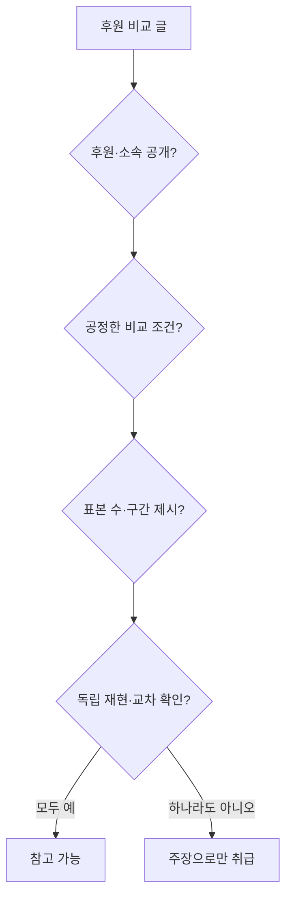
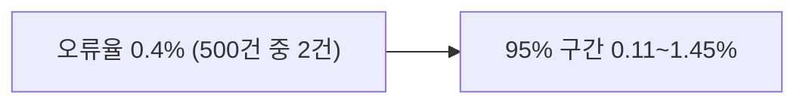

# 후원 연구 편향

> 비교 결과를 낸 연구·글의 **비용을 비교 대상 회사가 댔거나 그 회사 소속이 썼을 때, 그 회사에 유리한 결과가 나올 가능성이 높아지는 현상**이다. 벤더가 후원한 "우리 서비스가 더 정확하다"는 비교 글은 같은 눈으로 읽을 수 없다.

## 쉽게 말하면
자동차 회사가 돈을 대서 한 "연비 비교 시험"은 시험 조건, 비교 대상, 공개하는 지표를 후원사에 유리하게 고르기 쉽다. 시험이 거짓은 아니어도 어떤 부분이 빠졌는지 의심하며 읽어야 한다.

## 자세히
(Cochrane 방법론 리뷰 페이지를 직접 열어 확인. 이 결과는 약물·의료기기 연구에 대한 것이고 데이터 라벨링 벤더 연구에 직접 측정된 것이 아니다. 라벨링 적용은 유추와 제안이다.)
- **의학에서 측정된 결과(Lundh 등, Cochrane 2017 갱신)**: 75편을 종합해 업계 후원 연구가 비업계 후원 연구보다 **유리한 효능 결과**를 더 자주 보고했다(위험비 RR **1.27**, 95% 구간 1.17~1.37, 25편, 증거 수준 중간), **유리한 결론**도 더 많았다(RR **1.34**, 1.19~1.51, 29편, 낮음). 해로움 결과는 차이가 통계적으로 유의하지 않았다(RR 1.37, 0.64~2.93, 4편, 매우 낮음). 흥미롭게도 **표준 편향 위험 평가 항목(무작위 배정 생성, 배정 은닉, 추적, 선택적 결과 보고)에서 차이가 없었고**, 눈가림은 오히려 업계 연구가 더 잘 되어 있었다(RR 1.25). 저자들은 이를 "표준 편향 위험 평가로는 설명되지 않는 업계 편향"이 있다는 신호로 해석한다. 또 결과와 결론의 일치 정도는 업계 연구가 더 낮았다(RR 0.83, 0.70~0.98, 6편).
- **라벨링 벤더 비교 글에 적용(제안)**: 이 글의 사례는 상위 노드 [관리형 인력 라벨링](#managed-workforce-labeling)에 있는 "관리형 인력 판매사가 후원한 비교"(2019, 오류율 크라우드 7% 대 관리형 0.4%)다. 후원사가 있다고 결과가 틀렸다는 뜻은 아니지만 읽을 때 확인할 점이 있다.
  1. **누가 돈을 냈고 누가 썼나**(후원·소속 공개 여부)
  2. **비교 조건이 공정한가**(같은 과제·같은 지침·같은 감사 방식·같은 보수)
  3. **표본 크기와 불확실성**: 오류율 0.4%가 500건 중 2건이면 95% 구간은 약 0.11~1.45%, 250건 중 1건이면 0.07~2.2%로 넓다(직접 계산, Wilson). 표본 수가 없으면 평가할 수 없다.
  4. **지표 정의**(정확도·일치율·카파)와 **누가 정답을 정했나**
  5. **빠진 비교**(비용, 확장 속도, 다른 벤더, 혼합 방식)
  6. **재현 가능성**: 데이터·지침 공개 여부, 독립 연구의 재현
- **대응(제안)**: 벤더 주장은 **자체 파일럿**으로 확인한다([라벨링 벤더 SLA](#vendor-labeling-sla)의 골드 세트·감사 표본). 독립 출처(학술 연구, 사용자 커뮤니티 사례)와 교차 확인하고 후원 글은 "주장:"으로 표기해 신뢰도를 낮춘다.
- **한계**: 업계 후원이 항상 편향을 낳는 것은 아니다. 의학의 결과를 다른 분야에 그대로 옮길 수 없고, 후원 여부 외에 연구 설계 품질이 더 중요한 경우도 많다.

## 그림으로 보기

## 예시
- 라벨링 업체 블로그의 "저희 팀 정확도 99.6% vs 크라우드 93%" 비교: 표본·측정 방식을 문의하고 우리 데이터로 파일럿한다.
- 교육 소재: "광고성 연구 읽는 법" 체크리스트 — 6가지 질문을 실제 기사로 실습.

## 헷갈리는 것과 비교
| 개념 | 차이 |
|---|---|
| 후원 연구 편향 | 후원자에 유리한 결과·결론이 늘어남 |
| [관리형 인력 라벨링](#managed-workforce-labeling) | 이 편향이 걸린 사례를 담은 노드 |
| [라벨링 벤더 SLA](#vendor-labeling-sla) | 자체 검증을 계약으로 확보 |
| 출판 편향 | 유의한 결과만 출판되는 문제(후원 편향과 다름) |

## 더 읽을거리
- [Cochrane: Industry sponsorship and research outcome (MR000033)](https://www.cochrane.org/MR000033/METHOD_industry-sponsorship-and-research-outcome) — 75편 종합 결과(직접 확인, 의학 분야).
