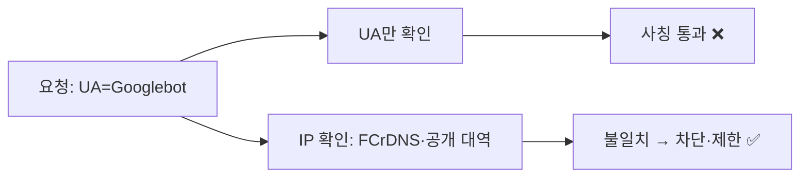
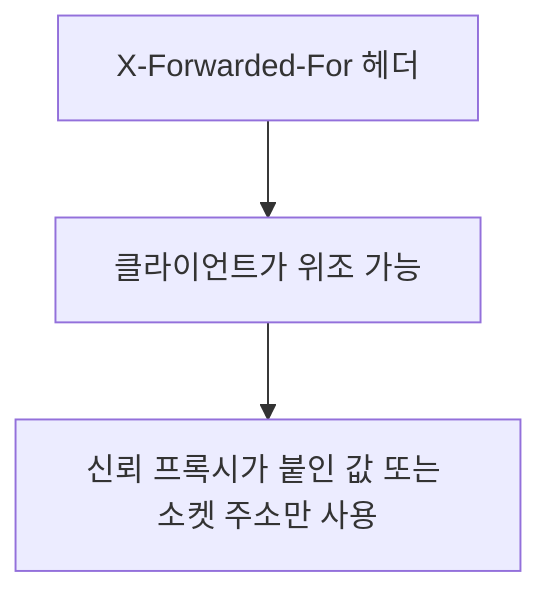

# User-Agent 사칭

> User-Agent는 요청을 보내는 쪽이 **스스로 적는 문자열**이라 누구나 `Googlebot`이라고 쓸 수 있다. 크롤러 신원은 헤더가 아니라 **접속 IP(역방향 DNS·공개 IP 대역)로 검증**해야 한다.

## 쉽게 말하면
이름표를 직접 써서 달면 누구나 "경찰"이라고 쓸 수 있다. 진짜 경찰인지는 신분증(공인된 출처)으로 확인해야 한다.

## 자세히
- 직접 실행(지역 서버, 파이썬; 구글이 공개한 `googlebot.json` 접두사 317개와 대조하는 검증 코드):
  | 요청 | UA가 Googlebot이라 주장 | 서버가 본 출발 IP | 구글 공개 대역 포함 |
  |---|---|---|---|
  | 일반 클라이언트가 Googlebot UA를 붙임 | 예 | 127.0.0.1 | **아니오 → 사칭** |
  | 같은 요청에 `X-Forwarded-For: 66.249.66.1`을 위조해 붙임 | 예 | 코드가 헤더를 믿으면 66.249.66.1 | 예(**헤더를 믿은 오검증**) |
  | 평범한 파이썬 UA | 아니오 | 127.0.0.1 | 아니오 |
- 읽는 법:
  - 첫 행처럼 UA 한 줄 바꾸기만으로 크롤러를 흉내 낼 수 있다. UA로 허용·차단을 정하면 우회된다.
  - **둘째 행이 더 위험하다**: `X-Forwarded-For` 같은 전달 헤더도 클라이언트가 임의로 쓸 수 있다. 서버가 이 헤더의 값을 그대로 IP로 믿으면 검증이 통과되어 버린다. 신뢰하는 프록시·로드밸런서가 붙인 값만(체인의 마지막 신뢰 지점) 쓰거나 **소켓의 실제 원격 주소**를 써야 한다(제안).
- Google 문서(2026-11-27 열람)는 검증이 "구글을 사칭하며 접근하는 스패머 등"에 대비하는 방법이라고 설명하고, 수동 FCrDNS 확인([FCrDNS](#fcrdns))과 공개 IP 대역(JSON) 대조를 제시한다.
- 실무 점검(제안): ① UA만으로 허용 목록을 만들지 않는다 ② 정책(robots·TDM 신호)을 지킨다고 주장하는 크롤러도 공식 IP·DNS로 신원을 확인한다 ③ 확인에 실패하면 속도 제한·차단 ④ 공개 IP 목록은 주기적으로 갱신한다([IP 대역 목록 갱신](#ip-range-list-refresh)).
- 한계: 이 시험은 로컬 서버의 간이 재현이며 실제 트래픽의 분포나 오탐률은 측정하지 않았다.

## 그림으로 보기



## 예시
```python
ip = self.client_address[0]        # 소켓 주소(위조 불가)
ok = any(ipaddress.ip_address(ip) in net for net in nets)
```
- 교육: 로그 분석 실습에서 "Googlebot"을 주장하는 요청 중 대역 밖 IP 비율 계산.

## 헷갈리는 것과 비교
| 개념 | 차이 |
|---|---|
| User-Agent | 자기 신고(위조 쉬움) |
| IP·DNS 검증 | 네트워크 수준 근거 |
| X-Forwarded-For | 프록시가 붙이는 값이지만 직접 붙이면 위조 가능 |

## 더 읽을거리
- [Google: Verifying Googlebot](https://developers.google.com/search/docs/crawling-indexing/verifying-googlebot) — 검증 절차(읽음).
- 직접 실행: UA·X-Forwarded-For 위조와 대역 대조 시험.
