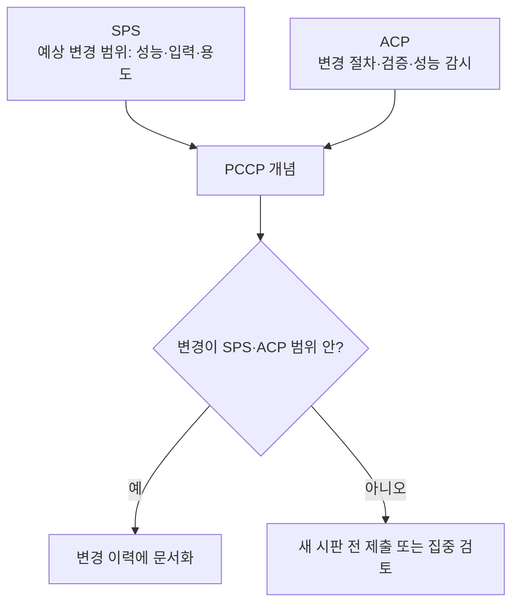

# SPS와 ACP

> FDA 2019 토론 문서가 제안한 "사전 결정 변경 관리 계획"의 두 부분. **SPS(SaMD Pre-Specifications)**는 제조사가 예상하는 변경의 범위("무엇이 될 것인가"), **ACP(Algorithm Change Protocol)**는 그 변경을 안전하게 구현하는 절차("어떻게 바꿀 것인가")다. 이후 PCCP의 뿌리가 됐다.

## 쉽게 말하면
SPS는 "이 자동차는 앞으로 엔진 출력을 이 범위 안에서 올릴 수 있다"는 허용 구역을 그은 지도이고, ACP는 "그 범위에서 개조할 때 따를 점검 절차"다. 허용 구역 안에서 절차를 지키면 매번 새 허가를 받지 않는다는 구상이다.

## 자세히
출처: FDA 2019 토론 문서(PDF 전문을 내려받아 읽음). 제안 문서이며 현행 법·지침과 용어가 다르다.
- **SPS**: 성능이나 입력, 또는 의도한 용도에 관한 제조사의 예상 변경. 원래 기기의 초기 사양과 표시 주위에 "잠재적 변경의 영역"을 그린다. 알고리즘이 학습하며 **무엇이 되려는지**를 말한다.
- **ACP**: SPS에 적은 예상 변경을 위험을 통제하며 달성하는 구체적 방법. 변경이 목표를 이루고 변경 후에도 기기가 안전·효과적임을 보장하기 위해 따를 데이터와 절차의 단계적 서술이며, 알고리즘이 안전하게 **어떻게 학습하고 바뀌는지**를 말한다.
- **적용 범위의 한계**: 사전 명세와 프로토콜에 어디까지 의존할 수 있는지는 요인에 따라 다르다. 문서의 예:
  - 의도한 용도를 바꾸지 않는 성능 개선·입력 변경: 적절한 수준의 사전 명세와 ACP로 가능. ACP에 검증 근거와 심각한 성능 저하를 감시·통제하는 방법을 담을 수 있다.
  - 같은 상황에서 정보의 중요도를 높이는 일부 용도 변경(예: "초기 징후 확인"에서 "확정 진단 보조"로): FDA와 제조사가 합의한 ACP로 가능할 수 있다.
  - 적응증 확대(새 환자군): 새 집단의 기준 표준이 없으면 ACP에 기준 표준 규정 계획을, 입력 데이터가 그 집단에 쉽지 않으면 임상적 연관성 입증과 데이터 수집 계획을 넣을 수 있다.
  - **부적절한 예**: 비중증 상황(스킨 이미지로 흉터 치유 관리)용 SPS·ACP를 위급 상황인 흑색종 진단에 쓰는 것은 적절하지 않다.
- **사후 처리(제안)**: SPS·ACP 범위 안 변경은 변경 이력과 기록에 문서화하고, 범위 밖이면 새 시판 전 제출. 범위를 정련할 때는 "집중 검토(focused review)"가 가능하며 심사 부서에 문의하거나 Pre-Sub 또는 제출을 선택할 수 있다.
- **현행과의 연결**: 이 구조가 PCCP의 변경 설명(SPS에 해당)·변경 프로토콜(ACP에 해당)·영향 평가로 발전했다는 대응은 이 지도의 해석이다([AI PCCP 최종 지침](#pccp-ai-final-guidance)).

## 그림으로 보기

## 예시
- SPS: "다른 제조사 CT 호환 확대, 민감도 유지·향상". ACP: "새 장비 데이터로 재학습, 사전 지정 성능 기준과 하위 집단 점검, 미달 시 배포 안 함".
- 적응증 확대 시: 소아 환자군에 쓰려면 새 집단의 기준 표준 규정과 입력 데이터의 임상적 연관 입증 계획을 ACP에 포함.

## 헷갈리는 것과 비교
| 개념 | 차이 |
|---|---|
| SPS | 무엇이 바뀔 수 있는가(범위) |
| ACP | 어떻게 안전하게 바꾸는가(절차) |
| [변경 설명 작성](#pccp-description-of-modifications) | 현행 PCCP의 대응 구성 요소 |
| [변경 프로토콜](#modification-protocol) | 현행 PCCP의 대응 구성 요소 |

## 더 읽을거리
- [Proposed Regulatory Framework for Modifications to AI/ML-Based SaMD (FDA, 2019)](https://www.fda.gov/media/122535/download) — SPS·ACP 정의와 적용 범위(내려받아 확인)
